#  SmartDock

<p align="center">
  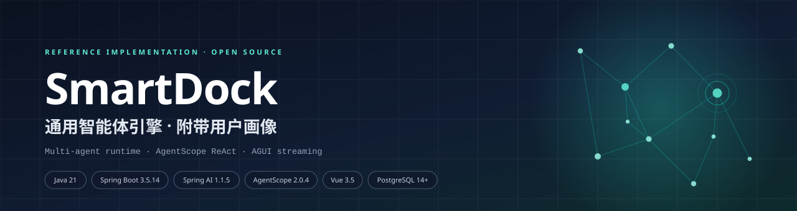
</p>

<p align="center">
  
  
  
  
  
  
</p>

<p align="center">
  <b>一个能查真实数据、能走真实流程的智能体工作台。</b><br>
  <sub>Java 21 · Spring Boot 3.5 · Vue 3.5 · PostgreSQL · 多租户 · Apache-2.0</sub>
</p>

SmartDock 是一个**开源的智能体工作台**：左侧是会话，右侧是工作区，技能点一下就能开工，工具调用全程可见，写操作先确认再执行。它就是你在截图里看到的那个界面——不是 SDK 加一个聊天框的示例。

引擎侧按 `agentId` 注册多智能体，走 ReAct 工具循环；业务能力通过「工具 SPI」接进来，不用改引擎核心。同一套底座上还带一条**用户画像引擎**（事件 → 指标 → 快照），让助手能查「这个人最近怎么样」，而不只是查任务列表。

<p align="center">
  <a href="#智能体工作台"><b>智能体工作台</b></a> ｜
  <a href="#30-秒了解">30 秒了解</a> ｜
  <a href="#一次请求怎么跑">一次请求怎么跑</a> ｜
  <a href="#快速开始">10 分钟跑起来</a> ｜
  <a href="#把自己的业务接进来">业务接入</a> ｜
  <a href="#扩展指南">扩展</a> ｜
  <a href="docs/architecture.md">分层与判定序</a>
</p>

## 30 秒了解

<table>
<tr><th align="left">你想要</th><th align="left">SmartDock 给你</th></tr>
<tr><td><b>一个能用的智能体工作台</b></td><td>会话 / 技能 / 工具 / 自动化 / 审计，一套界面全在里面；不是要你自己攒的组件库</td></tr>
<tr><td><b>让 AI 真的干活</b></td><td>ReAct 工具循环、工具 SPI 扩业务、HITL 写操作确认、AGUI/SSE 流式输出（28 类事件）</td></tr>
<tr><td><b>把业务 SOP 交给 AI</b></td><td>技能就是 Markdown 文件：写清「怎么做」，模型按步骤执行；管理台改完立即生效，不用发版</td></tr>
<tr><td><b>让 AI 到点自己跑</b></td><td>自动化：一句话 + 一个时间，到点用只读工具跑一轮，结果进通知和会话</td></tr>
<tr><td><b>看懂用户</b></td><td>事件源画像：维度配置 → 评分 → 分群 → 低分复核；快照可回放、可对账</td></tr>
<tr><td><b>不用从零搭后台</b></td><td>RuoYi-Vue-Plus 5.6.1 底座：多租户、权限、字典、OSS、风控、调度、监控</td></tr>
</table>

## 智能体工作台

<p align="center">
  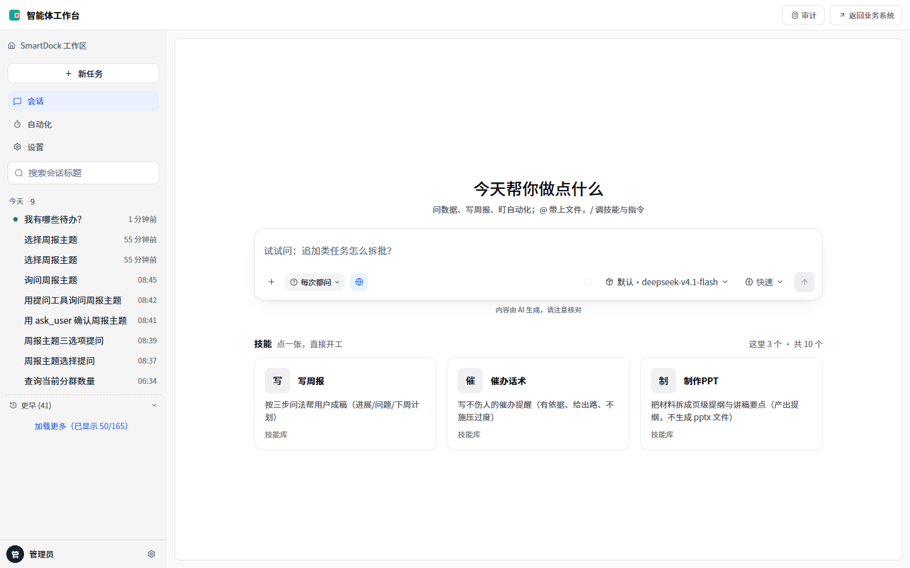
</p>

进门就是这一步：一句「今天帮你做点什么」，下面是这个租户里你能用的技能卡——点一张，输入框自动填好完整问法，不用想怎么开口。

<p align="center">
  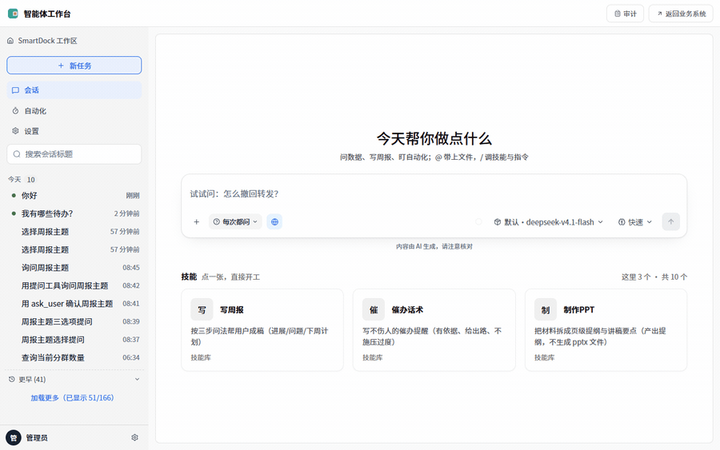
  <br><sub>一次完整问答（真实录屏，加速播放）：提问 → 思考 → 调 <code>dcs_query_my_todos</code> → 流式回答 → 标注来源与用量</sub>
</p>

会话页长这样：左边是会话历史，中间是消息流。工具调用不是黑盒——「已完成 · 用了 1 个工具 · 37 秒」点开就是每一步的耗时和参数。

### 技能：点一张，直接开工

<p align="center">
  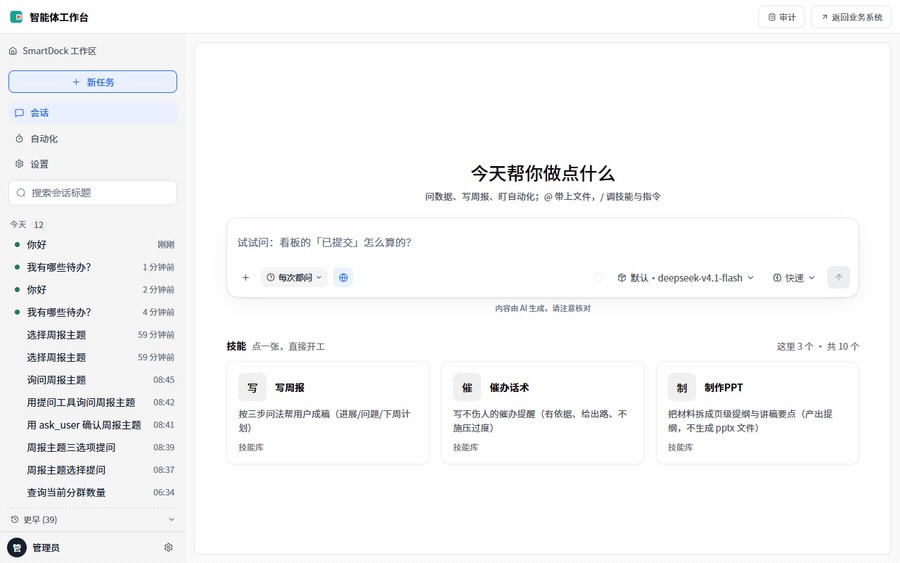
  <br><sub>点技能卡 → 输入框自动填好完整问法（不是替你发送，你可以先改）</sub>
</p>

技能是一个 Markdown 文件（官方 SKILL.md 格式，YAML frontmatter + 正文），业务和运维同学可以直接在管理台改，不用发版。本仓内置 10 个，成员默认能用 7 个：

```markdown
---
name: weekly-report
description: 用户说「帮我写周报/周报怎么写/本周总结」时，按三步问法帮用户成稿（进展/问题/下周计划）
displayName: 写周报
minRole: member
---
你正在使用「写周报」技能。目标：帮用户把这一周的事整理成一份能直接发出去的周报。
1. 先问：本周主要做了哪些事？（用户可能随手列几条，帮他归类，不要追问细节）
2. 再问：过程中遇到什么问题或卡点？怎么处理的？
3. 最后问：下周打算做什么？
成稿要求：三段式，进展写结果不写过程，问题写「卡在哪 + 谁来解决」，计划写具体动作。
```

- **渐进披露**：只有 `description` 常驻技能目录（模型靠它判断何时调用），正文默认不占上下文、用到才读——单技能正文上限 20000 字符
- **三层装载**：内置 classpath → `config/skills/` 部署期覆写 → 管理台在线编辑（优先级最高，下一轮会话生效）
- **权限双重闸**：`minRole` 控制谁能用，租户工具开关矩阵控制是否启用（停用后对所有角色整技能遮罩，超管也看不见）
- **可度量**：每个技能的使用次数与最近使用时间都落在管理台

<table>
<tr>
<td width="50%">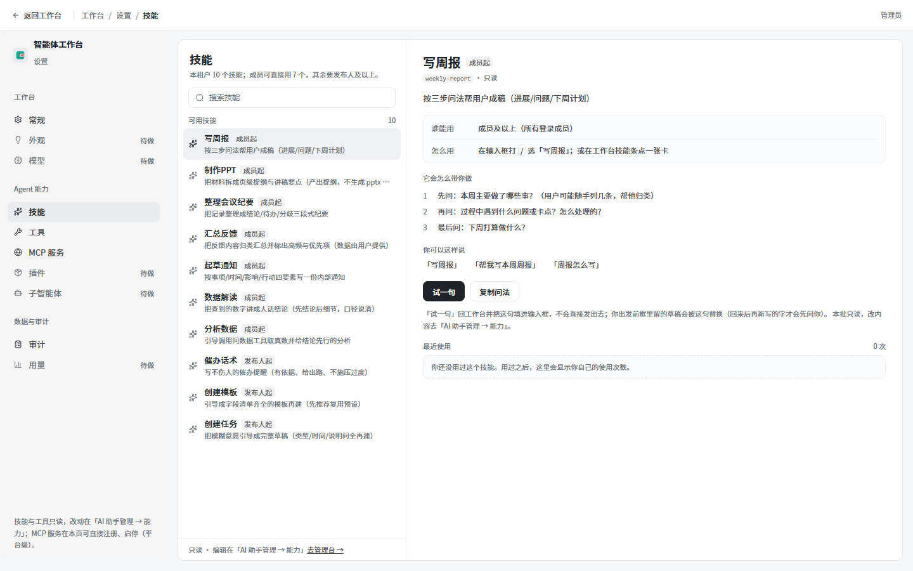<br><sub>技能库：左边目录只放一句话说明，右边是完整步骤、谁能用、怎么用，还能「试一句」直接填进输入框</sub></td>
<td width="50%">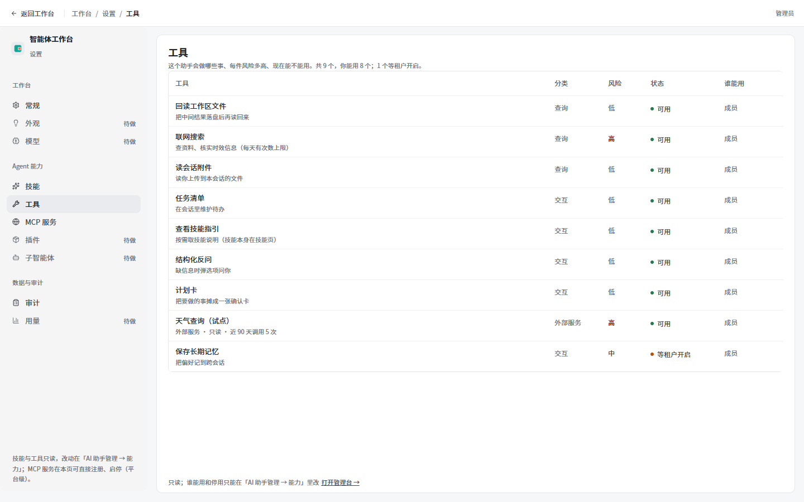<br><sub>工具面：9 个工具，按查询/交互/外部服务分类，标注风险与「谁能用」，不用的直接停用</sub></td>
</tr>
</table>

### 自动化：到点自己跑一轮

<p align="center">
  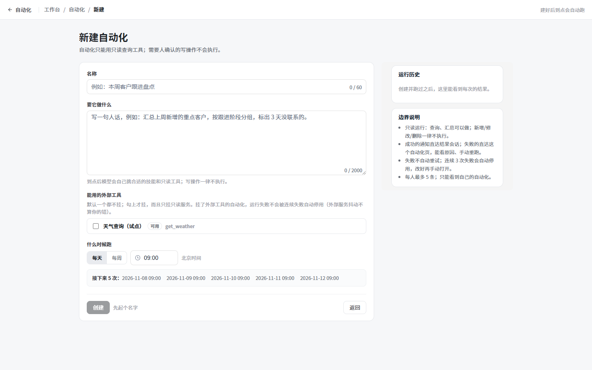
</p>

写一句要它做什么，选个时间；到点用**只读工具**跑一轮，结果放通知和会话里。写操作一律不执行——这是自动化与「定时脚本」的区别，也是它敢在生产环境跑的原因。失败不会静默：页面上能看原因，连续 3 次失败自动停用。

<table>
<tr>
<td width="50%">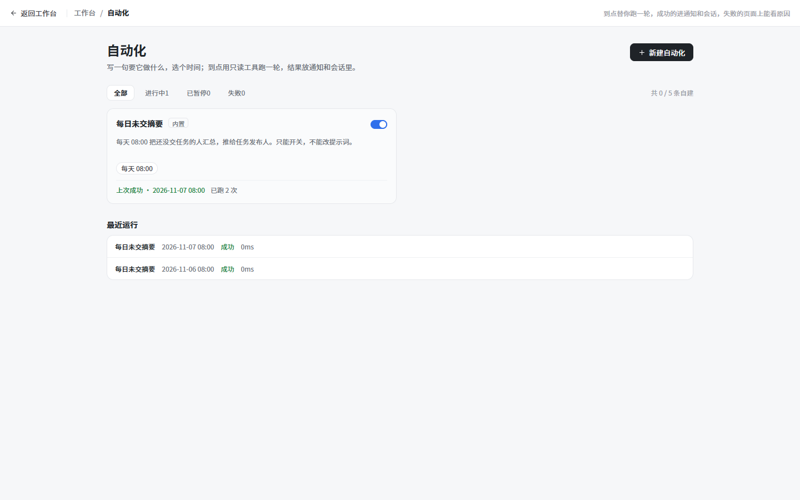<br><sub>自动化列表：进行中 / 已暂停 / 失败三档，内置一条「每日未交摘要」可直接开关</sub></td>
<td width="50%">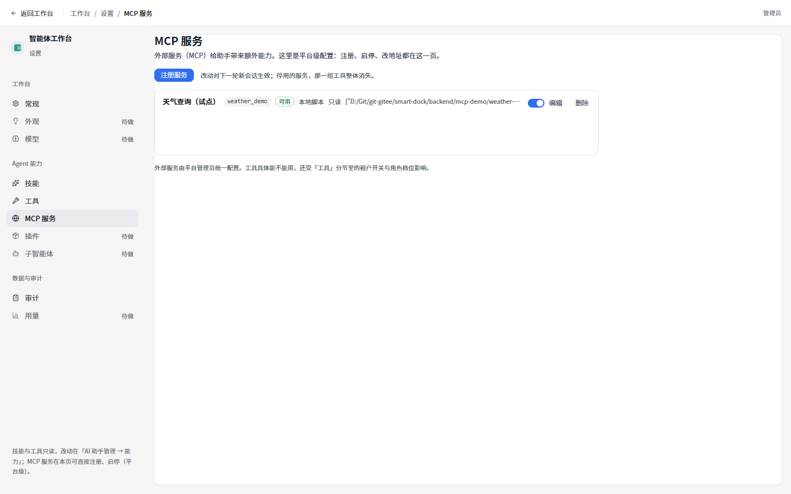<br><sub>MCP 服务：平台级注册、启停、header 令牌加密存储；外部工具调用单独限频</sub></td>
</tr>
</table>

### 设置与能力开关

<p align="center">
  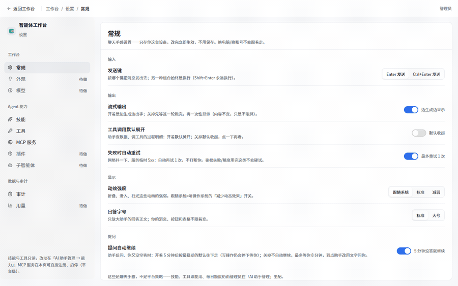
  <br><sub>设置页：常规手感（发送键、流式、动效、字号）自己调；技能与工具只读看清单；MCP 服务平台级注册</sub>
</p>

技能与工具是只读的——能力和权限在「AI 助手管理」里配，工作台只负责让你看清「我现在能用什么」。这条边界是有意为之：使用者不该在会话页里改权限。

## 一次请求怎么跑

<p align="center">
  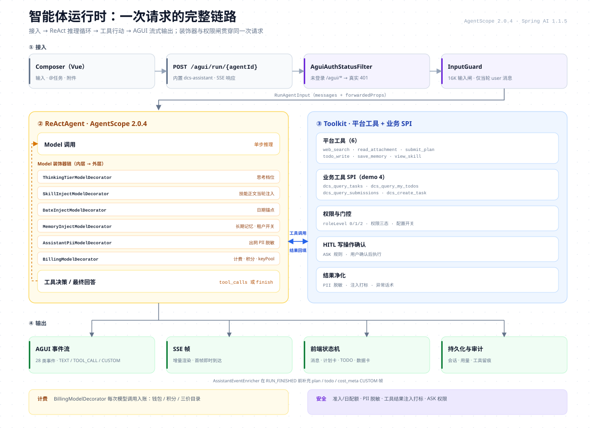
</p>

接入 → ReAct 推理循环 → 工具行动 → AGUI 流式输出；模型装饰器链与权限闸贯穿同一次请求。分层细节、模块边界与判定顺序见 [docs/architecture.md](docs/architecture.md)。

## 技术架构

<p align="center">
  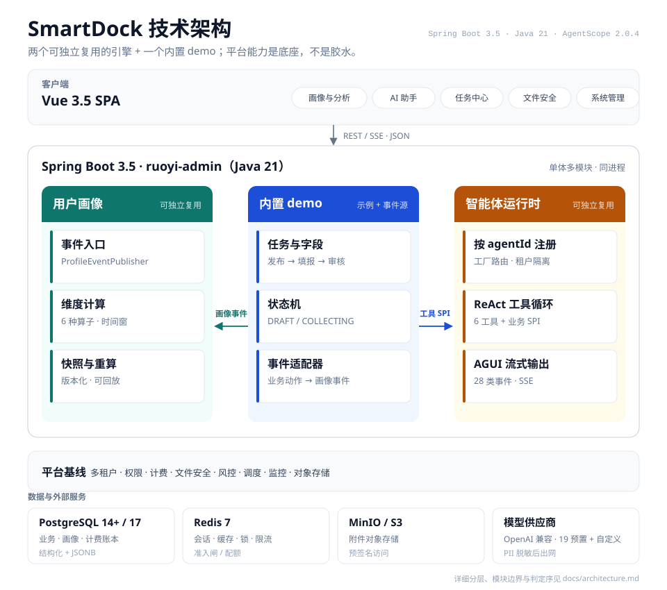
</p>

客户端只调 REST/SSE；智能体引擎与画像引擎同进程、互不依赖——智能体通过「工具 SPI」接业务能力，画像通过「业务事件」收业务动作；平台能力（多租户、权限、计费、文件安全、风控、调度、监控、对象存储）全部来自底座。

## 核心能力

### 🧩 智能体引擎（主打）

- **多智能体注册**：按 `agentId` 注册与路由，共用工具注册、权限、记忆、技能与计费
- **ReAct 工具循环**：模型自主决策调用工具，全程流式输出（AGUI/SSE，28 类事件）
- **工具 SPI 机制**：业务能力通过 `BizToolProvider` 扩展，无需修改引擎核心
- **写操作先确认**：`readOnly=false` 的工具在落库前停下来出确认卡，写明将改什么；待确认期间输入暂停、草稿保留
- **会话能力**：多会话历史、`@` 引用文件与业务对象、`/` 调技能与命令、计划卡（多步任务先列计划）、结构化反问（缺信息时给选项而不是瞎猜）
- **安全防护**：PII 出网脱敏、工具结果注入打标、16K 输入闸、权限三态与工具开关矩阵
- **计费系统**：钱包/积分双轨、19 家预置供应商 + 自定义、多 Key 池

### 📊 用户画像引擎（配套）

- **事件源评分**：业务动作 → 事件 → 规则 → 版本化快照，可回放、可对账
- **配置化维度**：六种算子 + 时间窗 + 打分映射 + 缺失策略，80% 维度零代码
- **通用接入**：任意业务源通过同构事件接入，配置维度即可产出画像

画像的完整界面与运营细节见 [画像引擎文档](docs/profile-engine.md)。

### 🏢 平台基线

继承 RuoYi-Vue-Plus 5.6.1，多租户、权限、字典、OSS、文件安全、风控、调度、监控一应俱全。

## 快速开始

> **只想最快看到效果？** 按「方式一」起好后端与前端（约 3 分钟），用内置演示账号登录，进「智能体工作台」——
> 先在「AI 模型配置」录入一个供应商 Key，就能在工作台里对话、点技能卡、看工具调用链。
> 画像侧想看满数据，再跑一次造数脚本、点一次「重建汇总」（约 292 事件 / 81 会话 / 4 位同事的合成演示口径；
> 实时看板只统计最近 5 分钟，演示种子是历史数据、显示为空属正常）。画像 Java 接入 10 分钟指南见
> [docs/profile-integration.md](docs/profile-integration.md)，协议字段表见
> [docs/profile-engine.md](docs/profile-engine.md#2-通用接入协议)。

### 前置条件

- JDK 21、Maven 3.8+
- Node.js ≥ 20.19.0、npm ≥ 8.19.0
- PostgreSQL 14+、Redis 7
- 本机演示建议可用内存 ≥ 4G；浏览器需支持 ES2020
- 可选：MinIO（附件存储）

### 方式一：本地开发

**1. 建库执行 SQL**

```bash
export PGCLIENTENCODING=UTF8
createdb -U postgres -E UTF8 smartdock

psql -U postgres -d smartdock -f backend/script/sql/baseline/01_schema.sql
psql -U postgres -d smartdock -f backend/script/sql/baseline/02_reference.sql
psql -U postgres -d smartdock -f backend/script/sql/baseline/03_identity.sql
psql -U postgres -d smartdock -f backend/script/sql/baseline/04_role_menu.sql
# 可选：一条演示任务；跳过即为干净空库
psql -U postgres -d smartdock -f backend/script/sql/baseline/05_demo_data.optional.sql
psql -U postgres -d smartdock -f backend/script/sql/baseline/06_profile_protocol.sql
psql -U postgres -d smartdock -f backend/script/sql/baseline/07_analytics.sql
```

Windows CMD 用 `set PGCLIENTENCODING=UTF8`，PowerShell 用 `$env:PGCLIENTENCODING='UTF8'`。

**2. 启动后端**

启动前先设置两把加密密钥（16/24/32 位可见 ASCII，两把必须不同；未配置会拒绝启动）：

```bash
export SMARTDOCK_AI_CONFIG_KEY=$(openssl rand -base64 24)
export SMARTDOCK_MCP_HEADERS_KEY=$(openssl rand -base64 24)
```

> 前者保护 AI 厂商 Key（`dcs_ai_config.api_key` / `dcs_ai_provider_access.api_key`），
> 后者保护 MCP 服务器请求头令牌（`dcs_mcp_server.headers`）。禁止写进源码或提交进仓库。
> 从旧版本升级时，首次启动会自动把历史密文换成新钥匙；之后请到厂商后台把对应 API Key/令牌
> 也换新——旧版内置钥匙已随公开源码泄露，换锁救不回已经流出去的凭证。

```bash
cd backend
mvn clean package -DskipTests
java -Duser.timezone=GMT+8 -jar ruoyi-admin/target/ruoyi-admin.jar --server.port=8090
```

默认连接 PostgreSQL `127.0.0.1:5432/smartdock`（`postgres` / `postgres`）、Redis `127.0.0.1:6379` db0 无口令。
口令不同时用启动参数覆盖：

```bash
java -Duser.timezone=GMT+8 -jar ruoyi-admin/target/ruoyi-admin.jar \
  --spring.datasource.dynamic.datasource.master.password=你的库口令 \
  --spring.data.redis.password=你的Redis口令
```

**3. 启动前端**

```bash
cd frontend
npm ci
npm run dev
```

访问 http://localhost:5188，使用 `admin / admin123` 登录。端口冲突时，前端改 `frontend/.env.development` 的 `VITE_APP_PORT`，后端用 `--server.port=` 覆盖。

> 需要浏览器里的 Vue 调试面板时（默认关闭，避免向页面注入调试浮层）：`VITE_DEVTOOLS=1 npm run dev`（Windows PowerShell：`$env:VITE_DEVTOOLS='1'; npm run dev`）。

**4. 造一份演示数据（可选）**

空库也能跑，但界面没数据。想快速看到截图里的效果：

```bash
node backend/script/demo/seed-internal-ops-demo.js --base http://localhost:8090 --days 30
```

脚本走管理员登录 + CSV 导入端点写入合成事件（4 位同事 30 天的登录/发布/提交/审核/关闭，约 292 条），再到「数据分析 → 重建汇总」跑一次重建，即可得到约 81 会话 / 4 位同事的内部协作演示口径。同一天重复执行幂等；跨天重播请先清掉旧的 `demo-io-` 前缀数据，否则会叠加。

### 方式二：Docker Compose（Linux 服务器推荐）

编排文件在 **`deploy/docker-compose.yml`**，包含 postgres / redis / minio / backend / frontend 五个服务。
Dockerfile 的构建上下文是**仓库根目录**，镜像会直接拷 `backend/ruoyi-admin/target/ruoyi-admin.jar`
与 `frontend/dist/`——所以**必须先构建产物**，再启动编排。

**1. 准备环境**

- Docker Engine 24+ 与 Docker Compose v2（按官方文档安装：<https://docs.docker.com/engine/install/>）
- 构建工具：JDK 21、Maven 3.8+、Node.js ≥ 20.19
- 也可以在本地构建好 `ruoyi-admin.jar` 与 `dist/` 后上传到服务器，只装 Docker

**2. 构建产物**

```bash
git clone https://gitee.com/rickie182/smart-dock.git
cd smart-dock

cd backend && mvn clean package -DskipTests && cd ..
cd frontend && npm ci && npm run build:prod && cd ..
```

**3. 配置口令并启动**

在 `deploy/` 下新建 `.env`（compose 会自动读取，勿提交）：

```bash
POSTGRES_PASSWORD=换成强口令
REDIS_PASSWORD=换成强口令
MINIO_PASSWORD=换成强口令
HTTP_PORT=80
# 两把加密密钥：各执行一次 openssl rand -base64 24 生成，必须不同，勿提交
SMARTDOCK_AI_CONFIG_KEY=换成32位随机串
SMARTDOCK_MCP_HEADERS_KEY=换成另一个32位随机串
```

```bash
cd deploy
docker compose up -d --build
docker compose ps        # 五个服务应为 running / healthy
```

**4. 访问与首启配置**

浏览器打开 `http://<服务器IP>/`，用 `admin / admin123` 登录并**立即改密**；
再到「AI 模型配置」录入供应商 Key 与 CNY 价格行，在「AI 助手管理」设为默认模型
（基线不含任何 Key，未配置时助手会明确提示）。

**5. Linux 运维要点**

- **端口**：`HTTP_PORT`（默认 80）对外；MinIO API `9000` 对外供附件直链；管理台 `9001` 只绑 `127.0.0.1`，远程用 `ssh -L 9001:127.0.0.1:9001 user@host` 访问。
- **防火墙**：只放行 80/443 与 9000；不要暴露 9001 与数据库/Redis 端口。
- **数据**：持久化在 `deploy/data/{postgres,redis,minio}`，日志在 `deploy/logs/`；备份直接打包 `deploy/data`。
- **升级/回滚**：重新构建产物后 `docker compose up -d --build`；`docker compose down`（不加 `-v`）保留数据，可回退镜像。
- **初始化 SQL**：首次启动自动执行 `backend/script/sql/baseline/` 的 01→07（含 05 演示数据）；不需要演示数据时，在**首次启动前**把 `05_demo_data.optional.sql` 移出该目录。修改 SQL 后需清空 `deploy/data/postgres` 才会重放。
- **HTTPS**：compose 只监听 80，生产建议在前面加 Nginx/Caddy 终止 TLS，再反代到 `HTTP_PORT`。
- 裸机部署、健康检查与更多细节见 [docs/deploy.md](docs/deploy.md)。

## 把自己的业务接进来

### 智能体：一个 Bean 就是一套工具

把业务能力暴露给助手，实现 `BizToolProvider` 即可；工具注册、权限校验、审计留痕、计费与 HITL 确认由引擎自动完成，不改引擎核心。

```java
@Component
public class OrderToolProvider implements BizToolProvider {

    @Override
    public String namespace() { return "order"; }

    @Override
    public List<BizToolSpec> tools() {
        BizToolSpec query = BizToolSpec.readOnly("order_query", "查询订单", "按手机号或订单号查最近订单");
        query.getParams().add(BizParamSpec.string("keyword", "手机号或订单号", true));
        BizToolSpec refund = BizToolSpec.write("order_refund", "订单退款", "对指定订单发起退款", "确认要发起退款吗");
        refund.getParams().add(BizParamSpec.string("orderNo", "订单号", true));
        return List.of(query, refund);
    }

    @Override
    public BizToolResult execute(BizToolCall call) {
        if ("order_query".equals(call.getToolName())) {
            return BizToolResult.ok(orderService.query(call.getArgs().get("keyword")));
        }
        return BizToolResult.fail("该操作未实现");
    }
}
```

只读工具直接执行；写工具在真正落库前会停下来出确认卡，确认后才执行。工具名全局唯一（建议加 `namespace` 前缀），权限门槛写在 `BizToolSpec` 里，模型看不到越权工具。

### 画像：三步，不改评分链路（配套）

画像引擎只认一种东西：**事件**。业务动作 → 事件 → 指标 → 快照，接入只需三步。

<p align="center">
  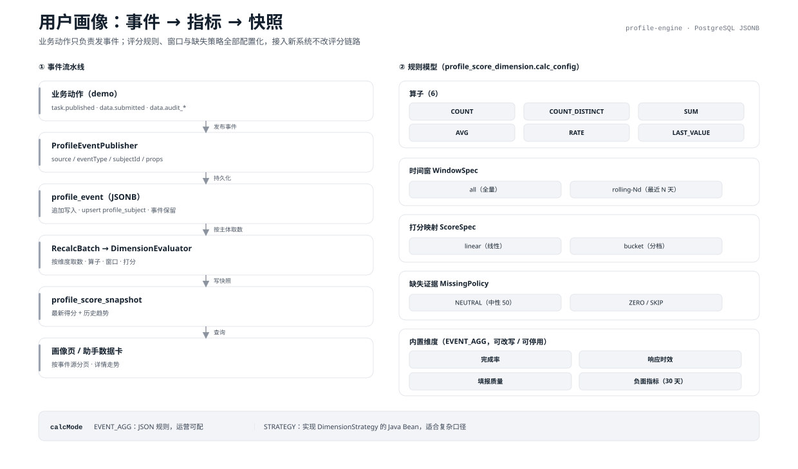
</p>

**第 1 步：在业务代码里发一条事件**

```java
@RequiredArgsConstructor
@Service
public class BizEventReporter {

    private final ProfileEventPublisher eventPublisher;   // 唯一入口

    public void onOrderPaid(String orderNo, Long userId, int amountFen, String channel) {
        ProfileEventBo e = new ProfileEventBo();
        e.setEventName("order.paid");                    // 点分小写：实体.动作
        e.setEventUid(ProfileUids.uid("myapp.order", "paid", orderNo)); // 幂等键，第一段带模块名
        e.setSubjectType("member");                      // 主体类型，缺省 user
        e.setSubjectId(String.valueOf(userId));
        e.getProps().put("amountFen", amountFen);         // 数值放数字类型，不能放字符串
        e.getProps().put("payChannel", channel);
        eventPublisher.publish(e);                        // false = 重复被幂等跳过，不是错误
    }
}
```

**第 2 步：配一个维度**（管理台「画像工作室 → 新建维度」，或插入一条 JSON）

```json
{
  "metric": { "operator": "SUM", "target": { "eventName": "order.paid", "prop": "amountFen" } },
  "window": { "type": "all" },
  "score": { "type": "linear", "direction": "higher", "lo": 0, "hi": 100000 },
  "missing": "neutral"
}
```

**第 3 步：触发重算，看画像**——主体详情、分群、漏斗与行为分析自动出数；每次计算进快照，历史可回放、可对账。

> 三条接入红线（踩了会静默丢数/错算）：事件编号第 1 段必须带模块名（防跨模块撞车）；异步/定时/MQ 线程必须用 `TenantHelper.dynamic` 包住租户上下文；`props` 数值放 JSON number、布尔放 1/0。
>
> 完整字段表、编号规则、HTTP 接入方式见 [业务接入指南（10 分钟）](docs/profile-integration.md)。

## 核心模块

| 模块 | 职责 |
|------|------|
| `ruoyi-admin` | 启动模块，聚合全部运行时 |
| `ruoyi-assistant` | 智能体运行时：ReActAgent、工具注册、AGUI 事件 |
| `ruoyi-assistant-spi` | 业务工具 SPI 契约 |
| `ruoyi-ai-billing` | AI 计费：供应商配置、钱包、积分、价格 |
| `ruoyi-profile-engine` | 画像引擎（配套）：事件源、维度计算、快照版本化 |
| `ruoyi-dcs` | 内置 Demo：任务/提交/审核/通知/画像事件 |
| `ruoyi-system` | 平台基座：用户/租户/部门/角色/菜单/字典 |
| `ruoyi-file-security` / `ruoyi-risk` / `ruoyi-job` | 文件安全、风控、调度 |

## 使用说明

### 工作台入口

登录后从左侧「AI 助手」进入，或用 `/agent` 直达。工作台有三个一级入口：

- **会话**：多会话历史、上下文用量、工具调用明细；`@` 带文件、`/` 调技能与命令
- **自动化**：写一句要它做什么、选个时间，到点只读跑一轮
- **设置**：常规手感、技能与工具清单、MCP 服务、审计与用量

### 抽屉模式

不想离开当前页面？业务页右侧的悬浮球打开助手抽屉，能力与工作台一致，只是收在一侧。

<p align="center">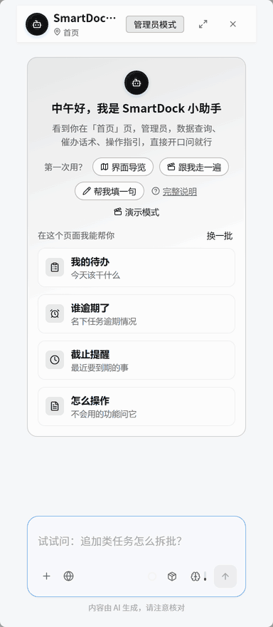<br><sub>抽屉模式（录屏）：思考 → 调工具 → 引用来源 → 给结论；工具面之外就直说查不到</sub></p>

### 写操作确认

<p align="center">
  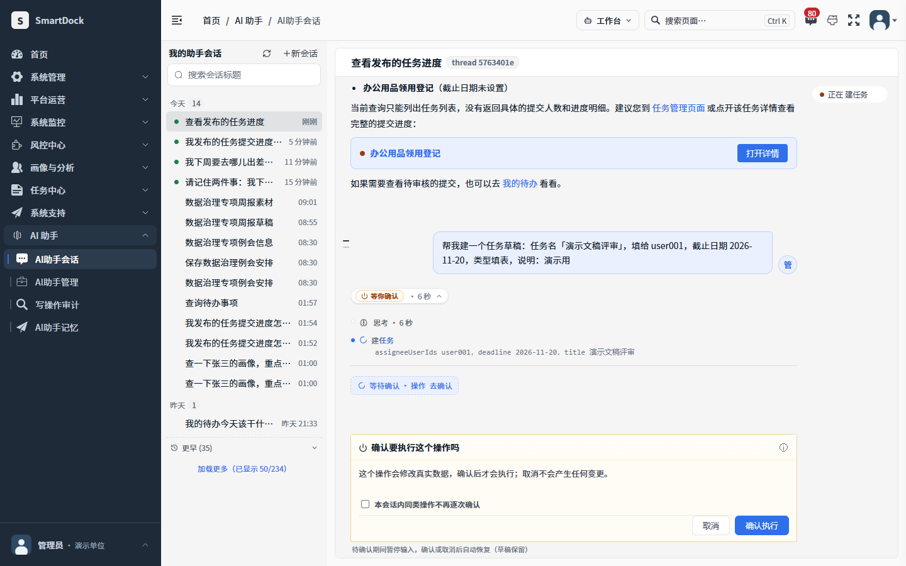
</p>

要写库之前先停下来问：卡片写明这一步会动真实数据，点「确认执行」才落库；待确认期间输入暂停、草稿保留。

### 用户画像（配套）

1. 业务系统通过 `ProfileEventPublisher` 发送事件（见 [把自己的业务接进来](#把自己的业务接进来)）；
2. 在「画像工作室」配置维度、权重与覆盖度；
3. 触发重算，查看主体画像与历史快照。

### 内置 Demo

任务采集系统演示了两个引擎的接入方式：

- 任务发布 → 成员填报 → 审核 → 通知
- 每次状态迁移产生画像事件
- 助手可查询任务、待办、提交，甚至创建草稿任务

<p align="center">
  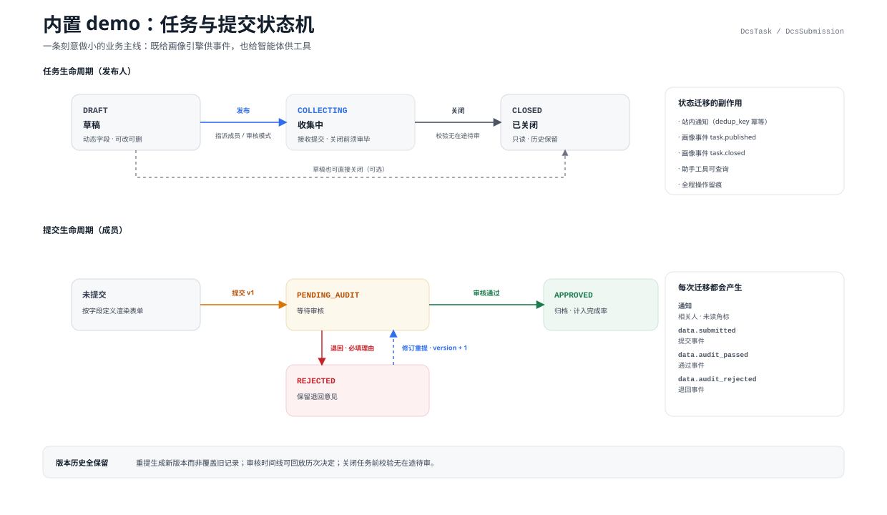
</p>

执行基线 `05_demo_data.optional.sql` 后可直接看到一条演示任务；跳过时 Demo 页为空，可自行创建任务体验。

## 更多界面

管理端负责「配能力、定门槛、看账」，和工作台是分开的两件事：

<table>
<tr>
<td width="50%">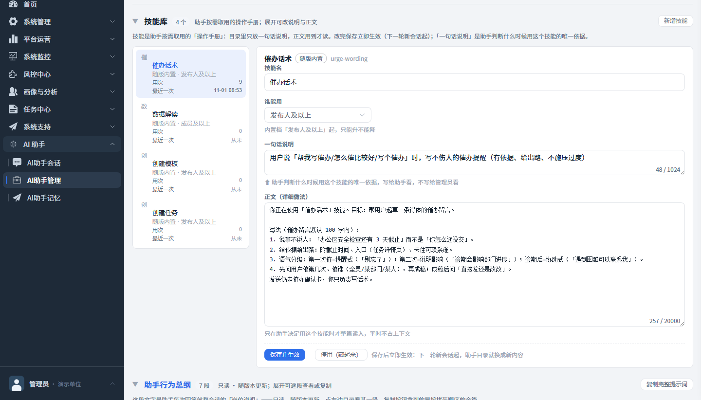<br><sub>管理端技能库：编辑 SKILL.md 正文、指定最低角色、看使用统计</sub></td>
<td width="50%">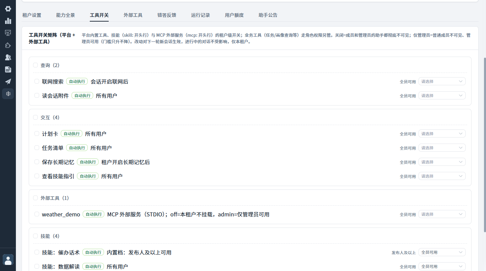<br><sub>工具开关矩阵：平台工具、MCP 外部工具、技能统一按角色与租户分档</sub></td>
</tr>
<tr>
<td width="50%">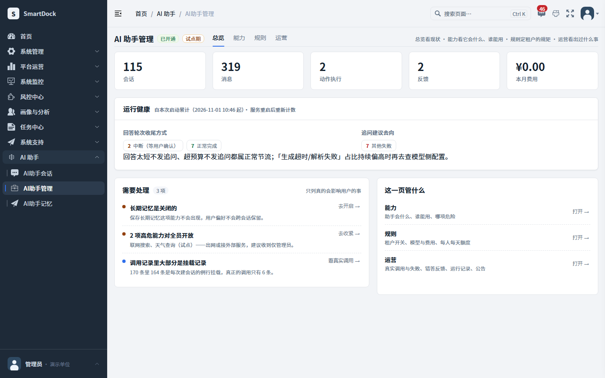<br><sub>管理端总览：开关、每日回合上限、联网次数与租户日预算，加上进程内运行健康</sub></td>
<td width="50%">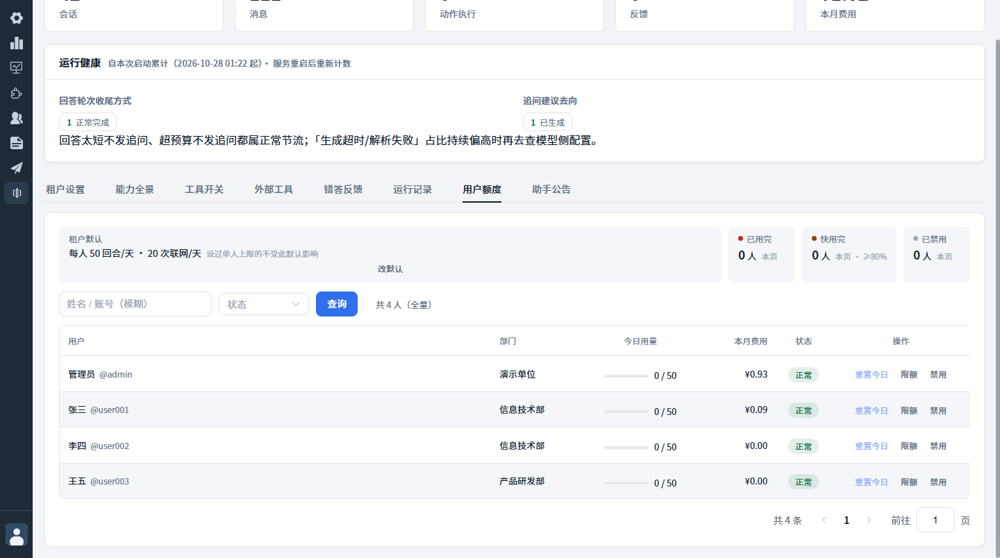<br><sub>用户额度：每人每日回合与联网次数、本月费用、超额状态，按人可调</sub></td>
</tr>
<tr>
<td width="50%">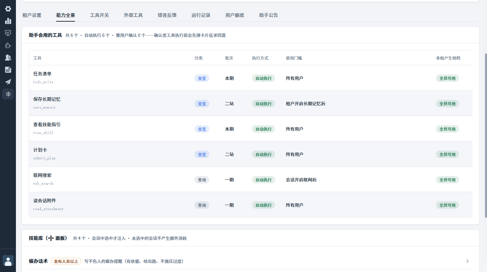<br><sub>能力全景：助手会用哪些工具、怎么执行、什么门槛、本租户是否生效</sub></td>
<td width="50%">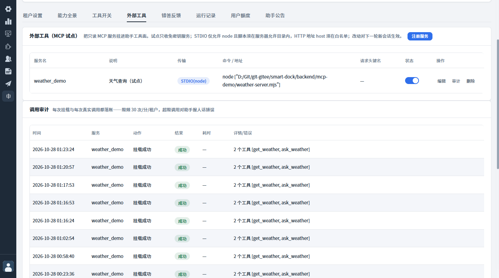<br><sub>外部工具：MCP 服务挂载与调用审计——每次挂载、每次调用都落账</sub></td>
</tr>
</table>

## 扩展指南

### 新增业务工具

实现 `BizToolProvider` 的 `namespace()` / `tools()` / `execute()` 三个方法，注册成 Spring Bean 即可，完整可粘贴示例见 [把自己的业务接进来](#把自己的业务接进来)。工具声明里 `readOnly=false` 会自动走 HITL 确认卡。

### 新增智能体

注册惰性工厂到 AGUI 注册表（工厂按登录身份建租户 agent）：

```java
@Bean
public AguiAgentRegistryCustomizer myAgentCustomizer() {
    return registry -> registry.registerFactory("my-agent", loginUser -> myAgentFactory.create(loginUser));
}
```

### 新增技能

在管理台「AI 助手管理 → 技能库」新建，或往 `config/skills/<技能名>/SKILL.md` 放一个文件：YAML frontmatter 写 `name/description/displayName/minRole`，正文写操作步骤。`description` 决定模型何时调用它，正文只在用到时进上下文。

### 新增画像维度（配套）

向 `profile_score_dimension` 插入配置（`prop` / `dedupKey` 键名需匹配 `^[A-Za-z][A-Za-z0-9_]{0,62}$`）：

```json
{
  "metric": { "operator": "COUNT", "target": { "eventName": "task.published" } },
  "window": { "type": "all" },
  "score": { "type": "linear", "direction": "higher", "lo": 0, "hi": 100 },
  "missing": "neutral"
}
```

## 技术栈

| 类别 | 组件 |
|------|------|
| 后端 | Java 21、Spring Boot 3.5.14、Spring AI 1.1.5、AgentScope 2.1.0-BETA1 |
| 框架 | Sa-Token、MyBatis-Plus、Redisson、Hutool、SnailJob |
| 前端 | Vue 3.5、TypeScript、Element Plus、Vite、Pinia、ECharts |
| 数据库 | PostgreSQL 14+、Redis 7、MinIO |
| 基础 | RuoYi-Vue-Plus 5.6.1 (MIT) |

## 使用边界与适合谁

**适合**：想直接拿到一个能用、能改的智能体工作台的团队；需要多智能体注册、工具接入、权限与计费底座的项目；顺带想要用户画像与行为分析的团队。

**不适合**（先说清楚，省得白折腾）：

- 想要开箱即用的 SaaS 成品、不愿碰 Java/Spring 的团队；
- 只要一个聊天框套壳、不需要工具调用、权限与审计留痕的场景；
- 需要多智能体自主协商编排的复杂流程——本项目按 `agentId` 注册与路由，不做多 agent 自主协同。

**它是参考实现，不是装上就能用的成品。** 两条引擎可以拆开单独复用（画像引擎不依赖智能体，智能体也不依赖画像），平台基线可以直接当脚手架改。上线前需要接入自己的模型 Key、替换默认口令，并完成所在组织要求的安全与合规评估。

## 安全与上线前检查

- 基线**不包含任何真实 AI Key**；`dcs.assistant.websearch.key` 默认留空（联网搜索未启用）。
- **加密密钥只走环境变量**：`SMARTDOCK_AI_CONFIG_KEY`（保护 AI 厂商 Key）与 `SMARTDOCK_MCP_HEADERS_KEY`（保护 MCP 请求头令牌），两把必须不同、16/24/32 位；未配置/长度错/仍用旧版内置钥匙会**拒绝启动**。轮换后请同时到厂商后台更换对应 Key/令牌——旧钥匙一旦公开，换锁不能撤回已泄露的凭证。
- `application.yml` 的 `jwt-secret-key`、RSA/AES 密钥以及数据库/Redis/MinIO 默认口令均为演示值，**上线前必须全部替换**。
- 默认账号仅用于本地演示；生产环境请删除或改密，并按组织要求配置密码策略。
- AI 只负责起草与建议：所有写操作都经过 HITL 确认，但模型输出不保证正确，关键结论请保留证据链。
- 仓库提供的是技术实现，不构成等保、隐私或行业合规的认证或法律意见。

## 测试与质量

后端 JUnit **451** 用例 + 前端 Vitest **241** 用例，覆盖权限矩阵、状态机、PII 脱敏、注入打标、HITL、AGUI 协议与计费。其中 8 个红队集成用例（`RedteamCore8Test`）需要完整的 PostgreSQL/Redis 才能启动 Spring 上下文；纯本地环境跑会报 8 个 context 加载错误，属预期（其余 443 个全部通过）。

```bash
# 后端（根 pom 默认 skipTests=true，且默认 dev profile；跑 local 组需显式指定）
cd backend && mvn test -DskipTests=false -P local

# 前端
cd frontend && npm test && npm run build:prod
```

README 里的界面截图由 `frontend/scripts/readme-screenshots.mjs` 生成（1440×900、亮色、同一套演示数据），改版后可一条命令重拍。

## 内置账号

| 账号 | 密码 | 角色 |
|------|------|------|
| admin | admin123 | 超级管理员 |
| user001 | admin123 | 成员 |
| user002 | admin123 | 成员 |
| user003 | admin123 | 成员 |

> 演示账号仅用于本地开发，首次登录请立即修改密码。

## 文档导航

- [智能体引擎深度文档](docs/agent-engine.md)
- [用户画像引擎深度文档](docs/profile-engine.md)
- [业务接入指南（10 分钟）](docs/profile-integration.md)
- [架构设计](docs/architecture.md)
- [使用说明（按角色走读）](docs/usage.md)
- [部署指南](docs/deploy.md)
- [基线 SQL 说明](backend/script/sql/baseline/README.md)
- [前端开发说明](frontend/README.md)
- [NOTICE（上游版权与署名）](NOTICE)

## 许可

本项目使用 Apache License 2.0，详见 [LICENSE](LICENSE)。

基础框架来自 [RuoYi-Vue-Plus](https://gitee.com/dromara/RuoYi-Vue-Plus) 5.6.1 (MIT)，AI 运行时基于 [AgentScope (Java)](https://github.com/agentscope-ai/agentscope-java) 2.1.0-BETA1，模型访问基于 [Spring AI](https://spring.io/projects/spring-ai) 1.1.5。

## 🙏 特别鸣谢

> 感谢以下优秀的开源项目为本项目提供支持：

- [AgentScope（Java）](https://github.com/agentscope-ai/agentscope-java) — 智能体运行时框架：ReActAgent 工具循环、权限上下文与 AGUI 事件协议
- [RuoYi-Vue-Plus](https://gitee.com/dromara/RuoYi-Vue-Plus) — 成熟的企业级快速开发框架：多租户、权限与平台基座
- [Spring AI](https://spring.io/projects/spring-ai) — Spring 生态的模型访问网关与抽象
- [Vue 3](https://github.com/vuejs/core) & [Element Plus](https://github.com/element-plus/element-plus) — 现代化的前端框架与组件库
- [Sa-Token](https://sa-token.cc) / [MyBatis-Plus](https://baomidou.com) / [Redisson](https://redisson.org) / [Hutool](https://hutool.cn) — 认证鉴权、ORM、分布式协调与工具库

---

<p align="center">
  <sub>SmartDock · 让「接得进来、用得放心、看得明白」成为可运行的代码</sub>
</p>
