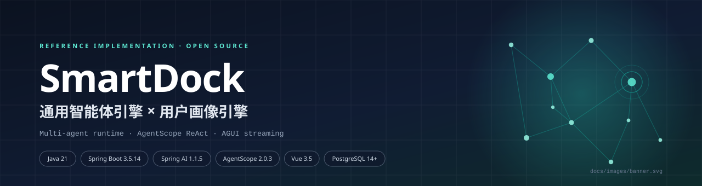
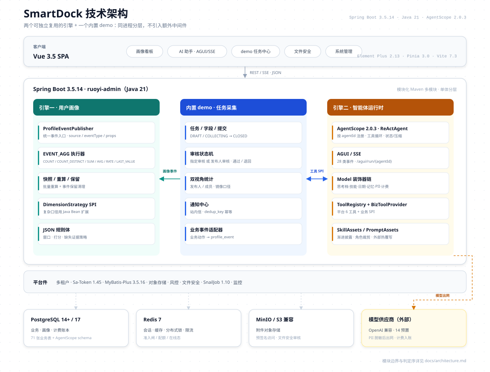
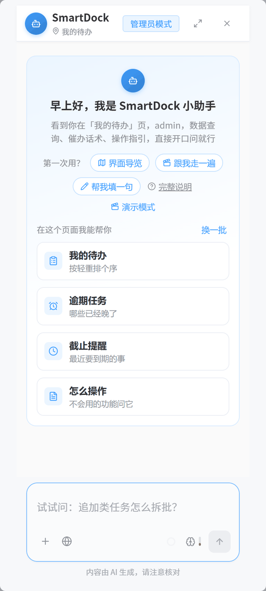
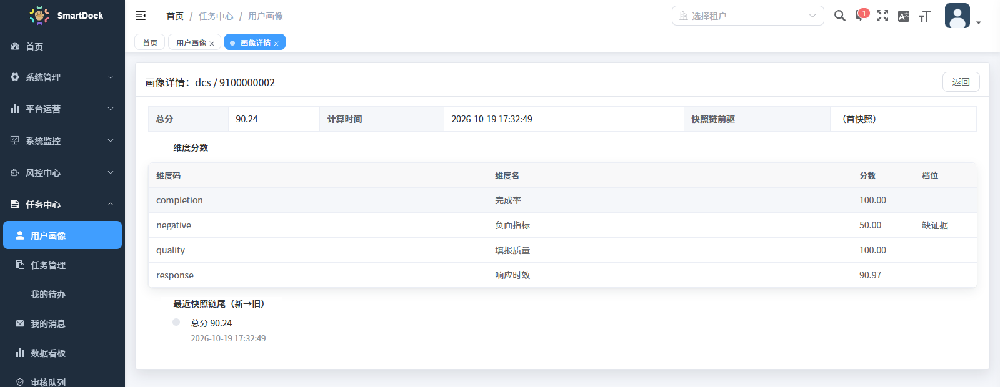

# SmartDock 通用智能体引擎 × 用户画像引擎

<p align="center">
  
</p>

<p align="center">
  
  
  
  
  
  
  
  
</p>

SmartDock 是一套**通用智能体（Agent）引擎**与**用户画像引擎**的参考实现，基于 AgentScope 2.0.3 ReActAgent 的流式运行时构建。项目内置完整的企业级平台基线（多租户、权限、OSS、调度等）。

> 定位：参考实现（reference implementation），不是免配置的生产成品。上线前需要接入自己的模型 Key、替换默认口令，并完成所在组织要求的安全与合规评估。

## 目录

- [核心能力](#核心能力)
- [快速开始](#快速开始)
- [技术架构](#技术架构)
- [核心模块](#核心模块)
- [使用说明](#使用说明)
- [扩展指南](#扩展指南)
- [技术栈](#技术栈)
- [安全与上线前检查](#安全与上线前检查)
- [测试与质量](#测试与质量)
- [内置账号](#内置账号)
- [文档导航](#文档导航)
- [许可](#许可)
- [🙏 特别鸣谢](#-特别鸣谢)

## 核心能力

### 🧩 智能体引擎（主打）

- **多智能体注册**：按 `agentId` 注册与路由，共用工具注册、权限、记忆、技能与计费
- **ReAct 工具循环**：模型自主决策调用工具，全程流式输出
- **工具 SPI 机制**：业务能力通过 `BizToolProvider` 扩展，无需修改引擎核心
- **安全防护**：PII 出网脱敏、工具结果注入打标、16K 输入闸、HITL 写操作确认
- **计费系统**：钱包/积分双轨、13 家预置供应商 + 自定义、多 Key 池

### 📊 用户画像引擎

- **事件源评分**：业务动作 → 事件 → 规则 → 版本化快照，可回放、可对账
- **配置化维度**：六种算子 + 时间窗 + 打分映射 + 缺失策略，80% 维度零代码
- **通用接入**：任意业务源通过同构事件接入，配置维度即可产出画像

### 🏢 平台基线

继承 RuoYi-Vue-Plus 5.6.1，多租户、权限、字典、OSS、文件安全、风控、调度、监控一应俱全。

## 快速开始

### 前置条件

- JDK 21、Maven 3.8+
- Node.js ≥ 20.19.0、npm ≥ 8.19.0
- PostgreSQL 14+、Redis 7
- 本机演示建议可用内存 ≥ 4G；浏览器需支持 ES2020
- 可选：MinIO（附件存储）

### 方式一：本地开发

**1. 建库执行 SQL**

```bash
export PGCLIENTENCODING=UTF8
createdb -U postgres -E UTF8 smartdock

psql -U postgres -d smartdock -f backend/script/sql/baseline/01_schema.sql
psql -U postgres -d smartdock -f backend/script/sql/baseline/02_reference.sql
psql -U postgres -d smartdock -f backend/script/sql/baseline/03_identity.sql
psql -U postgres -d smartdock -f backend/script/sql/baseline/04_role_menu.sql
# 可选：一条演示任务；跳过即为干净空库
psql -U postgres -d smartdock -f backend/script/sql/baseline/05_demo_data.optional.sql
psql -U postgres -d smartdock -f backend/script/sql/baseline/06_profile_protocol.sql
psql -U postgres -d smartdock -f backend/script/sql/baseline/07_analytics.sql
```

Windows CMD 用 `set PGCLIENTENCODING=UTF8`，PowerShell 用 `$env:PGCLIENTENCODING='UTF8'`。

**2. 启动后端**

```bash
cd backend
mvn clean package -DskipTests
java -Duser.timezone=GMT+8 -jar ruoyi-admin/target/ruoyi-admin.jar --server.port=8090
```

默认连接 PostgreSQL `127.0.0.1:5432/smartdock`（`postgres` / `postgres`）、Redis `127.0.0.1:6379` db0 无口令。
口令不同时用启动参数覆盖：

```bash
java -Duser.timezone=GMT+8 -jar ruoyi-admin/target/ruoyi-admin.jar \
  --spring.datasource.dynamic.datasource.master.password=你的库口令 \
  --spring.data.redis.password=你的Redis口令
```

**3. 启动前端**

```bash
cd frontend
npm ci
npm run dev
```

访问 http://localhost:5188，使用 `admin / admin123` 登录。端口冲突时，前端改 `frontend/.env.development` 的 `VITE_APP_PORT`，后端用 `--server.port=` 覆盖。

### 方式二：Docker Compose（Linux 服务器推荐）

编排文件在 **`deploy/docker-compose.yml`**，包含 postgres / redis / minio / backend / frontend 五个服务。
Dockerfile 的构建上下文是**仓库根目录**，镜像会直接拷 `backend/ruoyi-admin/target/ruoyi-admin.jar`
与 `frontend/dist/`——所以**必须先构建产物**，再启动编排。

**1. 准备环境**

- Docker Engine 24+ 与 Docker Compose v2（按官方文档安装：<https://docs.docker.com/engine/install/>）
- 构建工具：JDK 21、Maven 3.8+、Node.js ≥ 20.19
- 也可以在本地构建好 `ruoyi-admin.jar` 与 `dist/` 后上传到服务器，只装 Docker

**2. 构建产物**

```bash
git clone https://gitee.com/rickie182/smart-dock.git
cd smart-dock

cd backend && mvn clean package -DskipTests && cd ..
cd frontend && npm ci && npm run build:prod && cd ..
```

**3. 配置口令并启动**

在 `deploy/` 下新建 `.env`（compose 会自动读取，勿提交）：

```bash
POSTGRES_PASSWORD=换成强口令
REDIS_PASSWORD=换成强口令
MINIO_PASSWORD=换成强口令
HTTP_PORT=80
```

```bash
cd deploy
docker compose up -d --build
docker compose ps        # 五个服务应为 running / healthy
```

**4. 访问与首启配置**

浏览器打开 `http://<服务器IP>/`，用 `admin / admin123` 登录并**立即改密**；
再到「AI 模型配置」录入供应商 Key 与 CNY 价格行，在「AI 助手管理」设为默认模型
（基线不含任何 Key，未配置时助手会明确提示）。

**5. Linux 运维要点**

- **端口**：`HTTP_PORT`（默认 80）对外；MinIO API `9000` 对外供附件直链；管理台 `9001` 只绑 `127.0.0.1`，远程用 `ssh -L 9001:127.0.0.1:9001 user@host` 访问。
- **防火墙**：只放行 80/443 与 9000；不要暴露 9001 与数据库/Redis 端口。
- **数据**：持久化在 `deploy/data/{postgres,redis,minio}`，日志在 `deploy/logs/`；备份直接打包 `deploy/data`。
- **升级/回滚**：重新构建产物后 `docker compose up -d --build`；`docker compose down`（不加 `-v`）保留数据，可回退镜像。
- **初始化 SQL**：首次启动自动执行 `backend/script/sql/baseline/` 的 01→07（含 05 演示数据）；不需要演示数据时，在**首次启动前**把 `05_demo_data.optional.sql` 移出该目录。修改 SQL 后需清空 `deploy/data/postgres` 才会重放。
- **HTTPS**：compose 只监听 80，生产建议在前面加 Nginx/Caddy 终止 TLS，再反代到 `HTTP_PORT`。
- 裸机部署、健康检查与更多细节见 [docs/deploy.md](docs/deploy.md)。

## 技术架构

[](docs/images/architecture.svg)

<p align="center"><sub>分层架构：客户端 → Spring Boot 应用 → 两个引擎 + demo → 平台件 → 数据与外部服务</sub></p>

## 核心模块

| 模块 | 职责 |
|------|------|
| `ruoyi-admin` | 启动模块，聚合全部运行时 |
| `ruoyi-profile-engine` | 画像引擎：事件源、维度计算、快照版本化 |
| `ruoyi-assistant` | 智能体运行时：ReActAgent、工具注册、AGUI 事件 |
| `ruoyi-assistant-spi` | 业务工具 SPI 契约 |
| `ruoyi-ai-billing` | AI 计费：供应商配置、钱包、积分、价格 |
| `ruoyi-dcs` | 内置 Demo：任务/提交/审核/通知/画像事件 |
| `ruoyi-system` | 平台基座：用户/租户/部门/角色/菜单/字典 |
| `ruoyi-file-security` / `ruoyi-risk` / `ruoyi-job` | 文件安全、风控、调度 |

## 使用说明

### AI 助手

<p align="center"></p>

1. 登录后进入「AI 模型配置」，配置模型供应商与 API Key；
2. 为模型维护 **CNY 价格行**（价格目录维护或自动探测）——无人民币价格行的模型不会进入可选列表；
3. 在「AI 助手管理」设置默认模型；
4. 打开助手抽屉，开始对话。

助手支持：

- 页面感知：随当前页面推荐问题
- `@` 引用业务对象
- 思考档位切换（快/平衡/深）
- 工具调用可视化
- HITL 写操作确认

> 基线不包含任何 AI Key；没有可用模型配置时，助手会明确提示未配置，不会静默降级到其他租户或平台配置。

### 用户画像

1. 业务系统通过 `ProfileEventPublisher` 发送事件；
2. 在「画像工作室」配置维度、权重与覆盖度；
3. 触发重算，查看主体画像与历史快照。

[](docs/images/screenshots/profile-detail.png)

### 网站数据接入（5 分钟）

想让你的网站变成「看得见访客」的报表？不用写代码，三步：

1. 登录管理台 → 「画像与分析 → 数据分析」，第一个页签就是**「数据接入」**；
2. 想先看效果：点**「模拟 3 个访客访问」**，切到实时看板看数字跳动（模拟数据可一键清掉）；
3. 接自己的网站：在「接我的网站」块里**起个名字 → 创建并生成代码 → 复制整段代码贴进你的网页**，点「检测接入」——「钥匙有效 + 测试事件已收到」两个绿灯亮起即链路打通，第三盏「看板已有数据」在你网站的真实访问到达后自动点亮。

```html
<!-- 示例：地址在页面里生成时自动写死为你的系统地址，贴到任何网页都能用 -->
<script src="https://你的系统地址/sdk/smartdock-analytics.js"></script>
<script>SmartdockAnalytics.init({ siteKey: '（创建站点时自动生成）', endpoint: 'https://你的系统地址/analytics/collect' });</script>
```

SDK 零依赖（约 668 行），自动完成访客识别、30 分钟会话、单页应用路由跟踪、断网补传；贴完代码回到「流量概览 / 页面 / 漏斗 / 留存」页签看数据。Docker 部署时 `deploy/frontend/nginx.conf` 已内置 `/analytics/` 转发，无需额外配置。

### 内置 Demo

任务采集系统演示了两个引擎的接入方式：

- 任务发布 → 成员填报 → 审核 → 通知
- 每次状态迁移产生画像事件
- 助手可查询任务、待办、提交，甚至创建草稿任务

执行基线 `05_demo_data.optional.sql` 后可直接看到一条演示任务；跳过时 Demo 页为空，可自行创建任务体验。

## 扩展指南

### 新增画像维度

向 `profile_score_dimension` 插入配置（`prop` / `dedupKey` 键名需匹配 `^[A-Za-z][A-Za-z0-9_]{0,62}$`）：

```json
{
  "metric": { "operator": "COUNT", "target": { "eventType": "task.published" } },
  "window": { "type": "all" },
  "score": { "type": "linear", "direction": "higher", "lo": 0, "hi": 100 },
  "missing": "neutral"
}
```

### 新增业务工具

实现 `BizToolProvider` 接口，返回工具列表：

```java
@Bean
public BizToolProvider taskToolProvider() {
    return () -> List.of(
        BizToolSpec.readOnly("query_tasks", "查询任务列表", "按标题模糊查询与我相关的任务")
    );
}
```

### 新增智能体

注册工厂到 AGUI 注册表：

```java
@Bean
public AguiAgentRegistryCustomizer myAgentCustomizer() {
    return registry -> registry.registerFactory("my-agent", factory);
}
```

## 技术栈

| 类别 | 组件 |
|------|------|
| 后端 | Java 21、Spring Boot 3.5.14、Spring AI 1.1.5、AgentScope 2.0.3 |
| 框架 | Sa-Token、MyBatis-Plus、Redisson、Hutool、SnailJob |
| 前端 | Vue 3.5、TypeScript、Element Plus、Vite、Pinia、ECharts |
| 数据库 | PostgreSQL 14+、Redis 7、MinIO |
| 基础 | RuoYi-Vue-Plus 5.6.1 (MIT) |

## 安全与上线前检查

- 基线**不包含任何真实 AI Key**；`dcs.assistant.websearch.key` 默认留空（联网搜索未启用）。
- `application.yml` 的 `jwt-secret-key`、RSA/AES 密钥以及数据库/Redis/MinIO 默认口令均为演示值，**上线前必须全部替换**。
- 默认账号仅用于本地演示；生产环境请删除或改密，并按组织要求配置密码策略。
- AI 只负责起草与建议：所有写操作都经过 HITL 确认，但模型输出不保证正确，关键结论请保留证据链。
- 仓库提供的是技术实现，不构成等保、隐私或行业合规的认证或法律意见。

## 测试与质量

后端 JUnit **447** 用例 + 前端 Vitest **200** 用例，覆盖权限矩阵、状态机、PII 脱敏、注入打标、HITL、AGUI 协议与计费。

```bash
# 后端（根 pom 默认 skipTests=true，必须显式覆盖）
cd backend && mvn test -DskipTests=false

# 前端
cd frontend && npm test && npm run build:prod
```

## 内置账号

| 账号 | 密码 | 角色 |
|------|------|------|
| admin | admin123 | 超级管理员 |
| user001 | admin123 | 成员 |
| user002 | admin123 | 成员 |
| user003 | admin123 | 成员 |

> 演示账号仅用于本地开发，首次登录请立即修改密码。

## 文档导航

- [智能体引擎深度文档](docs/agent-engine.md)
- [用户画像引擎深度文档](docs/profile-engine.md)
- [架构设计](docs/architecture.md)
- [使用说明（按角色走读）](docs/usage.md)
- [部署指南](docs/deploy.md)
- [基线 SQL 说明](backend/script/sql/baseline/README.md)
- [前端开发说明](frontend/README.md)
- [NOTICE（上游版权与署名）](NOTICE)

## 许可

本项目使用 Apache License 2.0，详见 [LICENSE](LICENSE)。

基础框架来自 [RuoYi-Vue-Plus](https://gitee.com/dromara/RuoYi-Vue-Plus) 5.6.1 (MIT)，AI 运行时基于 [AgentScope (Java)](https://github.com/agentscope-ai/agentscope-java) 2.0.3，模型访问基于 [Spring AI](https://spring.io/projects/spring-ai) 1.1.5。

## 🙏 特别鸣谢

> 感谢以下优秀的开源项目为本项目提供支持：

- [AgentScope（Java）](https://github.com/agentscope-ai/agentscope-java) — 智能体运行时框架：ReActAgent 工具循环、权限上下文与 AGUI 事件协议
- [RuoYi-Vue-Plus](https://gitee.com/dromara/RuoYi-Vue-Plus) — 成熟的企业级快速开发框架：多租户、权限与平台基座
- [Spring AI](https://spring.io/projects/spring-ai) — Spring 生态的模型访问网关与抽象
- [Vue 3](https://github.com/vuejs/core) & [Element Plus](https://github.com/element-plus/element-plus) — 现代化的前端框架与组件库
- [Sa-Token](https://sa-token.cc) / [MyBatis-Plus](https://baomidou.com) / [Redisson](https://redisson.org) / [Hutool](https://hutool.cn) — 认证鉴权、ORM、分布式协调与工具库

---

<p align="center">
  <sub>SmartDock · 让「接得进来、用得放心、看得明白」成为可运行的代码</sub>
</p>
