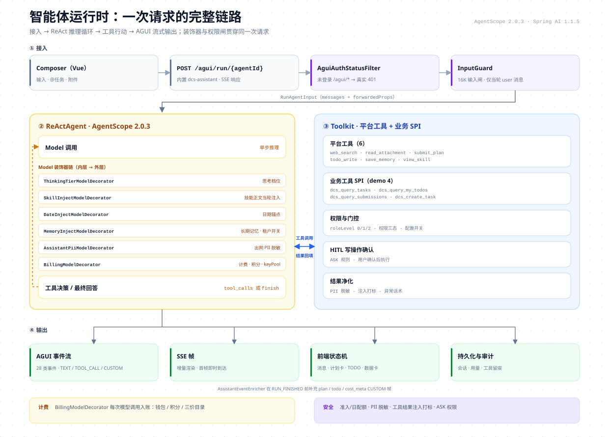

# 智能体引擎 · 深度文档

> 本文承接 README「引擎：智能体运行时」章节的实现细节：注册模型、装配代码、装饰器链、
> 技能与提示词、状态可靠性、AGUI 事件全集与管理运维面。能力概览与工具系统见 README。



## 1. 多智能体注册模型

agent 不是硬编码单例，而是注册表中的工厂。starter 通过 `ObjectProvider` 收集所有
`AguiAgentRegistryCustomizer`，在注册表就绪后回调：

```java
@Bean
public AguiAgentRegistryCustomizer dcsAssistantAgentRegistryCustomizer() {
    return registry -> registry.registerFactory(
        AssistantAgentFactory.AGENT_ID,      // "dcs-assistant"
        agentFactory::createFromLogin);      // 按登录租户惰性创建
}
```

| 关注点 | 行为 |
|---|---|
| 路由 | `POST /agui/run/{agentId}`；不带 `agentId` 时由 `app.agui.default-agent-id`（默认 `dcs-assistant`）兜底 |
| 创建时机 | 首个请求线程按登录租户惰性创建；未配置模型的租户收到 `AiNotConfiguredException`，不做静默降级 |
| 实例粒度 | 每次新会话（`userId + threadId`）新建实例，配合 `AssistantRuntimeContextResolver` 的租户作用域实现会话隔离 |
| 共享能力 | 工具注册、权限上下文、记忆、技能、PII、计费、AGUI 事件、状态存储由引擎统一提供 |
| 多 agent | 一个运行时可注册多个工厂，共用租户、供应商配置与计费账本；协同编排（handoff/团队）需在工厂层自行实现 |

## 2. ReActAgent 装配

以下代码摘自 `AssistantAgentFactory`（为可读性做了换行与去参，顺序与真实装配一致）：

```java
Model innermost = new ThinkingTierModelDecorator(
        modelFactory.buildModel(cfg, aguiThreadId), aguiThreadId,
        capabilityService.matchCapability(tenantId, cfg.getProvider(), cfg.getModelName()));

innermost = new SkillInjectModelDecorator(innermost, aguiThreadId, identity.getRoleLevel());
innermost = new DateInjectModelDecorator(innermost);
if (memoryOn) {
    innermost = new MemoryInjectModelDecorator(
        innermost, memoryService, tenantId, userId);
}

Model model = new BillingModelDecorator(
        new AssistantPiiModelDecorator(innermost, piiFilter, tenantId),
        cfg, userId, aiBillingService, tenantWalletService,
        modelPriceService, costLedger, aguiThreadId)
    .creditService(creditService)
    .keyPool(providerKeyPool);

Toolkit toolkit = new Toolkit();
PermissionContextState.Builder pb = PermissionContextState.builder();
Set<String> registered = ToolRegistry.registerAll(toolkit, identity, deps, pb);
registered.addAll(providerToolRegistry.registerProviders(toolkit, identity, aguiThreadId, pb));

ReActAgent agent = ReActAgent.builder()
    .name("dcs-assistant")
    .sysPrompt(PromptAssets.filterCheatsheet(
        PromptAssets.sysPrompt(memoryOn, false), registered)
        + SkillAssets.catalog(identity.getRoleLevel()))
    .model(model)
    .stateStore(stateStore)
    .toolkit(toolkit)
    .permissionContext(pb.build())
    .middleware(new DcsCompactionMiddleware(
        workspaceManager, new CompactionSummaryModel(model),
        AssistantCompactionAssets.buildConfig(
            AssistantCompactionPolicy.deriveTriggerTokens(
                cfg.getContextWindow(), cfg.getMaxTokens())),
        conversationService))
    .enablePendingToolRecovery(true)
    .build();
```

新增 agent 时，`name`、系统提示词与工具面可按业务裁剪，其余装配顺序可直接复用。

## 3. 模型装饰器链

装饰器从内到外依次包裹。顺序不是随意的：越靠内越接近模型，越靠外越接近请求边界。

| 顺序 | 装饰器 | 职责 | 开关/说明 |
|---|---|---|---|
| 1（最内） | `ThinkingTierModelDecorator` | 把 `fast/balanced/deep` 翻译成原生参数：`reasoning_effort` 或 `thinking.type` | `balanced` 不注入，使用服务端默认 |
| 2 | `SkillInjectModelDecorator` | 用户选中的技能正文仅当轮注入，不进会话记忆 | `skillId` 随请求上行；摘掉即无 |
| 3 | `DateInjectModelDecorator` | 在消息尾部追加「今天是 …」日期锚点 | 每轮动态区，不碰缓存前缀 |
| 4 | `MemoryInjectModelDecorator` | 注入租户内长期记忆 | 仅租户 `memoryEnabled=1` 时装配 |
| 5 | `AssistantPiiModelDecorator` | 出网前对姓名/手机/证件/邮箱脱敏 | PII 在内、计费在外 |
| 6（最外） | `BillingModelDecorator` | 钱包/积分计费、回合成本汇总、供应商 Key 池上报 | 优先用模型 usage；缺失时按出网字符估算 |

**为什么 PII 在计费内层**：PII 装饰器包在原生模型外，实际发给模型的内容已经脱敏；
计费装饰器在最外层，优先使用模型返回的 usage，缺失时才按出网消息估算 token；账本只记录用量与金额，
不落完整对话正文。

**为什么技能注入在记忆内层**：技能正文是当前轮的临时系统指令，位于记忆装饰器内层；
装饰器一律在消息尾部追加，实际消息序为 `[原文…, 记忆段, 日期段, 技能段]`。技能段不会写进会话记忆，摘掉即无。

## 4. 技能与提示词资产

**技能库（渐进披露）**：

- 技能正文放在 `prompts/skills/<id>.md`（可带 frontmatter 作编辑提示）；`id/name/description/minRole` 以内嵌技能表为准，外部文件只覆写正文，改文案不会改变权限语义；
- 系统提示词只注入**技能目录**（id + 名称 + 一句话描述），目录预算 **600 字符**；
- 正文只在两种时机进入上下文：用户当轮选中技能，或模型调用 `view_skill` 自取；
- 单技能正文上限 **6000 字符**，超出截断并告警；
- 加载三级兜底：外部 `config/prompts/skills/` → classpath → 内嵌常量；
- 外部目录相对启动进程工作目录（本地 `cd backend` 启动即 `backend/config/prompts/`）；进程内缓存不过期，变更后需重启，容器部署需自行挂载该目录；
- 目录按 `minRole` 裁剪；`view_skill` 再按角色兜底。

内置示例技能：`create-mission`（创建任务）、`create-template`（创建模板）、
`data-reading`（数据解读）、`urge-wording`（催办话术，仅起草文案，不发送）。

**提示词资产**：

- 段落化资产：角色、纪律、记忆、路由、布局、图表协议、速查卡；
- 外部 `config/prompts/<file>` 可覆写（路径与缓存规则同上），空白/读失败回退 classpath，再回退内嵌常量；
- `PromptAssets.filterCheatsheet` 按**实际注册的工具名**裁剪速查卡，避免提示词里出现模型看不见的工具；
- 催办纪律段仅在会话注册面包含催办工具时装配；当前平台与 demo 均无催办工具，因此运行态不装配；
- 技能目录按 `minRole` 裁剪，成员目录里不会出现发布人/管理员技能。

## 5. 上下文、状态与可靠性

| 能力 | 实现 |
|---|---|
| 会话状态 | `JdbcAgentStateStore` + `PostgresDialect`，表预建在 `agentscope` schema，`autoCreateTable=false` |
| 连接隔离 | `SearchPathDataSource` 代理：借出连接时 `SET search_path TO agentscope, public`，归还前还原 |
| 自动压缩 | `DcsCompactionMiddleware` 继承 `CompactionMiddleware`，租户阈值默认 **60000 token**，保留约 1/10（下限 2000） |
| 压缩标记 | 压缩后向会话写入分隔条，前端可渲染「已压缩」状态；也可在会话管理页手动触发压缩 |
| 恢复 | `enablePendingToolRecovery(true)` 处理无结果的 `tool_use`；启动时把悬挂的 `asking` 翻转为 `allowed` |
| 会话缓存 | 每会话装配 agent；模型选择、联网开关、自选范围指纹变化时失效重建；技能与思考档逐请求读取，下一轮即生效 |
| 租户隔离 | 工具身份快照绑定 `userId/tenantId`；模型配置无可用行时抛错，不静默回退平台配置 |

## 6. AGUI 事件协议全集

**端点**：`POST ${VITE_APP_BASE_API}/agui/run/{agentId}`（开发环境 `/dev-api` 由 Vite 代理到 8090）。
前端使用 `fetch` + `ReadableStream` 读取 SSE 帧，而不是 `EventSource`，以便显式携带 `Authorization`。

AgentScope 2.0.3 的 `AguiEventType` 共 **28 类**：

| 分组 | 事件 |
|---|---|
| Run（3） | `RUN_STARTED`、`RUN_FINISHED`、`RUN_ERROR` |
| Text（4） | `TEXT_MESSAGE_START`、`TEXT_MESSAGE_CONTENT`、`TEXT_MESSAGE_END`、`TEXT_MESSAGE_CHUNK` |
| Tool（5） | `TOOL_CALL_START`、`TOOL_CALL_ARGS`、`TOOL_CALL_END`、`TOOL_CALL_RESULT`、`TOOL_CALL_CHUNK` |
| State / Activity（5） | `STATE_SNAPSHOT`、`STATE_DELTA`、`MESSAGES_SNAPSHOT`、`ACTIVITY_SNAPSHOT`、`ACTIVITY_DELTA` |
| Reasoning（7） | `REASONING_START`、`REASONING_MESSAGE_START`、`REASONING_MESSAGE_CONTENT`、`REASONING_MESSAGE_END`、`REASONING_MESSAGE_CHUNK`、`REASONING_END`、`REASONING_ENCRYPTED_VALUE` |
| Step（2） | `STEP_STARTED`、`STEP_FINISHED` |
| Raw / Custom（2） | `RAW`、`CUSTOM` |

在标准事件之外，`AssistantEventEnricher` 会转发以下 CUSTOM 帧：

| 帧名 | 用途 |
|---|---|
| `plan` | `submit_plan` 生成的计划卡（步骤、状态、三按钮） |
| `todo` | `todo_write` 生成的会话清单 |
| `cost_meta` | 本回合金额与 token 数（前端只展示，不自行算价） |

## 7. 管理与运维面

智能体除了对话主链，还配套一组管理页面与接口（控制器位于
`ruoyi-assistant` 的 `controller/` 包，前端页面在 `views/dcs/assistant/` 下）：

| 面 | 内容 |
|---|---|
| 会话管理页 | 会话列表、消息回放、重命名、导出、恢复、治理（管理端可清理） |
| 记忆管理页 | 租户长期记忆条目的查看与维护 |
| 助手管理页（管理端） | 使用统计、会话治理、联网搜索配置与连通测试、公告发布/撤回、反馈列表与统计、配额覆盖（单用户日配额覆盖或禁用） |
| 能力全景 | `AssistantCapabilityPanoramaController` 输出当前租户可用的模型/工具/开关面，供诊断「为什么我的智能体没有某能力」 |
| HITL | `AssistantHitlController` 承接确认卡的放行/中止，恢复原 run |
| 附件 | `AssistantAttachmentController` 管理当前会话附件，供 `read_attachment` 工具读取 |
