# SmartDock 后端架构详解：代码层级、核心类与接口流转

> **这份文档解决什么问题**：你看得懂每个文件夹是干什么的、一次请求从浏览器到数据库经过谁、智能体（Agent）从一句话到流式回答到底经过哪些类和方法。
>
> **基准**：`master` @ `0a5a11a`（2026-11-20）。文中的类名、路径、行号都按这个提交核对过；代码继续演进后，行号可能小幅漂移，**类名和方法名是稳定锚点**。
>
> **怎么读**：第一次读先看第 0、2、3 章，建立"模块—分层—请求"的整体图；想查某个业务域直接跳第 4 章；只想搞懂 Agent 就跳第 5 章（本篇最重的一章）；排查问题看 5.14 和 9 章。
>
> **网页版**：同一份内容的开发手册形态（26 张流程图 + 清单 + 排障树）见 [backend-dev-manual.html](backend-dev-manual.html)。
>
> **和旧文档的关系**：`docs/architecture.md` 是模块级总览，`docs/agent-engine.md` 是智能体专题；本文是**代码级深读版**。三份冲突时，以本文和当前代码为准；旧文档里已过时的 6 处断言在附录 C 列出。

---

## 0. 一分钟总览

先记住三句话：

1. **这是一个单体应用，不是微服务。** 一个 `ruoyi-admin` 进程把 9 个业务模块和 24 个公共件全部装进同一个 JVM，模块之间靠 Maven 依赖和 Spring Bean 调用，不是靠 HTTP 互调。
2. **业务代码按"域"分家，域内按"四层"排队。** 画像、分析、采集 demo、风控、计费、文件安全、系统管理、AI 助手各占一个模块；每个域内部固定是 `controller → service → domain → infrastructure/mapper`，新代码只进 `com.smartdock.<域>.<层>`。
3. **Agent 的入口不在本仓，在框架 jar 里。** `/agui/run/{agentId}` 这个 HTTP 端点由 AgentScope 的 `agentscope-agui-spring-boot-starter` 提供；本仓负责的是三件事：**门卫**（`AssistantRuntimeContextResolver` 做登录/权限/配额/落库）、**装配**（`AssistantAgentFactory` 把模型、工具、中间件拼成一个 `ReActAgent`）、**出帧**（`AssistantEventEnricher` 把引擎事件翻译成前端认识的 AGUI 事件和自定义卡片）。

一张全景图（后面每章都会展开其中一块）：

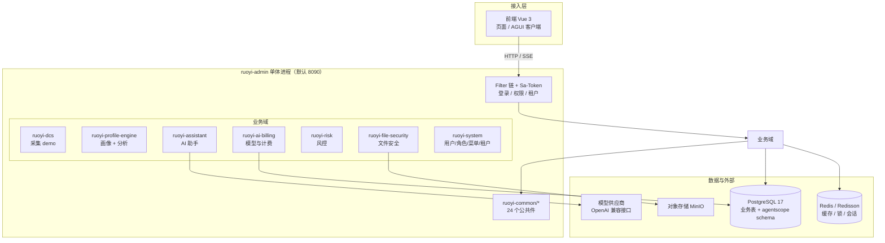

---

## 1. 术语表（先过一遍，后面不再解释）

| 词 | 大白话 |
|---|---|
| **模块（module）** | 一个 Maven 子工程，编译出来是一个 jar。比如 `ruoyi-assistant` 就是"AI 助手"这个 jar。 |
| **包（package）** | Java 的文件夹命名空间，比如 `com.smartdock.assistant.controller`。 |
| **Controller** | 前台接待：只做三件事——收参数、验权限、把结果包成统一格式返回。不写业务逻辑。 |
| **Service** | 业务经理：编排一次用例，比如"发布任务"要改状态、写事件、发通知，按顺序调用。 |
| **Mapper** | 仓库管理员：只负责和数据库表打交道，写 SQL。 |
| **BO / VO / DTO / Query** | 四件套：`*Bo` 是进参、`*Vo` 是出参、`*DTO` 是跨模块传输、`*Query` 是查询条件。 |
| **Gateway（网关/端口）** | 一个"插座"接口：domain 层定义"我需要什么能力"，infrastructure 层给出实现。目的是让业务层不直接依赖数据库/外部服务。 |
| **SPI** | "扩展插座标准"：本仓定义接口，别的模块按标准插进来。AI 助手的业务工具就是 SPI。 |
| **装饰器（Decorator）** | 套娃：在不改原对象的前提下，一层层加行为。模型装饰器就是"在真正发请求前后各做一件事"。 |
| **中间件（Middleware）** | 流水线关卡： Agent 每走一步（推理/行动）都会经过，可以拦截、改写、旁路。 |
| **SSE** | Server-Sent Events：服务器持续向浏览器单向推送的管道。对话流式回答用它。 |
| **AGUI** | 一套"智能体 ↔ 前端"的事件协议：`RUN_STARTED`、`TEXT_MESSAGE_CONTENT`、`TOOL_CALL_*` 等。前端按事件类型渲染。 |
| **HITL** | Human-In-The-Loop：需要人点"确认/取消"才能继续的环节。 |
| **R&lt;T&gt;** | 后端统一返回信封：`{ code, msg, data }`。 |
| **TableDataInfo** | 分页返回信封：`{ total, rows }`。 |
| **租户（tenant）** | 一个客户单位。业务表基本都带 `tenant_id`，MyBatis 插件自动加隔离条件。 |
| **幂等（idempotent）** | 同一个请求重复送达，只算一次。事件账本用 `(tenant, source, event_uid)` 唯一键实现。 |
| **快照链** | 每次评分拍一张"照片"存起来，用 `prev_snapshot_id` 串成链，能回看分数怎么变的。 |
| **事件账本** | `profile_event` 表，append-only（只追加不修改），所有画像/分析都从它派生。 |
| **组合根（composition root）** | `ruoyi-admin` 里的 `web/adapter` 包：A 模块要用 B 模块的能力，但不想直接依赖 B，就在组合根里做桥。 |

---

## 2. 全局代码层级

### 2.1 构建层级：四层聚合

根 `backend/pom.xml` 只聚合 4 个东西：

```text
ruoyi-vue-plus（根 pom，packaging=pom）
├── ruoyi-admin          ← 唯一可启动的 Web 服务（启动类 org.dromara.DromaraApplication）
├── ruoyi-common         ← 24 个公共件（pom 聚合）
├── ruoyi-extend         ← 2 个独立服务（监控端、SnailJob 调度端）
└── ruoyi-modules        ← 9 个业务模块（pom 聚合）
```

`ruoyi-admin` 的启动类：

- 路径：`backend/ruoyi-admin/src/main/java/org/dromara/DromaraApplication.java`
- 关键注解：`@SpringBootApplication(scanBasePackages = {"org.dromara", "com.smartdock"})`
- 两个扫描根是有历史原因的：`org.dromara.*` 是 RuoYi 底座与助手主线，`com.smartdock.*` 是新域代码。**新代码只进 `com.smartdock.<域>.<层>`，不要再往 `org.dromara` 里加业务类**（详见 `backend/AGENTS.md` 的包卫生门禁）。

### 2.2 业务模块一览（含代码规模）

| 模块 | main Java | Controller | 一句话职责 | 关键依赖 |
|---|---:|---:|---|---|
| `ruoyi-admin` | 30 | 4 | 启动类、登录认证、跨模块适配器（`web/adapter`）、启动 Runner | 依赖下面所有业务模块 |
| `ruoyi-system` | 159 | 21 | 用户/角色/菜单/部门/字典/参数/租户/OSS/通知/监控 | 只依赖 common |
| `ruoyi-dcs` | 43 | 7 | 内置采集 demo：任务 → 填报 → 提交 → 审核 → 通知 | profile-engine、assistant-spi |
| `ruoyi-profile-engine` | 188 | 18 | 画像引擎 + 行为分析中心（两块包：`com.smartdock.profile` / `com.smartdock.analytics`） | assistant-spi |
| `ruoyi-assistant` | 213 | 23 | AI 助手：AGUI、会话、记忆、技能、MCP、HITL、自动化、计费装饰器 | dcs、system、ai-billing、assistant-spi |
| `ruoyi-assistant-spi` | 5 | 0 | 业务工具 SPI 契约（纯 JDK + Lombok，零业务依赖） | 无 |
| `ruoyi-ai-billing` | 114 | 11 | AI 模型配置、价格、用量、钱包、积分、服务费、对账 | system |
| `ruoyi-risk` | 65 | 8 | 风控：风险事件、评分、处置、验证码、敏感词、内容机审 | system |
| `ruoyi-file-security` | 34 | 1 | 文件安全检测（fileguard）+ 文件人工审核（file-review） | risk、system |
| `ruoyi-job` | 11 | 0 | SnailJob 执行器示例（账单 DAG 等），无业务表 | common-job |

> 口径说明：main Java 文件数按 `src/main/java/**/*.java` 统计；Controller 数按 `*Controller.java` 统计。`ruoyi-extend` 下的监控端和 SnailJob 服务端是独立进程，不算业务模块。

### 2.3 模块依赖图（谁可以调谁）

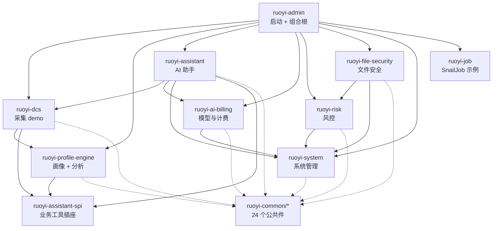

**三条依赖铁律**：

1. **`ruoyi-common/*` 永不反向依赖任何业务模块。** 公共件只提供能力（MyBatis、Redis、Sa-Token、OSS…），不知道业务存在。
2. **业务模块之间尽量不直接 import。** 必须跨模块时，用"端口 + 组合根适配器"：消费方定义接口（`FileReviewGate`、`RiskBehaviorSink`、`MissionReviewProbe`），实现在 `ruoyi-admin/src/main/java/org/dromara/web/adapter/`。这样依赖方向在组合根收口，业务模块保持单向。
3. **`ruoyi-dcs` 是 demo，不是核心。** 它依赖画像引擎（把采集动作翻译成画像事件）和 `assistant-spi`（把采集工具插给 AI 助手），但画像引擎反过来不依赖 dcs。

### 2.4 包层级：域优先 + 四层

新代码的包名只有一个合法形状：

```text
com.smartdock.<域>.<层>
  域：profile / analytics / dcs / risk / aibilling / filesecurity / assistant / shared
  层：controller / service / mapper / domain/bo / domain/vo / domain/model
      / domain/gateway / infrastructure / query / protocol / engine / tools / support / config
```

四层各自放什么（一句话版）：

| 层 | 放什么 | 不许放什么 |
|---|---|---|
| `controller` | 权限注解、参数校验、调用 service、返回 `R<T>` | 业务判断、直接调 Mapper |
| `service` | 用例编排、事务边界、跨表流程 | HTTP 细节、SQL |
| `domain` | 实体（`model`）、入出参（`bo/vo`）、跨层接口（`gateway`） | Spring 注解堆砌、直接依赖 infrastructure |
| `infrastructure` | Gateway 实现、外部服务客户端、模型/计费实现 | 业务用例编排 |
| `mapper` | MyBatis-Plus Mapper 接口 + XML | 业务规则 |

**`legacy` 是什么**：`com.smartdock.assistant.legacy` 是 2026-11-19 批 2 由旧根整棵改名而来的"老城区"，里面有 143 个文件（截至本提交）。规则是**只许改、不许新增文件**；新功能只能进 `com.smartdock.assistant.<层>`。当前新根 70 个文件、legacy 143 个文件，搬迁还在进行（批 4–7 已搬技能线、MCP 线、记忆线等）。

### 2.5 命令与入口速查

| 事情 | 看哪里 |
|---|---|
| 启动类 | `ruoyi-admin/.../org/dromara/DromaraApplication.java` |
| 全局异常 | `ruoyi-common/ruoyi-common-web/.../handler/GlobalExceptionHandler.java` |
| 登录/权限拦截 | `ruoyi-common/ruoyi-common-security/.../config/SecurityConfig.java` |
| 租户插件 | `ruoyi-common/ruoyi-common-tenant/.../config/TenantConfig.java` |
| MyBatis 插件顺序 | `ruoyi-common/ruoyi-common-mybatis/.../config/MybatisPlusConfig.java` |
| 跨模块适配器 | `ruoyi-admin/.../org/dromara/web/adapter/` |
| 智能体工厂 | `ruoyi-assistant/.../assistant/legacy/core/AssistantAgentFactory.java` |
| AGUI 身份门卫 | `ruoyi-assistant/.../assistant/legacy/core/AssistantRuntimeContextResolver.java` |
| AGUI 事件出帧 | `ruoyi-assistant/.../assistant/legacy/core/AssistantEventEnricher.java` |

---

## 3. 一次普通 HTTP 请求怎么走

先看"没有 Agent"的普通业务请求。理解了这条链，Agent 那条链只是多了几道门。

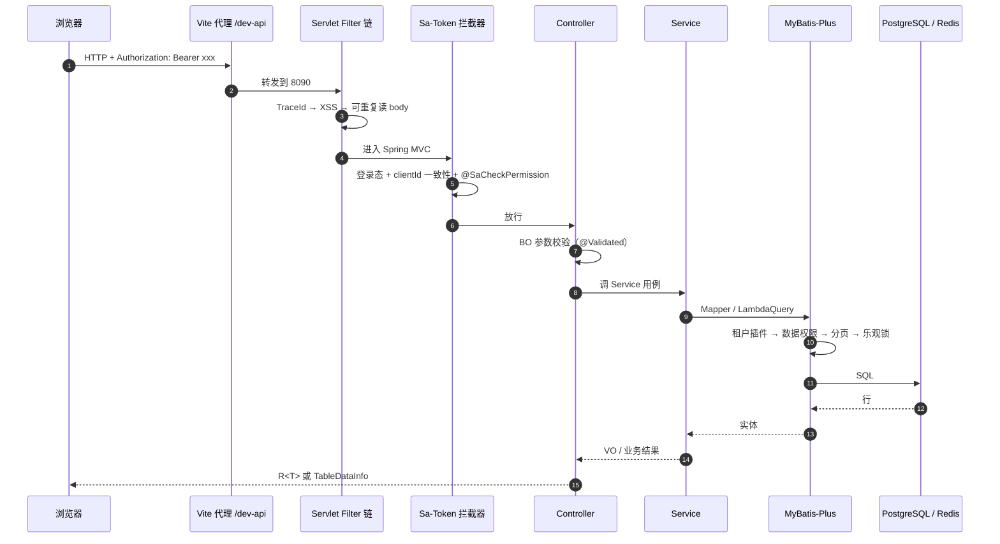

### 3.1 七道横切关，各自管什么

| 顺序 | 关 | 关键类 | 管什么 | 出问题会怎样 |
|---:|---|---|---|---|
| 1 | TraceId | `TraceIdFilter`（`ruoyi-common-web`） | 给每个请求生成 `traceId` 写进 MDC 和响应头 | 日志无法串起一次请求 |
| 2 | XSS | `XssFilter` | 按 `xss.enabled` 过滤请求参数 | 富文本会被误杀，需配 `excludeUrls` |
| 3 | 可重复读 body | `RepeatableFilter` | 让 `@RequestBody` 能读多次 | 加密/审计场景拿不到 body |
| 4 | 登录与权限 | `SecurityConfig` + `SaInterceptor` | 校验登录态、`clientId` 一致、`@SaCheckPermission` | 401/403；异步 dispatch 会直接放行（Agent SSE 必需） |
| 5 | 租户 | `TenantLineInnerInterceptor` | 自动给 SQL 加 `tenant_id` 条件 | 手写 SQL 会报"列不存在"，需 `@InterceptorIgnore` |
| 6 | 数据权限 | `PlusDataPermissionInterceptor` | 按角色/部门限制能看到的数据 | 越权读 |
| 7 | 分页/乐观锁 | `PaginationInnerInterceptor` / `OptimisticLockerInnerInterceptor` | 分页上限 500、版本号 CAS | 全表扫描、并发覆盖 |

**为什么租户插件排第一**：MyBatis-Plus 的插件是按顺序执行的，租户条件必须先注入，后面的数据权限和分页才能在同一张"已经隔离过的表"上工作。顺序写死在 `MybatisPlusConfig` 里，不要随意调换。

### 3.2 Controller 的"门卫三件事"

以 `DcsTaskController` 为例：

```java
@SaCheckPermission("dcs:task:publish")
@PostMapping("/publish/{taskId}")
public R<Void> publish(@PathVariable Long taskId) {
    taskService.publish(taskId, LoginHelper.getUserId());
    return R.ok();
}
```

1. **权限**：`@SaCheckPermission` 三段式（`域:资源:动作`），两段式匹配不上超管 `*:*:*`。
2. **参数**：BO 上的 `@NotNull`/`@Size` 等，失败由 `GlobalExceptionHandler` 统一转 400。
3. **返回**：`R.ok(data)` 或 `TableDataInfo`，前端拦截器按信封解包。

**Controller 不许做的事**：直接注入 Mapper、写事务、跨模块调别人的 Service。ArchUnit 的 `LayeringTest` 会抓"Controller 直接依赖 Mapper/借用其他模块 Service"。

### 3.3 Service 的"三件事"

1. **编排**：按用例顺序调用多个 Mapper/领域服务。
2. **事务**：`@Transactional(rollbackFor = Exception.class)`，跨表写必须在一个事务里。
3. **发事件**：业务动作翻译成画像事件（`ProfileEventPublisher`）或 Spring 事件（通知/审计），但注意事务边界——`afterCommit` 里写库必须用 `REQUIRES_NEW`，否则会跟着外层回滚。

---

## 4. 业务域逐域拆解

这一章按域讲：**这个域是干什么的 → 代码在哪 → 有哪些接口 → 核心类和方法 → 一条主流程 → 关键点**。

> 接口口径：全仓 `ruoyi-modules` 下共 89 个 Controller、526 个 `@*Mapping` 方法（含 assistant 的 23 个）。本章不逐条抄 526 个方法，而是按"控制器 + 主流程"给地图；要查某个具体端点，按表里的 Controller 类名全局搜索即可。

### 4.1 画像引擎（profile）

**一句话**：把业务系统产生的"事件"记成一本只追加的账，再从账本里算出用户是谁、值多少分、属于哪群人、要不要人工复核。

**代码落点**：`backend/ruoyi-modules/ruoyi-profile-engine/src/main/java/com/smartdock/profile/`

#### 4.1.1 数据模型（先认四张核心表）

| 表 | 作用 | 关键字段 |
|---|---|---|
| `profile_event` | 事件账本，append-only | `(tenant_id, source, event_uid)` 唯一；`event_name`、`subject_id`、`session_id`、`occurred_at`、`props` JSONB |
| `profile_subject` | 主体（用户/匿名设备） | `subject_type`、`subject_id`、首见/末见时间 |
| `profile_score_dimension` / `profile_score_rule` | 评分维度与权重规则 | 维度启用开关、规则 JSON |
| `profile_score_snapshot` | 每次评分的"照片" | `total_score`、`grade`、`prev_snapshot_id`（串链） |

#### 4.1.2 接口地图

| 子域 | Controller | 基础路径 | 方法数 | 权限簇 |
|---|---|---|---:|---|
| 查询/总览 | `ProfileQueryController` | `/profile` | 8 | `profile:score:query` 等 |
| 管理/灌数 | `ProfileAdminController` | `/profile` | 4 | `profile:event:publish`、`profile:recalc:run` |
| 删除权 | `ProfileDeletionController` | `/profile/deletion` | 3 | `profile:deletion:*` |
| 导出日志 | `ProfileExportController` | `/profile/export` | 1 | `profile:export:query` |
| 源配置 | `ProfileSourceConfigController` | `/profile/source-config` | 1 | `profile:engine:query` |
| 身份图谱 | `ProfileIdentityController` | `/profile/identity` | 2 | `profile:identity:*` |
| 接入协议 | `ProfileProtocolController` | `/profile/protocol` | 5 | `profile:protocol:*` |
| Schema | `ProfileSchemaController` | `/profile/schema` | 3 | `profile:schema:*` |
| 评分模型 | `ProfileScoreModelController` | `/profile/model` | 17 | `profile:model:*` |
| 权重规则 | `ProfileRuleController` | `/profile/rule` | 12 | `profile:rule:edit` |
| 维度治理 | `ProfileDimensionController` | `/profile/dimension` | 8 | `profile:dimension:edit` |
| 场景模板 | `ProfileScenarioController` | `/profile/scenario` | 5 | `profile:scenario:edit` |
| 分群/触达 | `ProfileSegmentController` | `/profile/segment` | 16 | `profile:segment:*`、`profile:reach:*` |
| 低分复核 | `ProfileReviewController` | `/profile/review` | 7 | `profile:review:*` |
| PII 字段 | `ProfilePiiFieldController` | `/profile/pii` | 3 | `profile:pii:*` |

#### 4.1.3 主流程：一条事件如何变成分数

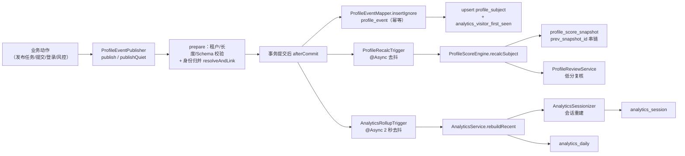

**核心类与核心方法**：

| 类 | 路径 | 核心方法 | 具体做什么 |
|---|---|---|---|
| `ProfileEventServiceImpl` | `profile/event/ProfileEventServiceImpl.java` | `publish` / `publishQuiet` | 普通发布触发"打分 + 汇总"，quiet 只触发汇总（dcs 等高频动作不重复打分） |
| 同上 | 同上 | `publishBatchDetailed` | 逐条隔离写，返回 written/duplicated/failures，供 CSV 补录精确对账 |
| 同上 | 同上 | `writePrepared` | `REQUIRES_NEW` 内 `insertIgnore` 写事件，再独立短事务 upsert 主体/首见 |
| `ProfileScoreEngine` | `profile/engine/ProfileScoreEngine.java` | `recalcSubject(source, subjectType, subjectId)` | 取启用维度 + 最新规则，逐维算分，加权归一化，写快照；无维度时落"占位 50 分"并标 `unconfigured` |
| `ProfileRecalcService` | `profile/engine/ProfileRecalcService.java` | `startAndRun` / `resume` | 批量重算，`profile_recalc_batch` 记批次，从 `last_subject_id` 断点续跑 |
| `ProfileScoreModelService` | `profile/engine/ProfileScoreModelService.java` | `run` / `evaluateSubjectIfActive` | 模型全量跑 + 事件后增量；发布/回滚/版本对比 |
| `ProfileSegmentService` | `profile/engine/ProfileSegmentService.java` | `evaluate` / `writeRun` | 规则分群评估；写 run + 成员快照 + 统计，只保留最近 30 个真实 run |
| `ProfileReviewService` | `profile/engine/ProfileReviewService.java` | `evaluateAfterRecalc` / `finish` | 低于阈值入队；分数回升自动销案；人工确认/驳回用条件 UPDATE 防并发 |
| `ProfileIdentityService` | `profile/identity/ProfileIdentityService.java` | `resolveAndLink` / `unmerge` | 匿名 ↔ 登录主体归并；共享浏览器换账号只改挂链接，不搬走对方身份 |

**关键点**：

- **幂等**：`(tenant, source, event_uid)` 唯一键 + `insertIgnore`。重复投递返回 false 不报错。
- **事务内调用**：`publish` 在事务里返回 true 只代表"已受理"，真正落账在 `afterCommit`；精确对账必须用 `publishBatchDetailed`。
- **快照链**：`prev_snapshot_id` 串起来，并发用 `advisoryXactLock("score:...")` 防"链变树"。
- **PII**：`profile_pii_field` 是全局字段字典（**没有 tenant_id**），这是有意为之：字段定义跨租户共享。

### 4.2 分析中心（analytics）

**一句话**：不新增任何埋点，直接复用 `profile_event` 这本账，把事件重建成"会话"，再算日汇总、趋势、漏斗、留存、路径。

**代码落点**：`backend/ruoyi-modules/ruoyi-profile-engine/src/main/java/com/smartdock/analytics/`

#### 4.2.1 接口地图

| Controller | 基础路径 | 方法数 | 管什么 |
|---|---|---:|---|
| `AnalyticsController` | `/analytics` | 25 | 概览、趋势、拆解、漏斗、留存、会话、路径、自定义报表、CSV 导入、重建、实时 |
| `AnalyticsHealthController` | `/analytics/health` | 1 | 活跃源健康巡检 |
| `AnalyticsReplayController` | `/analytics/replay` | 5 | 回放任务 start/resume/pause/list/get |

#### 4.2.2 会话口径（全系统最容易算错的地方）

| 场景 | 规则 |
|---|---|
| 有显式 `sessionId` | 直接用它生成会话键 `s:{sessionId}`，一个 sessionId 一个会话 |
| 没有显式 sessionId | 30 分钟无操作切分；隐式键 `v:{visitor}:{分钟桶}` **锚定首事件**（不是每次事件都换桶） |
| 新访客 | 该 `source` 下的第一次会话 |
| 跳出（bounce） | 单页会话；有搜索行为不算跳出；`page_leave` 不算"继续" |
| 迟到事件 | 重建窗口最多向左拉宽 7 天，避免晚到事件丢会话 |

#### 4.2.3 主流程：事件 → 会话 → 日汇总

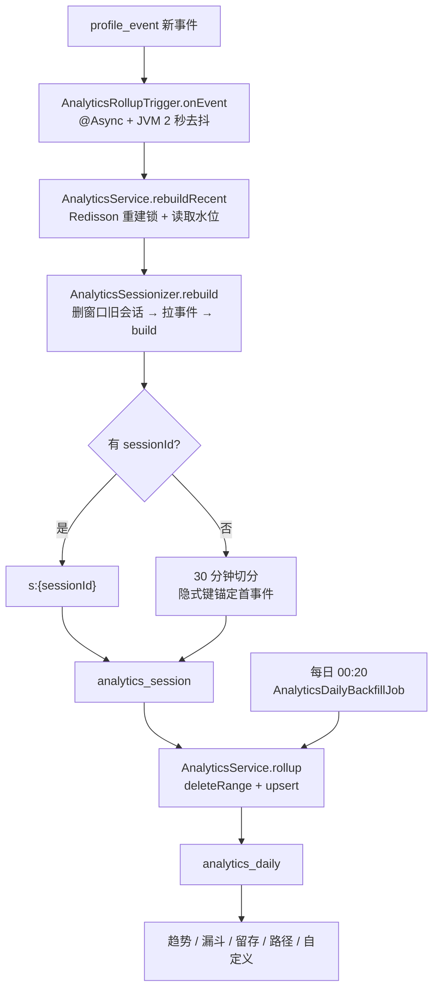

**核心类**：

| 类 | 核心方法 | 具体做什么 |
|---|---|---|
| `AnalyticsService` | `rebuildRecent` | 重建最近两天的会话和日汇总；分布式锁防并发；窗口默认 D-2 到明天 |
| `AnalyticsService` | `backfillDaily` | 每天重算 D-1..D-3，幂等，手工补数同入口 |
| `AnalyticsSessionizer` | `rebuild` / `build` | 纯函数式会话重建；先删窗口旧会话，再按规则切分，500 条一批插入 |
| `AnalyticsRollupTrigger` | `onEvent` | 2 秒去抖，合并窗口内多事件只触发一次；正确性靠 `rebuildRecent` 的锁兜底 |
| `AnalyticsReplayRunner` | `execute` | `@Async` 逐日推进回放，天粒度断点 |
| `AnalyticsReportValidator` | `validate` | 自定义报表的安全/结构校验（防注入、防超范围） |

**关键点**：

- **分析中心不建事件表**：它直接查 `profile_event`，所以"单源口径"才成立。外部网站采集口已于 2026-10-23 移除，数据进系统只有两条路：业务系统走 `ProfileEventPublisher`，离线数据走 CSV 补录。
- **去抖不等于正确性**：JVM 内的 2 秒去抖只是省计算；真正防并发的是 Redisson 锁 + 水位。多实例部署时不要依赖 JVM 标记。

### 4.3 采集 demo（dcs）

**一句话**：保留"任务 → 填报 → 提交 → 审核 → 通知"的最小闭环，作为平台的演示能力和 AI 工具的业务载体。

**代码落点**：`backend/ruoyi-modules/ruoyi-dcs/src/main/java/com/smartdock/dcs/`

#### 4.3.1 接口地图

| Controller | 基础路径 | 方法数 | 管什么 |
|---|---|---:|---|
| `DcsTaskController` | `/dcs/task` | 8 | 任务分页、我的任务、详情、创建/更新/发布/关闭 |
| `DcsSubmissionController` | `/dcs/submission` | 2 | 提交、我的提交 |
| `DcsAuditController` | `/dcs/audit` | 3 | 待审列表、审核决定、审计轨迹 |
| `DcsFeedbackController` | `/dcs/feedback` | 7 | 产品反馈 |
| `DcsNoticeController` | `/dcs/notice` | 2 | 我的通知、标记已读 |
| `DcsChangelogController` | `/dcs/changelog` | 5 | 更新日志（全局表） |
| `DcsStatsController` | `/dcs/stats` | 1 | 发布人/成员双视角概览 |

#### 4.3.2 状态机与不变量

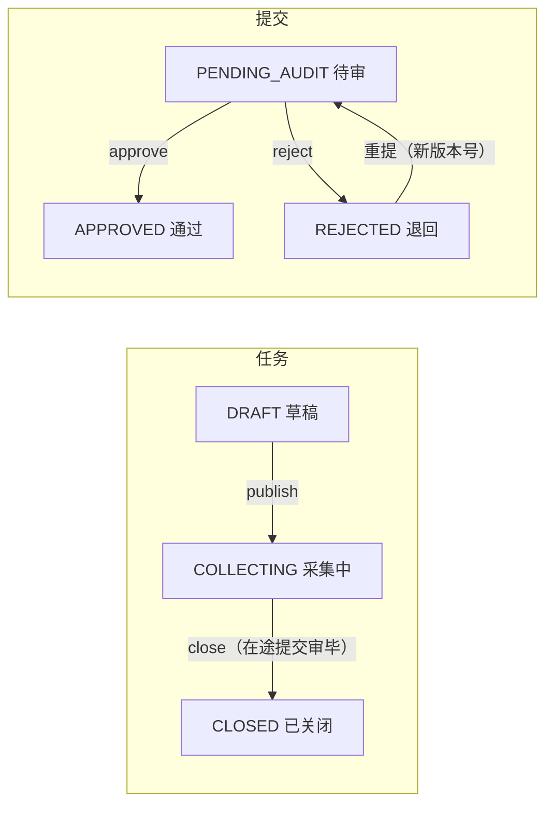

| 不变量 | 说明 |
|---|---|
| 只有 `COLLECTING` 期成员可提交 | 任务关闭后提交接口拒绝 |
| 同一 (task, user) 已有 `PENDING_AUDIT`/`APPROVED` 时不可重复提交 | 退回后重提生成新版本，旧版本只读保留 |
| 审核用 CAS | `WHERE status='PENDING_AUDIT'` 条件更新，防双审 |
| 通知幂等 | `dedup_key` + 部分唯一索引 `uk_dcs_notice_dedup` |
| 审计只追加 | `dcs_audit` append-only，`trail` 按提交聚合回放 |

#### 4.3.3 主流程：发布 → 提交 → 审核

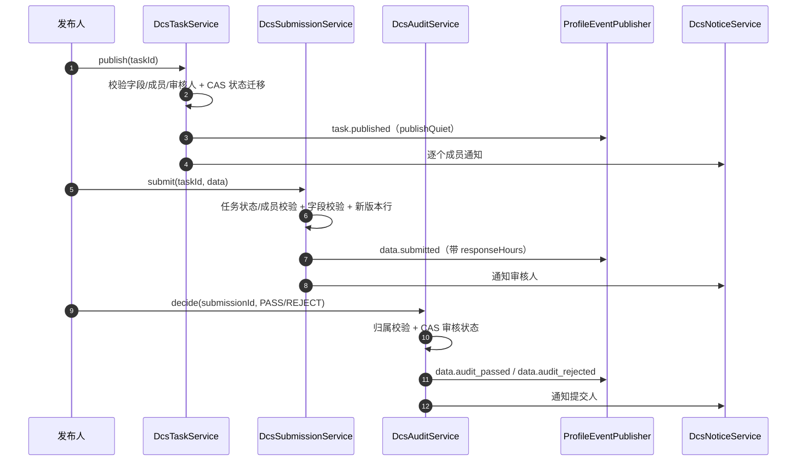

**核心类**：

| 类 | 核心方法 | 具体做什么 |
|---|---|---|
| `DcsTaskService` | `publish` / `close` | 校验 → CAS 状态迁移 → 翻译画像事件 → 通知成员 |
| `DcsSubmissionService` | `submit` | 任务/成员/字段校验 → `insertJsonb` 新版本 → 发事件 → 通知审核人 |
| `DcsAuditService` | `decide` | 归属校验 → `auditStatus` CAS → 写 `dcs_audit` → 发事件 → 通知提交人 |
| `DcsNoticeService` | `notify` | 按用户投递，`dedup_key` 幂等 |
| `DcsToolProvider` | `tools` / `execute` | 把"查任务/查我的待办/查提交/建任务"插给 AI 助手 |

### 4.4 风控（risk）

**一句话**：收集风险事件 → 算风险分（L0–L4）→ 该冻结的冻结、该出验证码的出验证码、该人工复核的进复核队列。

**代码落点**：`backend/ruoyi-modules/ruoyi-risk/src/main/java/com/smartdock/risk/`

#### 4.4.1 接口地图

| Controller | 基础路径 | 方法数 | 管什么 |
|---|---|---:|---|
| `DcsRiskDashboardController` | `/dcs/risk` | 3 | 看板、我的风险分、指定用户风险分 |
| `DcsRiskEventController` | `/dcs/risk` | 2 | 事件列表/详情 |
| `DcsRiskActionController` | `/dcs/risk` | 11 | 处置动作列表/解除/复核、画像高风险复核 |
| `DcsRiskRuleController` | `/dcs/risk` | 5 | 规则增删改查/启停 |
| `DcsRiskWhitelistController` | `/dcs/risk` | 4 | 白名单 |
| `DcsRiskContentConfigController` | `/dcs/risk/content-config` | 2 | 内容机审开关 |
| `DcsSensitiveWordController` | `/dcs/sensitive-word` | 8 | 敏感词库 |
| `DcsCaptchaController` | `/dcs/captcha` | 4 | 验证码 need/generate/verify/verify-otp |

#### 4.4.2 主流程

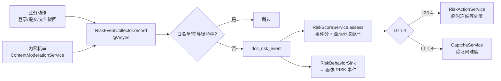

**核心类**：

| 类 | 核心方法 | 具体做什么 |
|---|---|---|
| `RiskEventCollector` | `record` | `@Async` 采集；白名单/幂等/规则权重；落 `dcs_risk_event`；同时写画像 `RISK` 行为 |
| `RiskScoreService` | `assess(userId, ip)` | 事件类型规则分 vs 全局累计分，`HybridRiskPolicy` 取更严，输出 L0–L4 |
| `RiskActionService` | `syncAssessment` | L3/L4 才处置；先过期旧 ACTIVE，再按 `userId:actionType` 唯一键幂等插入 |
| `CaptchaService` | `generate` / `verify` | L1–L4 难度；Redis 存挑战；L4 加 OTP；成功后发一次性 pass |
| `ContentModerationService` | `moderateDetail` | 填报文本机审；命中记 `TASK_CONTENT_RISK`；灰度开关决定是否拦截 |
| `DcsFileReviewServiceImpl` | `reject` | 文件审核驳回后补记 `FILE_REJECTED` 风险事件 |

**关键点**：

- **两套"画像复核"不是一回事**：`profile_review_queue` 是画像引擎的"低分复核"；`dcs_profile_review` 是风控侧的"画像高风险人工复核"。名字像，表和入口都不同。
- **白名单优先于规则**：IP/用户白名单命中直接跳过，避免内部人员被误伤。

### 4.5 计费（ai-billing）

**一句话**：管模型配置、价格、用量、钱包、积分、服务费和对账；AI 每调一次模型，这里要落一条 usage 并扣钱（或扣积分）。

**代码落点**：`backend/ruoyi-modules/ruoyi-ai-billing/src/main/java/com/smartdock/`

#### 4.5.1 接口地图

| Controller | 基础路径 | 方法数 | 管什么 |
|---|---|---:|---|
| `DcsAiConfigController` | `/dcs/ai-config` | 29 | 模型/供应商/密钥/探活/默认槽 |
| `DcsAiModelPriceController` | `/dcs/ai-model-price` | 7 | 模型价格 |
| `DcsAiPriceController` | `/dcs/ai-price` | 2 | 生效价格 |
| `DcsAiUsageController` | `/dcs/ai-usage` | 5 | 用量查询/汇总 |
| `DcsAiCreditController` | `/dcs/ai-credit` | 12 | 积分套餐/订阅/加油包/流水 |
| `DcsTenantWalletController` | `/dcs/tenant-wallet` | 8 | 钱包/充值/扣减/阈值 |
| `DcsTenantWalletLedgerController` | `/dcs/tenant-wallet-ledger` | 1 | 钱包流水 |
| `DcsWalletPaymentOrderController` | `/dcs/wallet-payment-order` | 3 | 充值订单 |
| `DcsServiceChargeRuleController` | `/dcs/service-charge-rule` | 5 | 服务费规则 |
| `DcsAiDocDomainController` | `/dcs/ai-doc-domain` | 5 | 文档域名白名单 |
| `AiFaviconController` | `/dcs/ai/favicon` | 1 | Favicon 代理（匿名 + IP 限流） |

#### 4.5.2 主流程：一次模型调用如何扣费

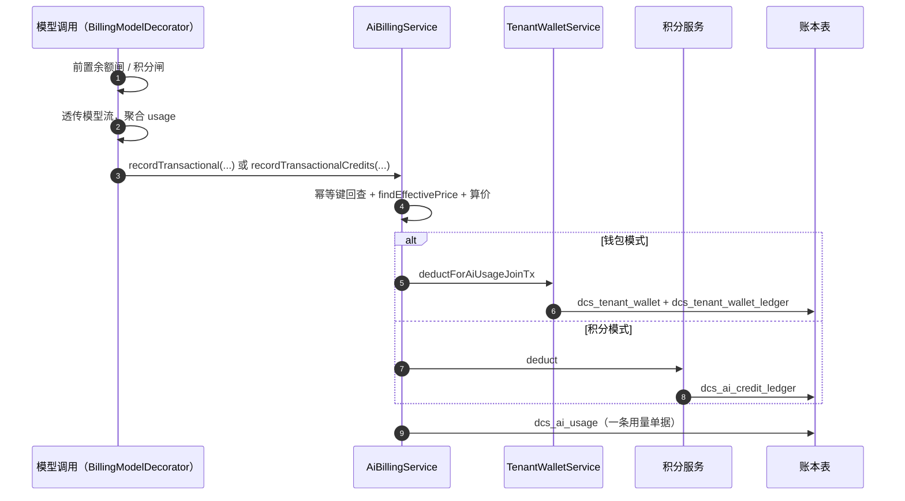

**核心类**：

| 类 | 核心方法 | 具体做什么 |
|---|---|---|
| `AiBillingService` | `recordTransactional` | 幂等回查 → 取生效价格 → 算价 → 同事务扣钱包 → 插 `dcs_ai_usage` |
| 同上 | `recordTransactionalCredits` | 积分模式：同事务扣积分，钱包不动，快照标 `walletDeducted:false` |
| `TenantWalletService` | `deductForAiUsageJoinTx` | 条件 UPDATE "足额才扣"，写流水；余额不足只留痕不阻断 |
| `DcsAiCreditServiceImpl` | `preGate` / `deduct` | 订阅/周池/加油包夹逼扣减；幂等流水 |
| `AiBillingCalculator` | `calculate` | 纯计算：token/次数计费、服务费、币种、账单快照 |
| `WalletReconcileJob` | `reconcile` | 每晚 02:30 对账（余额 vs 流水净额、流水链、空 biz_id、助手计费），只告警不动账 |

**关键点**：

- **幂等键不是全场景幂等**：`BillingModelDecorator` 的键是 `ai-assistant:{tenant}:{configId}:{instanceId}:{seq}`，含 `instanceId`，只防"同一订阅内 doFinally 重复触发"。跨订阅/agent 重建后重放会生成新键，可能双记。代码注释自己承认这是已知限制（`BillingModelDecorator.java:38-41`）。旧文档写"幂等键防重复落账"容易被读成全场景，这里纠正。
- **余额不足不阻断回答**：钱包扣减失败只打 `walletDeducted:false`，对话继续，避免"没钱了突然不能聊天"；但会留下欠费痕迹供对账。

### 4.6 文件安全（file-security）

**一句话**：文件上传前先做安全检测（宏/伪装/敏感内容），上传后按配置决定"免审/跳过/进人工队列"，审核通过前别人看不到。

**代码落点**：`backend/ruoyi-modules/ruoyi-file-security/src/main/java/com/smartdock/`

#### 4.6.1 接口地图

| Controller | 基础路径 | 方法数 | 管什么 |
|---|---|---:|---|
| `DcsFileReviewController` | `/dcs/fileReview` | 9 | 审核列表/通过/驳回/配置/guard 统计与日志 |

#### 4.6.2 主流程：上传 → 判定 → 审核

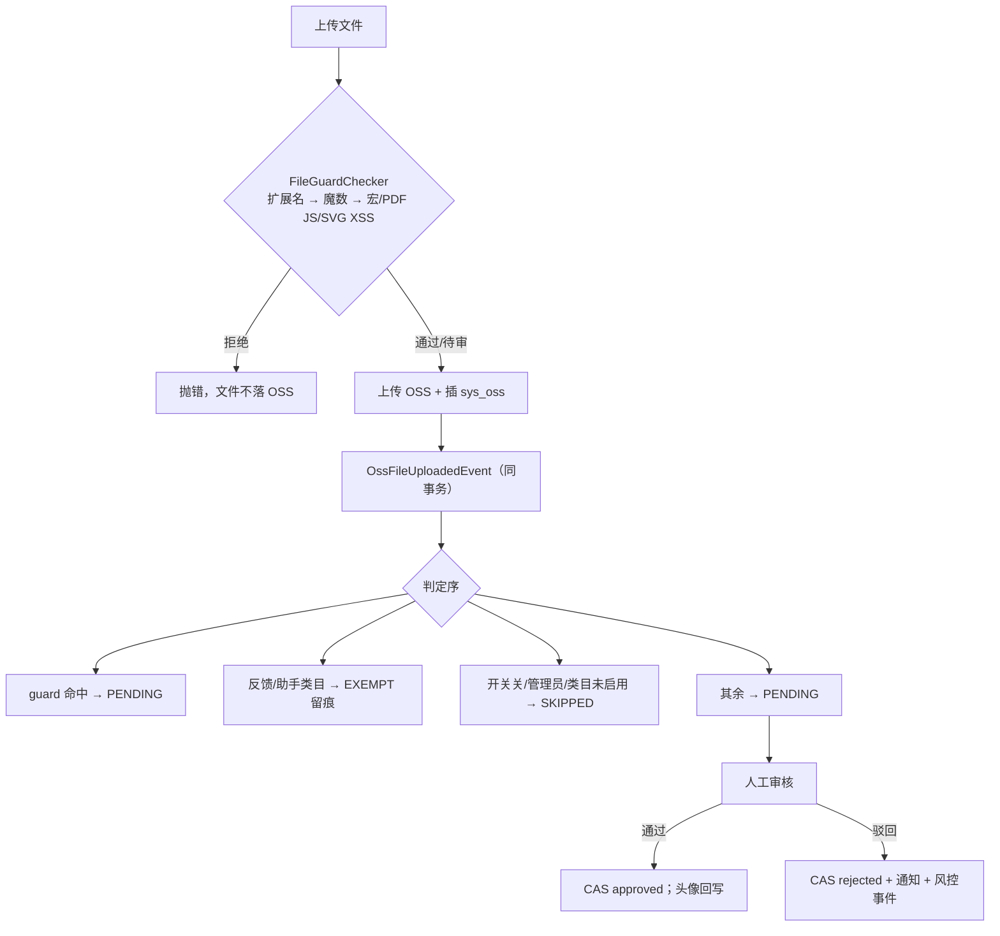

**核心类**：

| 类 | 核心方法 | 具体做什么 |
|---|---|---|
| `OssUploadedEventListener` | `onUploaded` | 与上传同事务；按"guard → 反馈/助手豁免 → 开关 → 管理员 → 类目 → PENDING"顺序建单 |
| `DcsFileReviewServiceImpl` | `approve` / `reject` | 逐条 CAS；通过后头像回写；驳回后发通知 + 风险事件 |
| `DcsFileReviewGateImpl` | `isVisibleToCurrentUser` | 预览/下载/列表/删除的放行矩阵；删除级联闭单 |
| `DcsFileGuardCheckerImpl` | `checkUpload` | 扩展名白名单 → 魔数 → 宏/PDF JS/SVG XSS 深扫 |
| `DcsFileReviewConfigServiceImpl` | `save` | 租户级开关、类目、guard 模式、白名单扩展名 |

**关键点**：

- **判定顺序不可调换**：guard 命中必须无视配置/管理员/类目直接进审；反馈/助手类目是豁免（EXEMPT），不是 PENDING。
- **读侧也要拦**：不是"审核完就完了"，`preview/download/listByIds` 都要过 `FileReviewGate`，否则拿到 ossId 就能绕过。

### 4.7 系统管理（system）

**一句话**：RuoYi 底座：用户、角色、菜单、部门、字典、参数、租户、OSS、通知、监控。它也是"动态菜单"和"租户初始化"的源头。

**代码落点**：`backend/ruoyi-modules/ruoyi-system/src/main/java/org/dromara/system/`

#### 4.7.1 接口地图（21 个 Controller）

| 子域 | Controller | 基础路径 |
|---|---|---|
| 用户/角色/菜单/部门/岗位 | `SysUserController` / `SysRoleController` / `SysMenuController` / `SysDeptController` / `SysPostController` | `/system/user`、`/system/role`、`/system/menu`、`/system/dept`、`/system/post` |
| 字典/参数/通知/客户端 | `SysDictTypeController` / `SysDictDataController` / `SysConfigController` / `SysNoticeController` / `SysClientController` | `/system/dict/*`、`/system/config`、`/system/notice`、`/system/client` |
| 租户/套餐 | `SysTenantController` / `SysTenantPackageController` | `/system/tenant`、`/system/tenant/package` |
| OSS | `SysOssController` / `SysOssConfigController` | `/resource/oss`、`/resource/oss/config` |
| 社交/个人中心 | `SysSocialController` / `SysProfileController` | `/system/social`、`/system/user/profile` |
| 公告门户 | `SysNoticePortalController` | `/dcs/announcement` |
| 监控 | `CacheController` / `SysLogininforController` / `SysOperLogController` / `SysUserOnlineController` | `/monitor/*` |

#### 4.7.2 核心链路：动态菜单与租户初始化

**动态菜单**（前端路由的来源）：

```text
sys_menu 表
  → SysMenuServiceImpl.selectMenuTreeByUserId(userId)
     超管：全部菜单；普通用户：角色 + 租户套餐关联的菜单
  → buildMenus() 转 RouterVo（path/component/meta/hidden/children）
  → GET /system/menu/getRouters
  → 前端 permissionStore.generateRoutes() + router.addRoute()
```

**租户初始化**：

```text
SysTenantServiceImpl.insertByBo
  → 创建租户 + 套餐/菜单/角色/字典初始化
  → TenantProvisioningHandler.provision(tenantId)
      风控模块在这里复制默认规则（DcsRiskTenantProvisioningHandler）
```

**核心类**：

| 类 | 核心方法 | 具体做什么 |
|---|---|---|
| `SysOssServiceImpl` | `upload` | 先 `FileGuardChecker` 再上传；插 `sys_oss` + 发 `OssFileUploadedEvent`；异常补偿删对象 |
| `SysUserServiceImpl` | `insertUser` / `updateUserAvatar` | 用户与角色/岗位关联；头像单列更新（文件审核通过后回写） |
| `SysTenantServiceImpl` | `insertByBo` | 建租户 + 套餐/菜单/角色/字典 + 领域初始化钩子 |
| `SysMenuServiceImpl` | `selectMenuTreeByUserId` / `buildMenus` | 菜单树 + RouterVo 转换 |
| `SysPermissionServiceImpl` | `getMenuPermission` | 聚合角色权限 + 菜单权限，供 Sa-Token 判定 |

### 4.8 定时任务（job）

**一句话**：`ruoyi-job` 只放 SnailJob 执行器示例（账单 DAG 等），没有业务表；真正的业务定时任务分散在各业务模块的 `@Scheduled`。

#### 4.8.1 真实在跑的定时任务（不含 assistant）

| 类.方法 | 时间 | 做什么 |
|---|---|---|
| `AnalyticsDailyBackfillJob.backfillRecentDays` | 每天 00:20 | 回填 D-1..D-3 日汇总 |
| `ProfileOpsJob.refreshSegments` | 每小时 :05 | 动态分群保鲜 |
| `ProfileOpsJob.scanReviewSla` | 每天 09:10 | 复核 SLA 超期提醒 |
| `ProfileOpsJob.scanHealth` | 每小时 :15 | 引擎健康巡检 |
| `ProfileRetentionJob.cleanup` | 每天 03:30 | 事件归档/清理、重建日志 30 天清理 |
| `WalletAlertScheduler.scanLowBalance` | 每天 09:00 | 低余额告警 |
| `CreditAlertScheduler.scanCreditState` | 每天 09:10 | 积分到期/周池/加油包告警 |
| `WalletReconcileJob.reconcile` | 每天 02:30 | 钱包对账（只告警） |
| `ModelHealthScheduler.patrol` | 每天 04:00 | 在用模型探活 |
| `DcsAiProviderAccessServiceImpl.scheduledBalanceRefresh` | 每天 04:30 | 厂商钥匙余额刷新 |

#### 4.8.2 SnailJob

`ruoyi-job` 里的 `AlipayBillTask` / `WechatBillTask` / `SummaryBillTask` 是 DAG 示例，`Test*Job` 是分片/广播/MapReduce 示例。**它们不是业务任务**，别把演示代码当生产逻辑。

### 4.9 业务域之间的"暗线"

这些关系不看代码很容易漏：

| 暗线 | 怎么连的 |
|---|---|
| 采集 → 画像 | `DcsTaskService/DcsSubmissionService/DcsAuditService` 调 `ProfileEventPublisher.publishQuiet` |
| 采集 → 通知 | `DcsNoticeService`；文件驳回/钱包告警通过 admin 的 adapter 桥进来 |
| 风控 → 画像 | `RiskBehaviorSinkAdapter` 把风险行为写成 `source=risk` 的画像事件 |
| 文件 → 风控 | 文件驳回后 `RiskEventCollector.record(FILE_REJECTED)` |
| 文件 → 通知 | `FileReviewNoticeEvent` → `FileReviewNoticeAdapter` → `DcsNoticeService` |
| 计费 → 通知 | `WalletAlertEvent` → `WalletAlertNoticeAdapter` → `DcsNoticeService` |
| 画像 → 采集 | 分群触达 `ProfileReachChannel` 的实现是 dcs 的 `InAppReachChannel`（站内通知） |
| 助手 → 业务 | `BizToolProvider` SPI：dcs/profile/analytics 三个提供方 |

---

## 5. 智能体运行时（本篇重点）

> 这一章回答："我从输入框发一句话，到屏幕上逐字出现回答，中间到底经过了谁？"以及"每个核心类、核心方法具体干什么？"

### 5.1 先分清：哪些是框架的，哪些是本仓的

很多人第一次读代码会找不到 `/agui/run` 的 Controller，因为它**不在本仓**。

| 能力 | 归属 | 具体位置 |
|---|---|---|
| `POST /agui/run/{agentId}` 端点 | **框架 jar** | `io.github.ck-ys.agentscope:agentscope-agui-spring-boot-starter:2.1.0-ckys3` 里的 `io.agentscope.spring.boot.agui.mvc.AguiRestController` |
| SSE 传输、SseEmitter、超时 | **框架 jar** | `AguiMvcController` |
| AGUI 协议编排（解析 context/agent/adapter） | **框架 jar** | `AguiRequestProcessor` |
| Agent 注册表、线程会话缓存 | **框架 jar** | `AguiAgentRegistry` / `ThreadSessionManager` / `DefaultAgentResolver` |
| ReAct 推理循环、工具调用协议 | **框架 jar** | `ReActAgent` 及 AgentScope core |
| 身份/权限/配额/落库门卫 | **本仓** | `AssistantRuntimeContextResolver` |
| Agent 怎么装配（模型/工具/中间件） | **本仓** | `AssistantAgentFactory` |
| 技能、MCP、业务工具、HITL、计划、压缩、计费 | **本仓** | `com.smartdock.assistant.*` |
| 把引擎事件翻译成前端认识的帧 | **本仓** | `AssistantEventEnricher` |

本仓 `application.yml` 只配了三个相关键：

```yaml
agentscope:
  agui:
    server-side-memory: true      # 打开服务端会话缓存
    default-agent-id: dcs-assistant
```

路径前缀没配，所以实际端点就是 `/agui/run/{agentId}`。

### 5.2 全链路全景图

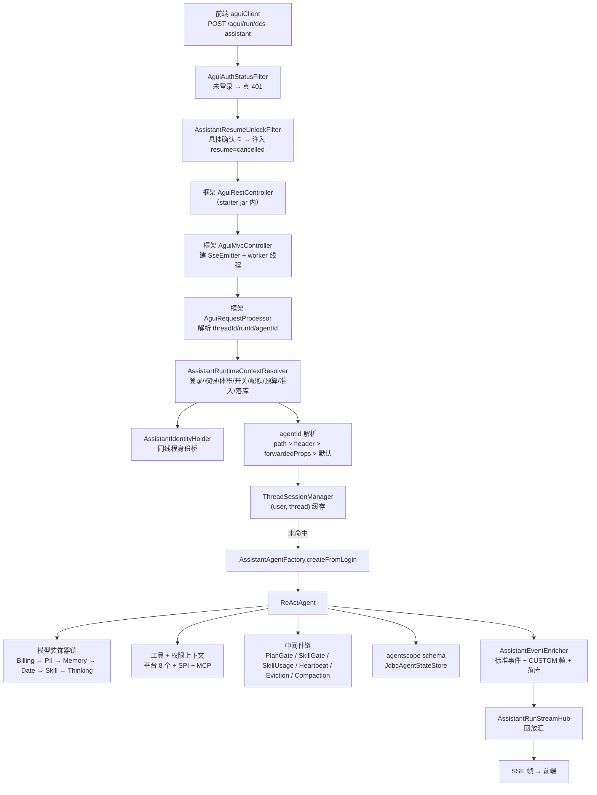

**读图顺序**：先看左上到右下这条主干（请求进来 → 门卫 → 选 agent → 跑 agent → 出帧），再回头看每个节点旁边的本仓类。下面按这个顺序逐段拆。

### 5.3 入口：三个过滤器 + 框架两层

请求进入 `/agui/*` 时，先过三个本仓/框架的过滤器，再到框架 Controller：

| 顺序 | 类 | 路径 | 做什么 |
|---:|---|---|---|
| 1 | `AguiAuthStatusFilter` | `legacy/core/AguiAuthStatusFilter.java:29` | 只拦 `/agui/*`；`StpUtil.checkLogin()` 失败时返回**真正的 HTTP 401**（不是 JSON 信封里的 401） |
| 2 | `AssistantResumeUnlockFilter` | `legacy/core/AssistantResumeUnlockFilter.java:62` | 如果请求体没带 `resume`、thread 上还挂着确认卡、且请求者是卡的主人 → 自动注入 `resume=cancelled`，作废旧卡，避免"旧卡毒化 thread" |
| 3 | Sa-Token `SaInterceptor` | `ruoyi-common-security/.../SecurityConfig.java` | 校验登录态 + `clientId`；**异步 dispatch 直接放行**（否则 SSE 二次分发会重复鉴权、放大异常） |

框架侧：

| 类 | 做什么 | 关键点 |
|---|---|---|
| `AguiRestController#runWithAgentId` | 解析 JSON body 为 `RunAgentInput`，委托 `AguiMvcController` | 注解是 `@PostMapping("${agentscope.agui.path-prefix:/agui}/run/{agentId}", produces = TEXT_EVENT_STREAM_VALUE)` |
| `AguiMvcController#handleInternal` | 创建 `SseEmitter`（默认 600000ms），把处理提交到 `Executors.newCachedThreadPool()` | **resolver 和 factory 都在这个 worker 线程里同步执行**，这是后面 `AssistantIdentityHolder` ThreadLocal 能成立的前提 |
| `AguiRequestProcessor#process` | 先 `resolveRuntimeContext`，再 `resolveAgentId`，再 `resolveAgent`，最后 `adapter.run` | `threadId`/`runId` 从请求体取；agentId 优先级固定 |

**agentId 优先级**（`AguiRequestProcessor.resolveAgentId`）：

```text
URL path variable  >  X-Agent-Id header  >  forwardedProps.agentId  >  agentscope.agui.default-agent-id  >  "default"
```

所以 `/agui/run/dcs-assistant` 永远选 `dcs-assistant`；`/agui/run` 不带 path 时才看 header / props / 默认。

### 5.4 门卫：AssistantRuntimeContextResolver 逐闸

这是本仓在 Agent 链路上**最重的一个类**。它实现框架的 `AguiRuntimeContextResolver` 接口，每请求执行一次。

文件：`backend/ruoyi-modules/ruoyi-assistant/src/main/java/com/smartdock/assistant/legacy/core/AssistantRuntimeContextResolver.java`

#### 5.4.1 十道闸（顺序不能乱）

| # | 闸 | 方法/行号 | 检查什么 | 失败返回 |
|---:|---|---|---|---|
| 1 | 登录 | `resolve` L68-76 | Bearer token → `LoginHelper.getLoginUser(token)` | 401 |
| 2 | 助手权限 | L84-89 | `LoginHelper.isSuperAdmin` 或权限集含 `*:*:*` / `dcs:assistant:use` | 403「角色未开通」 |
| 3 | 租户解析 | L95 / `resolveTenantId` L352 | 超管动态租户（Redis 键）优先，否则登录快照租户 | 回退快照，不阻断 |
| 4 | 输入体积 | L100 `inputGuard.validate` | 最后一条 user 消息 > 16000 字符 | 400 |
| 5 | 租户开关 | L103 `configService.assertOpen` | 租户是否开通助手 | 403；PG 异常 503 |
| 6 | 用户禁用 | L107 `quotaService.assertEnabled` | 用户是否被单独暂停 | 403 |
| 7 | 日回合限额 | L119-121 `dailyQuota.tryTurn` | 单人覆盖 > 租户默认；积分模式跳过（除非急停） | 429/503 |
| 8 | 日预算 | L123-126 `dailyQuota.checkBudget` | 钱包模式才查；积分模式跳过 | 429 |
| 9 | 准入闸 | L128 `admissionGate.admit` | Redis 滑窗：租户/全站活跃双限 | 429 |
| 10 | 持久化 | L130 `persistUserSide` | thread 首绑 + run 登记 + user 消息落库 | 异主 403；PG 故障降级继续 |

**为什么第 7 道要单独处理积分模式**：积分订阅租户的"回合数"不再是成本闸，套餐积分才是；但管理员把回合上限配成 0（急停）时仍要拦，所以条件写成 `!creditsMode || roundLimit <= 0`，不能简单跳过。

**失败补偿**：第 7 道之后任何一道失败，`catch` 里会 `refundTurn` 把刚扣的回合退掉（积分模式不退，因为本来就没扣）。这个细节决定"被拒的请求不消耗额度"。

#### 5.4.2 十道闸之后的"副作用"

通过门禁后，resolver 还要做五件事：

1. **身份桥**：`AssistantIdentityHolder.set(user, threadId, runId)`（L143）。稍后框架在同一个 worker 线程里调 `agentFactory::createFromLogin`，工厂从这个 ThreadLocal 取身份——因为响应式线程没有 Sa-Token 上下文。
2. **写会话级 Holder**：思考档 `AssistantThinkingTierHolder`、模型选择 `AssistantModelChoiceHolder`、联网 `AssistantWebSearchHolder`、提问自动继续 `AssistantAskPrefHolder`、自主权 `AssistantAutonomyHolder`、技能 `AssistantSkillHolder`（L150-203）。这些值**逐请求**从 `forwardedProps` 读，下一次请求可以完全不同。
3. **处理计划卡决定**：`planDecision=confirm/cancel/adjust` → `planSignal.decide`（L163-192）。如果 confirm 抢不到卡（旧卡/第二次点），条件收尾 run 并退回合，抛 409「这张计划卡已经处理过了」。
4. **手动技能使用统计**：用户从胶囊选技能也是"取用"，`skillUsageService.record`（L212-218）；HITL 续跑带 `resume` 时不重复记。
5. **缓存失效判定**：模型选择/联网开关/自选范围/自主权/租户装配指纹任一变化 → `ThreadSessionManager.removeSession("t:租户:用户", threadId)`（L243-260），下一请求重建 agent；权限面变化额外打 `markRuleInstallPending`，让工厂把新规则装回旧会话 state。

#### 5.4.3 一个容易忽略的租户口径

resolver 返回的 `RuntimeContext.userId` 是 `"t:" + tenantId + ":" + userId`，这里的 `tenantId` 是**动态租户**；而工厂建模型/工具时用的是 `LoginUser.getTenantId()`（登录快照租户）。超管切租户时两者可能不同。代码注释已明确这个取舍；第 9 章把它列为"需要运行时验证"的风险点。

### 5.5 选 agent：注册表 + 线程会话缓存

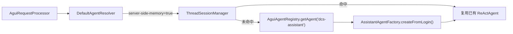

| 类 | 路径 | 核心方法 | 具体做什么 |
|---|---|---|---|
| `DcsAssistantAgentConfiguration` | `legacy/config/DcsAssistantAgentConfiguration.java:31` | `dcsAssistantAgentRegistryCustomizer()` | 向框架注册惰性工厂：`registerFactory("dcs-assistant", agentFactory::createFromLogin)` |
| `AguiAgentRegistry`（框架） | starter jar | `registerFactory` / `getAgent` | 有 factory 就每次 `get()` 新实例；否则回退 singleton |
| `DefaultAgentResolver`（框架） | starter jar | `resolveAgent(agentId, threadId, userId)` | `server-side-memory=true` 时走线程会话缓存，否则直接查注册表 |
| `ThreadSessionManager`（框架） | starter jar | `getOrCreateAgent` / `removeSession` | 以 `(normalizeUser(userId), threadId)` 为键；首次或 agentId 变化才建，否则复用 |
| `AssistantIdentityHolder` | `legacy/core/AssistantIdentityHolder.java:30` | `set` / `consumeEntry` | ThreadLocal 一次一递；校验同线程 + 30 秒时效；取不到按 401 fail-closed |

**重要纠正**：旧文档说"每次新会话新建实例"，更准确的说法是"**每个新的 `(runtimeUserId, threadId)` 第一次出现时新建，之后复用**"。同一会话连续发消息不会重建 agent；只有缓存被 `removeSession`（模型/联网/权限面变化）或进程重启才会重建。

### 5.6 装配：AssistantAgentFactory 的 14 步

文件：`backend/ruoyi-modules/ruoyi-assistant/src/main/java/com/smartdock/assistant/legacy/core/AssistantAgentFactory.java`

入口有两个：

- `createFromLogin()`（L410）：框架 supplier 调它，从 `AssistantIdentityHolder` 取身份，取不到 401。
- `create(LoginUser, threadId)`（L154）：显式传入身份，自动化等场景用。

私有 `create(...)`（L158）的主线：

| 步 | 做什么 | 行号 |
|---:|---|---|
| 1 | `modelFactory.resolveConfigWithUserChoice(tenantId, threadId)`：用户会话选择 → 助手默认槽 → 上次使用 → 接口默认 | L161 |
| 2 | 回写模型选择/范围/联网/自主权的"建时基准"，供 resolver 下次判失效 | L163-178 |
| 3 | `assistantConfigService.effective(tenantId)` 一次读全 memory/toolGate/compaction，避免三次查询半新半旧 | L182-186 |
| 4 | `ToolIdentity.from(user)` 身份快照（角色档、租户、用户） | L197 |
| 5 | 从内到外构造模型装饰器链（见 5.7） | L198-227 |
| 6 | `new Toolkit()`、`PermissionContextState.Builder`、会话工作区 `s/<租户>/<用户>/<thread>` | L228-234 |
| 7 | `autoAllow` 谓词 + `AuditScope` + `AssistantActionLedgerHook`（写操作审计） | L239-244 |
| 8 | `ToolRegistry.registerAll(...)`：注册 8 个平台工具，**同循环**生成 ALLOW/ASK 规则 | L245-260 |
| 9 | `ProviderToolRegistry.registerProviders(...)`：注册 dcs/profile/analytics 三个 SPI 提供方 | L265-266 |
| 10 | `McpPilotService.attachEnabled(...)`：挂启用中的 MCP 工具；单个失败只 warn 不连坐 | L271-277 |
| 11 | 只读模式裁剪：只留 `view_skill` / `load_skill_through_path` / `read_file` + 只读 SPI + 勾选的只读 MCP | L283-302 |
| 12 | `AssistantSkillGateMiddleware`：技能可见性权威过滤 | L308-315 |
| 13 | `ReActAgent.builder()`：sysPrompt、model、stateStore、toolkit、skillWorkDir、permissionContext、6 个中间件、pending 恢复 | L316-380 |
| 14 | 若权限面变化，`replacePermissionContext` 把新规则装回旧会话持久化 state | L389-400 |

**第 13 步里的 sysPrompt 裁剪**：`PromptAssets.filterCheatsheet` + `filterDiscipline` 会按"实际注册成功的工具名"裁掉速查卡里不存在的工具。原因很实在：AgentScope 对未注册工具默认 ASK，模型如果照着提示词幻觉调用一个不存在的工具，会弹出一张死卡。所以提示词和注册面必须同源。

### 5.7 模型装饰器链：六层套娃

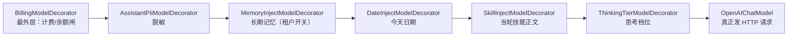

**怎么读这张图**：左边是最外层（离请求边界最近），右边是最内层（离模型最近）。一次模型调用从 `Billing.stream()` 进去，逐层 `delegate.stream()`，到 `OpenAIChatModel` 真正出网；返回时再逐层出来。

| 顺序（由内到外） | 装饰器 | 一句话作用 | 开关/注意 |
|---:|---|---|---|
| 1 | `ThinkingTierModelDecorator` | 把 `fast/balanced/deep` 翻成供应商原生参数 `reasoning_effort` 或 `thinking.type` | `balanced` 不注入，用服务端默认 |
| 2 | `SkillInjectModelDecorator` | 用户选中的技能正文，以 system 消息追加，仅本轮生效 | 每次模型调用现读 Holder；摘掉即无；过 `visibleTo` 闸 |
| 3 | `DateInjectModelDecorator` | 在消息尾部追加"今天是 YYYY-MM-DD 星期X" | 每轮动态区，不碰缓存前缀 |
| 4 | `MemoryInjectModelDecorator` | 按本轮最后一条用户提问检索长期记忆，追加 system 消息 | 仅租户 `memoryEnabled=1` 时装配 |
| 5 | `AssistantPiiModelDecorator` | 出网前对姓名/手机/证件/邮箱脱敏 | 在计费内层，计费按脱敏后文本估算 |
| 6 | `BillingModelDecorator` | 前置余额/积分闸；聚合 usage；`doFinally` 落账；成本累计；Key 池上报 | 最外层；标题/追问侧车共用同一条链 |

**三个容易记反的点**：

1. **PII 在计费内层**：实际发给模型的内容已经脱敏；计费在外层，优先用模型返回的 usage，缺失才按出网字符估算。
2. **技能在记忆内层**：消息尾部追加顺序是 `[原文…, 记忆段, 日期段, 技能段]`——记忆先追加（更靠内），日期其次，技能最后（更靠外）。所以"技能段是末位"。
3. **侧车也计费**：标题生成、追问生成复用同一个 `BillingModelDecorator`，小额消耗同样走钱包/积分。

### 5.8 工具系统：三层来源，一套权限

#### 5.8.1 三层工具

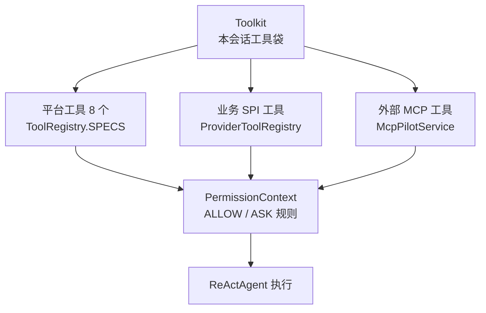

| 层 | 谁提供 | 数量 | 例子 |
|---|---|---:|---|
| 平台内置 | `ToolRegistry.SPECS`（L87-138） | 8 | `web_search`、`read_attachment`、`submit_plan`、`ask_user`、`todo_write`、`save_memory`、`view_skill`、`read_file` |
| 业务 SPI | `BizToolProvider` 实现方 | 3 个提供方 | dcs：查任务/查我的待办/查提交/建任务；profile：查画像/圈人/分群概况/低分复核；analytics：总览/趋势/漏斗/留存/路径/自定义 |
| 外部 MCP | `McpPilotService` 挂载 | 动态 | 管理员配置的 MCP server 工具；受 `mcp:<server>` 闸和角色档限制 |

另外 `load_skill_through_path` 是**框架技能中间件**注册的，不在 `ToolRegistry.SPECS` 里；本仓只给它补一条 ALLOW 规则（`AssistantAgentFactory.java:313-315`）。

#### 5.8.2 权限三档

| 档 | 含义 | 谁来判 |
|---|---|---|
| 角色档 | `member` / `admin`；工具写 `minRole`，网关只升不降 | `ToolIdentity.roleLevel` + `ToolRegistry.effectiveMinRole` |
| 租户闸 | `tool_gate` JSON：`off` / `member` / `admin`；`off` 直接不注册 | `AssistantConfigService.effective().toolGate()` |
| 单工具行为 | `ALLOW` 直接执行 / `ASK` 弹 HITL 确认 | `PermissionRule` + `PermissionContextState` |

**单一真相**：`ToolRegistry.registerAll` 把"注册工具"和"写权限规则"放在同一个循环里（L155-180），避免出现"工具注册了但没规则"或"规则写了但工具没注册"。`effectiveMinRoleSingle`（L222）是工具和技能共用的档位公式：`off=-1`；`member/admin` 与内置门槛取 `max`；非法值忽略。

#### 5.8.3 SPI 契约（业务模块怎么插工具）

`ruoyi-assistant-spi` 只有 5 个文件：

```java
public interface BizToolProvider {
    String namespace();                       // 命名空间，如 "dcs"
    List<BizToolSpec> tools();                // 工具清单
    BizToolResult execute(BizToolCall call);  // 执行
    default void revoke(...) { }              // 可选：撤回
}
```

`BizToolSpec` 描述工具名、显示名、描述、参数、是否只读、最低角色、所需权限串、确认卡标题。写类工具默认 `ASK`（弹确认卡），只读工具默认 `ALLOW`。

`ProviderToolRegistry.eligibleSpecs` 的过滤链（L165 起）：

1. 空名跳过；
2. 与平台内置撞名 → **内置优先**，SPI 让位；
3. provider 之间重复 → 先到先得；
4. `minRole` 不够 → 跳过；
5. 权限串不匹配 → 跳过。

`BizToolAgentAdapter` 把 SPI 工具桥成 AgentScope 的 `ToolBase`：只读工具显式放行；写类工具传空上下文 → 走 ASK；执行前后调 `AssistantActionLedgerHook` 写审计；慢工具每 2 秒发一条 `tool_progress`。

### 5.9 技能系统：三层仓 + 一道闸

#### 5.9.1 三层仓库

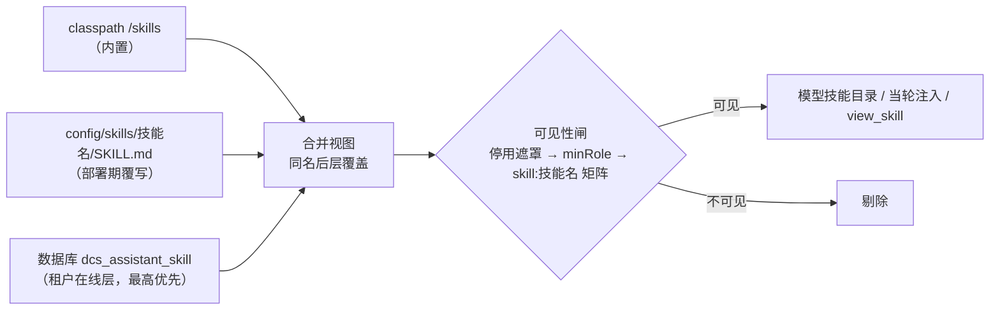

| 层 | 来源 | 优先级 | 生效方式 |
|---|---|---:|---|
| classpath | `resources/skills/<名>/SKILL.md` | 最低 | 随包发布 |
| 部署目录 | `config/skills/<名>/SKILL.md` | 中 | 改文件后重启 |
| 数据库 | `dcs_assistant_skill` | 最高 | 管理台保存后 Redis 广播即时失效 + 30 秒兜底 |

单技能正文上限 **20000 字符**，超了保存直接被拒。内置 10 个技能：`create-mission`、`create-template`、`data-analysis`、`data-reading`、`draft-notice`、`feedback-summary`、`meeting-minutes`、`ppt-outline`、`urge-wording`、`weekly-report`。

#### 5.9.2 可见性公式

`AssistantSkillGateMiddleware.filterVisible`（L55）→ `filterVisibleImpl`（L74）：

```text
可见 = 未被停用遮罩
      且 roleLevel >= max(技能 frontmatter minRole, 工具闸 skill:<name> 档位)
```

- `disabledIds` 命中的技能对**所有角色**整技能遮罩，超管也看不见。
- `skill:<name>` 行的语义与工具行同构：`off` 剔除；`member`/`admin` 只升不降。
- 判定路径**纯内存、不查库**：构造时取快照；官方基类对 `filterVisible` 异常按"全量放行"处理，所以这里异常必须自己兜住，不能把异常抛给基类。

#### 5.9.3 正文进入上下文的三条路

| 路径 | 谁触发 | 类 |
|---|---|---|
| 模型自取 | 模型调 `load_skill_through_path` | 框架 `DynamicSkillMiddleware` |
| 用户当轮选中 | Composer 选技能 → `forwardedProps.skillId` | `SkillInjectModelDecorator` |
| 工具兜底 | 模型调 `view_skill` | `SkillTools` |

三条路都过同一道闸 `visibleTo`（L116）。技能使用统计由 `AssistantSkillUsageMiddleware.onActing` 记：只有 `TOOL_CALL_RESULT` 成功才 +1；手动胶囊由 resolver 记一次，两边去重。

### 5.10 会话、状态与 run 生命周期

#### 5.10.1 两套"状态"

| 状态 | 存在哪 | 谁用 | 说明 |
|---|---|---|---|
| Agent 运行状态（消息历史、工具状态、权限上下文） | PostgreSQL `agentscope` schema | AgentScope 框架 | `agentscope_sessions` / `agentscope_snapshots` / `agentscope_store` |
| 业务会话（会话列表、消息、run、反馈、收藏、记忆） | `dcs_assistant_*` 表 | 本仓 | 前端查询、管理页、审计、计费 |

**`agentscope` schema 怎么隔离**：`AssistantStateStoreConfig` 用 `SearchPathDataSource` 包了一层 DataSource：每次借出连接先 `SET search_path TO agentscope, public`，归还前还原成默认。业务连接池完全不知道这件事。表由 migration 预建，代码侧不建表。

#### 5.10.2 run 生命周期

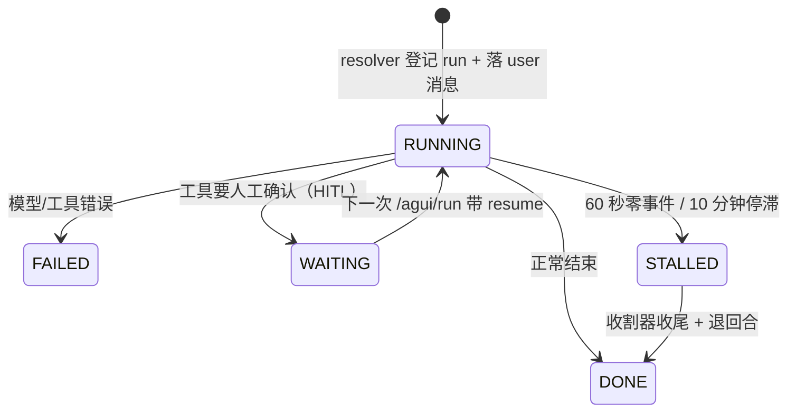

> 状态名以 `DcsAssistantRun` 的枚举为准，上图用白话表示语义。

关键类：

| 类 | 核心方法 | 做什么 |
|---|---|---|
| `AssistantConversationService` | `ensureConversation`（L58） | thread 首绑；异主 403；归档 403 |
| 同上 | `registerRun`（L87） | 同 runId 异主/异租户 403；返回是否新建；重放 409 |
| 同上 | `persistUserRound`（L700） | **一个事务**里完成 ensure + register + 双 RUNNING 检查 + 落 user 消息，防 PG 闪断空壳会话 |
| 同上 | `finishRun`（L209） | 按 runId 条件更新终态 |
| 同上 | `conversationByThread`（L309） | 按 thread 查会话 |
| `AssistantRunRecorder` | `onEvents`（L385） | 文本/工具/思考分段缓冲落 `dcs_assistant_message`；RUN_FINISHED 前同步写终态 |
| 同上 | `finalizeBuildFailure`（L794） | 建会话失败时同步 FAILED + 退回合，避免 60 秒僵尸 RUNNING |

#### 5.10.3 多实例语义

| 机制 | 类 | 作用 |
|---|---|---|
| 粘性路由 | `AssistantStickyHeaderFilter` | 按 `X-Thread-Id` 把同一会话粘到同一实例 |
| run 归属 | `dcs_assistant_run.owner_instance` | stop/HITL 发现卡在另一个活实例 → 409，提示刷新粘回 |
| 进程内缓存 | `ThreadSessionManager` / `AssistantPendingInterruptCache` / `AssistantRunStreamHub` | 单实例内存；进程重启会丢，靠 DB + 恢复 Job 兜底 |
| 恢复 Job | `AssistantRetentionJob` | 收尾挂起 run、恢复陈旧 ASKING、清过期悬挂卡 |

### 5.11 卡片与信号：HITL / 计划 / 反问 / TODO / 附件 / 压缩 / 心跳

这一节是"前端为什么能看到那些卡片"的答案。

| 能力 | 触发 | 核心类 | 前端收到的帧/事件 |
|---|---|---|---|
| HITL 确认 | 工具权限为 `ASK` | 框架 interrupt + `AssistantPendingInterruptCache` | `RUN_FINISHED` 带 `interrupt`，不是 CUSTOM |
| 计划卡 | 模型调 `submit_plan` | `PlanTools` → `AssistantPlanSignal` | `plan` CUSTOM 帧 |
| 计划拦截 | 计划待确认 | `AssistantPlanGateMiddleware` | `tool_denied` CUSTOM 帧 |
| 结构化反问 | 模型调 `ask_user` | `AskUserTools` → `AssistantAskUserBridge` | `ask_user` CUSTOM 帧 |
| TODO | 模型调 `todo_write` | `TodoTools` → `AssistantTodoSignal` | `todo` CUSTOM 帧 |
| 附件 | 前端上传后注册 | `AssistantAttachmentService` | 工具结果，不单独出帧 |
| 压缩 | 上下文超触发线 | `DcsCompactionMiddleware` | 不单独出帧；写 system 分隔条 + `dcs_assistant_compaction` |
| 心跳 | 每 20 秒 | `DcsHeartbeatMiddleware` | `dcs-heartbeat` CUSTOM 帧 |
| 费用 | 回合结束 | `AssistantCostLedger` | `cost_meta` CUSTOM 帧 |
| 记忆 | 回合结束 | `AssistantMemoryTurnLedger` | `memory_turn` CUSTOM 帧 |
| 自动完成 | 回合结束 | `AssistantEventEnricher` | `auto_done` CUSTOM 帧 |
| 续看截断 | attach 溢出 | `AssistantRunStreamHub` | `dcs-resume-truncated` CUSTOM 帧 |

#### 5.11.1 HITL 的真实流程

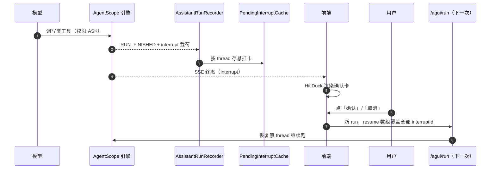

要点：

- `AssistantHitlController` **只有 `GET /pending`**，负责换设备/刷新后从缓存重建卡；它**不负责**放行/中止。放行/中止走下一次 `/agui/run` 的 `resume` 字段（框架 HITL 通道）。
- resume 必须**覆盖全部** `interruptId`，否则框架 `must-cover` 会拒绝；前端把没展示的卡也标成 `cancelled`。
- 如果前端没带 resume、但 thread 上有悬挂卡，`AssistantResumeUnlockFilter` 会注入 `resume=cancelled` 作废旧卡。

#### 5.11.2 计划卡：为什么"没确认就不能写"

`AssistantPlanGateMiddleware` 做两件事：

1. `onReasoning`：计划待确认时，从工具清单里**摘掉所有写类工具**（模型根本看不到 schema）；
2. `onActing`：如果同一批里出现 `submit_plan` + 其他写调用，拒绝写调用并投 `tool_denied`。

用户点"直接执行/改计划/取消"，前端把 `planDecision` + `planId` 塞进下一次请求的 `forwardedProps`，resolver 调 `planSignal.decide` 清闸。TTL 30 分钟兜底。

#### 5.11.3 压缩：触发线怎么算

`AssistantCompactionPolicy.deriveTriggerTokens`（L61）：

```text
触发线 = max(4000, 上下文窗口 − min(最大输出, 21000) − 13000)
```

例子：128K 窗口 / 最大输出 ≥ 21K → `128000 − 21000 − 13000 = 94000`；200K → 166000。

先走**微压缩**：触发线的 9 成与「触发线 − 2000」取小；清掉旧工具结果占位（保留最近 5 组；`read_attachment`/`save_memory`/`view_skill`/`read_file` 豁免）。清完还不够才走全量摘要，尾窗保留最后 1 轮原文（`keepMessages=2`）。

**熔断**：连续失败 3 次，或 3 步内快速回填连 3 次 → 本 agent 实例不再自动压缩。代价是该会话后续长对话可能撞供应商窗口报错；这是"防止反复烧钱"的取舍。旧文档写的"默认 60000 token、保留 1/10（下限 2000）"是更早的口径，已过时。

### 5.12 AGUI 事件协议：28 类标准 + 11 种自定义帧

#### 5.12.1 标准事件（AgentScope 2.1.0-ckys3，共 28 类）

| 分组 | 事件 |
|---|---|
| Run（3） | `RUN_STARTED`、`RUN_FINISHED`、`RUN_ERROR` |
| Text（4） | `TEXT_MESSAGE_START`、`TEXT_MESSAGE_CONTENT`、`TEXT_MESSAGE_END`、`TEXT_MESSAGE_CHUNK` |
| Tool（5） | `TOOL_CALL_START`、`TOOL_CALL_ARGS`、`TOOL_CALL_END`、`TOOL_CALL_RESULT`、`TOOL_CALL_CHUNK` |
| State / Activity（5） | `STATE_SNAPSHOT`、`STATE_DELTA`、`MESSAGES_SNAPSHOT`、`ACTIVITY_SNAPSHOT`、`ACTIVITY_DELTA` |
| Reasoning（7） | `REASONING_START`、`REASONING_MESSAGE_START`、`REASONING_MESSAGE_CONTENT`、`REASONING_MESSAGE_END`、`REASONING_MESSAGE_CHUNK`、`REASONING_END`、`REASONING_ENCRYPTED_VALUE` |
| Step（2） | `STEP_STARTED`、`STEP_FINISHED` |
| Raw / Custom（2） | `RAW`、`CUSTOM` |

#### 5.12.2 本仓追加的 CUSTOM 帧

| 帧名 | 产出点 | 用途 |
|---|---|---|
| `plan` | `AssistantEventEnricher.enrich` L120-135 | 计划卡 |
| `tool_denied` | 同上 L139-147 | 被计划闸拒绝的工具 |
| `ask_user` | 同上 L151-159；`AssistantAskUserBridge.publishNow` | 结构化反问卡 |
| `model_degrade` | 同上 L163-169 | 模型回退默认链的提示 |
| `todo` | 同上 L173-186 | 会话 TODO 清单 |
| `elicitation` | 同上 L191-200 | MCP elicitation 表单 |
| `cost_meta` | 同上 L210-220 | 本回合金额/token |
| `memory_turn` | 同上 L226-247 | 记忆注入/更新统计 |
| `auto_done` | 同上 L256-277 | 自动完成的可撤回动作 |
| `dcs-heartbeat` | `DcsHeartbeatMiddleware` L49 | 20 秒心跳，喂前端 600 秒看门狗 |
| `dcs-resume-truncated` | `AssistantRunStreamHub` L52 | 续看保留窗溢出提示 |

### 5.13 Agent 侧计费链

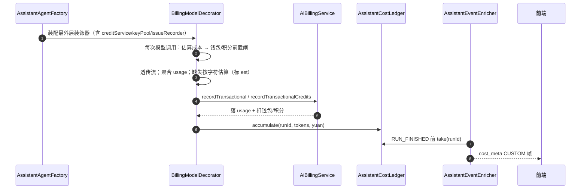

细节见 4.5。Agent 侧只多两件事：

1. **前置闸**：钱包模式要求余额 ≥ `max(0.01, 门槛, 本回合估算)`；积分模式要求积分够。
2. **成本角标**：`AssistantCostLedger` 按 runId 累加，`cost_meta` 只用于展示，前端不自己算价。

### 5.14 自动化：不走 AGUI 的旁路

`AssistantAutomationController` 管的是"定时/触发式自动任务"，执行入口是 `AutomationRunner`：

```text
AutomationRunner.run
  → agentFactory.createReadOnly(user, threadId, 勾选的只读 MCP)
  → agent.call(prompt, ctx).block(RUN_TIMEOUT)
```

它**不经过** `/agui/run`、没有 SSE、没有前端交互。只读装配会裁掉 `ask_user` / `submit_plan` / `todo_write` / `save_memory` 等交互/写工具，只留 `view_skill` / `load_skill_through_path` / `read_file` + 只读 SPI + 显式勾选的只读 MCP。因为无人值守，不能弹确认卡。

### 5.15 排查手册：为什么"我的智能体没有某能力"

按这个顺序查，基本能定位：

1. **角色**：有没有 `dcs:assistant:use`？没有 → 连对话入口都进不去。
2. **租户开通**：`dcs_assistant_config` 里该租户是否开通？没开 → 403「未开通」。
3. **用户状态**：`dcs_assistant_user_quota` 是否 `disabled=1`？日回合/预算是否超了？
4. **模型配置**：`dcs_ai_config` 是否有可用 CHAT 行、租户归属、CNY、启用？用户自选是否在允许范围？
5. **供应商 Key**：`dcs_ai_provider_access` / 环境变量是否可用？Key 池是否冷却？
6. **工具闸**：`tool_gate` JSON 里该工具是否 `off` / `admin`？
7. **技能**：frontmatter `minRole`、`skill:<name>` 矩阵、`disabled` 遮罩，三者取最严。
8. **联网**：`web_search` 需要会话开关 + 租户搜索 Key + 日配额，三者缺一不可。
9. **MCP**：server 是否启用、`mcp:<server>` 闸是否放行、挂载是否失败（失败只 warn，不阻断会话）。
10. **缓存**：改了模型/工具闸/技能后，下一请求生效；技能正文和思考档是逐请求读取，不用等缓存。

管理台有一个专门诊断接口：`GET /dcs/assistant/capability/panorama`（`AssistantCapabilityPanoramaController`），输出当前租户可用的模型/工具/开关面。

### 5.16 核心类 / 核心方法总表（最常查的三张表）

> 这是全文最"工具书"的部分。按"入口与装配 → 模型与工具 → 会话与卡片"三组排列。行号基于 `0a5a11a`。

#### 表 A：入口、装配、事件出网

| 类 | 文件:行 | 一句话职责 | 核心方法 | 具体做什么 | 去掉会怎样 |
|---|---|---|---|---|---|
| `AguiRestController`（框架） | starter jar | AGUI HTTP 入口 | `runWithAgentId` | 解析 body，委托 MVC controller；`POST /agui/run/{agentId}` | 没有对话端点 |
| `AguiMvcController`（框架） | starter jar | SSE 传输 | `handleInternal` | 建 `SseEmitter`，worker 线程跑 processor，逐帧写 SSE | 没有流式输出 |
| `AguiRequestProcessor`（框架） | starter jar | 协议编排 | `process` / `resolveAgentId` | 解析 context → 选 agentId → 选 agent → 建 adapter → run | 协议无法启动 |
| `AssistantRuntimeContextResolver` | `legacy/core/AssistantRuntimeContextResolver.java:68` | 身份/准入/落库门卫 | `resolve` | 10 道闸 + 身份桥 + Holder + 缓存失效 | 无鉴权、无限额、不落库，裸跑烧钱 |
| `AssistantIdentityHolder` | `legacy/core/AssistantIdentityHolder.java:30` | 同线程身份桥 | `set` / `consumeEntry` | ThreadLocal 一次一递；同线程 + 30s 时效；取不到 401 | 工厂拿不到身份，建会话失败 |
| `DcsAssistantAgentConfiguration` | `legacy/config/DcsAssistantAgentConfiguration.java:31` | 注册 agent 工厂 | `dcsAssistantAgentRegistryCustomizer` | `registerFactory("dcs-assistant", ...)` | `/agui/run/dcs-assistant` 找不到 agent |
| `AguiAgentRegistry`（框架） | starter jar | agent 注册表 | `registerFactory` / `getAgent` | factory 优先，每次新实例；否则 singleton | 无 agent 可选 |
| `ThreadSessionManager`（框架） | starter jar | 会话级 agent 缓存 | `getOrCreateAgent` / `removeSession` | `(user, thread)` 首次创建、之后复用 | 每轮重建，状态/成本都失控 |
| `AssistantAgentFactory` | `legacy/core/AssistantAgentFactory.java:158` | Agent 总装配 | `create` / `createFromLogin` | 模型配置 → 装饰器 → 工具 → 中间件 → ReActAgent | 没有 agent |
| `AssistantEventEnricher` | `legacy/core/AssistantEventEnricher.java:68` | 事件翻译/增强 | `enrich` | 落库、CUSTOM 帧、思考过滤、喂回放汇 | 前端看不到计划/费用/卡片，历史不落库 |
| `AssistantRunRecorder` | `legacy/persist/AssistantRunRecorder.java:385` | run/消息持久化 | `onEvents` / `finishRun` / `finalizeBuildFailure` | 文本/工具/思考分段落库；终态同步写；建失败收尾 | 没有消息历史、没有终态、退不了回合 |
| `AssistantRunStreamHub` | `legacy/core/AssistantRunStreamHub.java:94` | run 回放汇 | `accept` / `bridge` / `attach` | 4096 帧环形窗；attach 先重放再续播；断连只掉观众 | 刷新/换设备不能续看 |

#### 表 B：模型、工具、技能、中间件

| 类 | 文件:行 | 一句话职责 | 核心方法 | 具体做什么 | 去掉会怎样 |
|---|---|---|---|---|---|
| `AssistantModelFactory` | `infrastructure/AssistantModelFactory.java:118` | 选模型 + 建模型 | `resolveConfig` / `resolveConfigWithUserChoice` / `buildModel` | 用户选择 → 助手默认 → 上次使用 → 接口默认；建 `OpenAIChatModel` | 没有模型可调 |
| `ThinkingTierModelDecorator` | `legacy/core/ThinkingTierModelDecorator.java:26` | 思考档翻译 | `stream` | `fast/balanced/deep` → `reasoning_effort` / `thinking.type` | 档位不生效 |
| `SkillInjectModelDecorator` | `legacy/core/SkillInjectModelDecorator.java:24` | 当轮技能注入 | `stream` | 选中技能正文尾部追加；过可见性闸 | 手动选技能无效 |
| `DateInjectModelDecorator` | `legacy/core/DateInjectModelDecorator.java:32` | 日期锚点 | `stream` | 追加"今天是…" | 模型不知道今天 |
| `MemoryInjectModelDecorator` | `legacy/core/MemoryInjectModelDecorator.java:38` | 长期记忆注入 | `stream` | 按最后一条提问检索记忆，追加 system 消息 | 记忆不生效 |
| `AssistantPiiModelDecorator` | `legacy/security/AssistantPiiModelDecorator.java:23` | 出网脱敏 | `stream` | 姓名/手机/证件/邮箱逐块脱敏 | 原始 PII 出网 |
| `BillingModelDecorator` | `infrastructure/BillingModelDecorator.java:216` | 计费 | `doStream` / `record` | 前置余额闸；聚合 usage；落账；成本累计 | 不扣费、不记 usage |
| `ToolRegistry` | `legacy/core/ToolRegistry.java:155` | 平台工具唯一登记处 | `registerAll` / `effectiveMinRoleSingle` | 8 个工具按角色/闸注册，同循环写权限规则 | 平台工具全消失 |
| `ProviderToolRegistry` | `legacy/core/ProviderToolRegistry.java:112` | SPI 工具注册 | `registerProviders` / `eligibleSpecs` | 收集 provider，过滤后桥接注册，写 ALLOW/ASK | 业务工具全不可用 |
| `BizToolAgentAdapter` | `legacy/core/BizToolAgentAdapter.java:32` | SPI → 引擎工具 | `doExecute` / `checkPermissions` | 只读放行、写类 ASK、审计、进度 | SPI 工具无法执行 |
| `AssistantSkillGateMiddleware` | `legacy/core/AssistantSkillGateMiddleware.java:55` | 技能可见性权威 | `filterVisible` / `visibleTo` | 停用遮罩 + minRole + 矩阵 | 技能对所有人可见 |
| `AssistantSkillUsageMiddleware` | `legacy/core/AssistantSkillUsageMiddleware.java:58` | 技能使用统计 | `onActing` | 成功取用才 +1；手动胶囊去重 | 使用次数恒 0 |
| `AssistantPlanGateMiddleware` | `legacy/core/AssistantPlanGateMiddleware.java:78` | 计划待确认写闸 | `onReasoning` / `onActing` | 摘写工具；拒同批写调用 | 没确认就能写 |
| `DcsHeartbeatMiddleware` | `legacy/core/DcsHeartbeatMiddleware.java:49` | 流层心跳 | `withHeartbeat` | 每 20 秒发 `dcs-heartbeat` | 静默期前端误判断线 |
| `DcsCompactionMiddleware` | `legacy/core/DcsCompactionMiddleware.java:82` | 自动压缩 | `onReasoning` / `microcompact` | 微压缩 → 全量摘要 → 写分隔条/审计；失败熔断 | 上下文超窗 |

#### 表 C：会话、HITL、技能仓、计费、自动化

| 类 | 文件:行 | 一句话职责 | 核心方法 | 具体做什么 | 去掉会怎样 |
|---|---|---|---|---|---|
| `AssistantConversationService` | `legacy/service/AssistantConversationService.java:58` | 会话/消息/run 落库 | `ensureConversation` / `registerRun` / `persistUserRound` / `finishRun` | 首绑、登记、单事务落 user 轮、终态 | 没有会话历史 |
| `ConversationResumeService` | `service/ConversationResumeService.java:39` | 续看判定 | `prepare` | 查最新 RUNNING run；能续就 attach，不能就轮询 | attach 端点失效 |
| `AssistantHitlController` | `legacy/controller/AssistantHitlController.java:48` | 悬挂卡查询 | `pending` | 归属校验 + 缓存重建；跨实例 409 | 刷新后确认卡消失 |
| `AssistantPendingInterruptCache` | `legacy/persist/AssistantPendingInterruptCache.java:59` | 悬挂卡缓存 | `store` / `peek` / `clear` | 按 thread 存 interrupt 卡 | 换设备无法恢复 |
| `AssistantAskUserController` | `legacy/controller/AssistantAskUserController.java:49` | 反问作答 | `answer` / `snooze` | 独立端点作答，run 保持 RUNNING | 反问卡无法提交 |
| `AssistantStateStoreConfig` | `legacy/config/AssistantStateStoreConfig.java:39` | Agent 状态存储 | `dcsAssistantStateStore` | 包装 DataSource，`search_path=agentscope,public` | 跨请求状态丢失 |
| `AssistantSkillSource` | `legacy/core/AssistantSkillSource.java:88` | 技能三层仓 | `repositories` / `all` | classpath → config → DB 合并 | 技能只剩内置 |
| `DatabaseSkillRepository` | `legacy/core/DatabaseSkillRepository.java:55` | 技能在线层 | `getAllSkills` / `disabledIds` | 读租户技能行；30s TTL；坏行跳过 | 管理台改技能不生效 |
| `AiBillingService` | `../ruoyi-ai-billing/.../AiBillingService.java:156` | 计费落账 | `recordTransactional` / `recordTransactionalCredits` | 幂等 → 算价 → 扣钱包/积分 → 插 usage | 不落账 |
| `AutomationRunner` | `legacy/automation/service/AutomationRunner.java:210` | 无人值守执行 | `run` | 只读装配 + `agent.call().block()`，不走 AGUI | 自动化不执行 |

---

## 6. 数据面：表归谁、租户怎么隔离

### 6.1 表的归属（按域）

| 域 | 主要表 | 备注 |
|---|---|---|
| 画像 profile | `profile_event`、`profile_event_archive`、`profile_subject`、`profile_identity_link/merge`、`profile_score_dimension/rule`、`profile_score_snapshot`、`profile_score_model`、`profile_model_run/snapshot`、`profile_segment*`、`profile_review_queue`、`profile_reach_*`、`profile_engine_config`、`profile_source_config`、`profile_protocol`、`profile_schema_registry`、`profile_pii_field` | `profile_pii_field` 是全局字段字典，无 `tenant_id` |
| 分析 analytics | `analytics_session`、`analytics_daily`、`analytics_funnel`、`analytics_custom_report`、`analytics_replay_task`、`analytics_rebuild_log`、`analytics_visitor_first_seen` | 事件源直接查 `profile_event`，不另建事件表 |
| 采集 demo dcs | `dcs_task`、`dcs_task_field`、`dcs_submission`、`dcs_audit`、`dcs_notice`、`dcs_feedback`、`dcs_changelog` | `dcs_changelog` 是全局表 |
| 风控 risk | `dcs_risk_event`、`dcs_risk_rule`、`dcs_risk_whitelist`、`dcs_risk_action`、`dcs_profile_review`、`dcs_captcha_log`、`dcs_sensitive_word`、`dcs_word_fp_feedback` | 全部带 `tenant_id` |
| 计费 ai-billing | `dcs_ai_config`、`dcs_ai_model_price`、`dcs_ai_usage`、`dcs_ai_provider_access`、`dcs_ai_model_health`、`dcs_tenant_wallet`、`dcs_tenant_wallet_ledger`、`dcs_tenant_billing_mode`、`dcs_ai_credit_*`、`dcs_service_charge_rule`、`dcs_wallet_payment_order`、`dcs_wallet_alert_state`、`dcs_ai_doc_domain` | `dcs_ai_credit_plan` 是全局套餐表 |
| 文件安全 file-security | `dcs_file_review`、`dcs_file_review_config`、`dcs_file_guard_log` | 全部带 `tenant_id` |
| 系统 system | `sys_user`、`sys_role`、`sys_dept`、`sys_post`、`sys_config`、`sys_dict_*`、`sys_notice`、`sys_oss`、`sys_social`、`sys_logininfor`、`sys_oper_log` | `sys_menu`、`sys_tenant`、`sys_tenant_package`、`sys_client`、`sys_oss_config`、关联表是全局表 |
| 助手 assistant | `dcs_assistant_conversation`、`dcs_assistant_message`、`dcs_assistant_run`、`dcs_assistant_run_issue`、`dcs_assistant_favorite`、`dcs_assistant_feedback`、`dcs_assistant_memory`、`dcs_assistant_memory_pref`、`dcs_assistant_skill`、`dcs_assistant_skill_usage`、`dcs_assistant_user_pref`、`dcs_assistant_user_quota`、`dcs_assistant_attachment`、`dcs_assistant_action`、`dcs_assistant_compaction`、`dcs_assistant_config`、`dcs_assistant_model_setting`、`dcs_assistant_announcement`、`dcs_mcp_server`、`dcs_mcp_call_log` | 另有 `agentscope.*` 三张状态表 |
| Agent 状态 | `agentscope.agentscope_sessions`、`agentscope.agentscope_snapshots`、`agentscope.agentscope_store` | 独立 schema，AgentScope 框架读写 |

> 规模口径：`backend/script/sql/baseline/01_schema.sql` 里有 113 条 `CREATE TABLE`；2026-11-20 对演示库的盘点为 115 张表（含迁移新增），其中 57 张 `dcs_` 前缀。DDL 以 baseline 为准，增量走 `migration/*.sql`。

### 6.2 租户隔离的三条规则

1. **业务表带 `tenant_id`**：MyBatis-Plus 的 `TenantLineInnerInterceptor` 自动注入条件。
2. **全局表在 `tenant.excludes` 里显式排除**：`sys_menu`、`sys_tenant`、`sys_tenant_package`、`sys_client`、`sys_oss_config`、`sys_role_menu`、`sys_user_role`、`dcs_changelog` 等。新加全局表必须同步这个列表，否则会被插件当成业务表加条件，报"列不存在"。
3. **手写 SQL 被插件注入报错时**：加 `@InterceptorIgnore(tenantLine = "true")`，并在 SQL 里自己写租户条件。不要为了绕过报错把表加进 excludes。

### 6.3 PostgreSQL 方言红线

| 禁止 | 改用 |
|---|---|
| 反引号 `` ` `` | 双引号或无引号 |
| `LIMIT offset, n` | `LIMIT n OFFSET offset` |
| `GROUP_CONCAT` | `string_agg` |
| 自增主键 | 雪花 ID（`ASSIGN_ID`） |
| UUID 主键 | 雪花 ID（除非外部契约要求） |

### 6.4 JSONB 的使用场景

| 表/字段 | 存什么 | 为什么用 JSONB |
|---|---|---|
| `profile_event.props` | 事件属性 | 不同事件字段不同，Schema 轻校验 |
| `dcs_task.assignee_user_ids` / `auditor_user_ids` | 用户 ID 数组 | 一次任务多人，避免关联表 |
| `dcs_submission.data` | 动态字段值 | 字段定义在 `dcs_task_field`，值随定义变 |
| `dcs_assistant_config.tool_gate` | 工具开关矩阵 | 工具名动态增长，不想每次加列 |
| `profile_score_model` 配置 | 分箱/权重 | 整份模型是一棵 JSON 树 |

### 6.5 DDL 纪律

- 新增表/字段/索引/触发器/视图：**baseline 对应文件 + 新建 migration 一份**，两份都要能重复执行（`IF NOT EXISTS` / `ON CONFLICT`）。
- baseline 是"新环境一次建好"的权威结构；migration 是"老环境增量升级"。
- 只改代码不改 DDL = 新环境部署直接失败，这是本仓的硬门禁。

---

## 7. 横切能力：每个请求都会碰到的东西

### 7.1 登录与权限

| 项 | 规则 |
|---|---|
| 登录态 | Sa-Token，JWT simple 模式 |
| Token 传递 | `Authorization: Bearer <token>` |
| 登录 ID 格式 | `userType:userId`（如 `"00:1"`），用 `LoginHelper.getUserId()` 解析 |
| 权限串 | **三段式** `域:资源:动作`；两段式匹配不上超管 `*:*:*` |
| 权限来源 | 角色权限 + 菜单权限，`SysPermissionServiceImpl` 聚合 |
| 前端指令 | `v-hasPermi="['a:b:c']"`；无权限直接移除 DOM |

### 7.2 租户

- `TenantHelper.getTenantId()`：当前租户（超管切租户时是动态租户）。
- `TenantHelper.dynamic(...)`：临时切租户，**会删掉超管切换态**；先存后还。
- 助手 resolver 在流线程里拿不到 Sa-Token 上下文，所以动态租户要从 Redis 键按 `userId` 直读（`resolveTenantId` L352）。

### 7.3 加密密钥（启动即拒绝）

| 环境变量 | 保护什么 | 规则 |
|---|---|---|
| `SMARTDOCK_AI_CONFIG_KEY` | `dcs_ai_config.api_key`、`dcs_ai_provider_access.api_key` | 16/24/32 位可见 ASCII；未配/长度错/仍旧钥匙 → **服务拒绝启动** |
| `SMARTDOCK_MCP_HEADERS_KEY` | `dcs_mcp_server.headers` | 必须与上一把不同 |

`EncryptKeyStartupRunner` 启动校验；`EncryptKeyMigrationRunner` 自动换锁（旧钥匙只解密、绝不加密）。字段上的 `@EncryptField` 只写占位符 `${smartdock.encrypt.*}`，禁止字面量。

### 7.4 幂等与防重

| 场景 | 机制 |
|---|---|
| 事件账本 | `(tenant_id, source, event_uid)` 唯一 + `insertIgnore` |
| 站内通知 | `dedup_key` + 部分唯一索引 |
| 表单重复提交 | `@RepeatSubmit` + Redis 切面 |
| 计费 | `dcs_ai_usage` 幂等键 + 钱包/积分流水幂等键（注意 4.5 的边界） |
| 分群/评分并发 | Redisson 锁 + `advisoryXactLock` |

### 7.5 限流、日志、时区

| 能力 | 规则 |
|---|---|
| 限流 | `@RateLimiter` + Redis 切面；助手另有准入闸（租户/全站活跃双限） |
| 操作日志 | `@Log` + `LogAspect` → `OperLogEvent` → 异步落 `sys_oper_log` |
| 登录日志 | `SaTokenListener` → `LogininforEvent` → 异步落 `sys_logininfor` |
| 时区 | 后端固定 GMT+8（`-Duser.timezone=GMT+8`）；种子/测试数据按 UTC+8 墙上时间 |
| 异常 | `GlobalExceptionHandler` 统一转 `R<T>`；业务异常用 `ServiceException` 带 code |

---

## 8. 测试与门禁：哪些规则是"写死"的

### 8.1 三个 ArchUnit 门禁

| 测试 | 路径 | 抓什么 |
|---|---|---|
| `LayeringTest` | `ruoyi-admin/src/test/java/org/dromara/test/arch/LayeringTest.java` | Controller 不直接依赖 Mapper、不借用其他模块 Service |
| `PackageHygieneTest` | 同上目录 | 新代码包名/分层是否合规；legacy 文件数只减不增 |
| `PackageMigrationGuardTest` | 同上目录 | 搬迁进度守卫；基线只减不增 |

基线文件：`ruoyi-admin/src/test/resources/arch-baseline.json`。**残留行会被测试抓出来**，所以修掉一处要删一行，不能只加不减。

### 8.2 单测分布

| 模块 | 测试文件数 | 代表性测试 |
|---|---:|---|
| `ruoyi-admin` | 100 | `LayeringTest`、`PackageHygieneTest`、`P06AguiSseTest`、`D1BillingTest` |
| `ruoyi-profile-engine` | 48 | `AnalyticsSessionizerTest`、`ProfileRuleWeightsTest`、`ProfilePiiMaskerTest` |
| `ruoyi-assistant` | 40 | `AssistantTenantScopeTest`、`AssistantMcpEndpointContractTest`、`BillingModelDecoratorQuotaMapTest` |
| `ruoyi-ai-billing` | 19 | `AiBillingCalculatorUnitTest`、`ProviderKeyPoolUnitTest` |
| `ruoyi-risk` | 19 | `RiskScoreServiceUnitTest`、`CaptchaServiceUnitTest` |
| `ruoyi-file-security` | 12 | `FileGuardDecisionUnitTest`、`PdfJsScannerUnitTest` |
| `ruoyi-dcs` | 4 | `DcsStateMachineTest`、`DcsFieldValidatorTest` |
| `ruoyi-system` / `ruoyi-job` / `ruoyi-assistant-spi` | 0 | 无 `src/test` |

### 8.3 跑测试的两个坑

1. **根 pom 默认 `skipTests=true`**。不显式 `-DskipTests=false` 就是假绿灯。
2. **Surefire 用 `groups` 过滤**（`local` / `dev`）。跑门禁必须带 `-Dgroups=local`（或 `local,dev`），否则 `@Tag("local")` 的用例根本不执行。具体命令以 `backend/AGENTS.md` 和验收提示词为准。

---

## 9. 已知边界与未确认项（按证据等级分档）

> 这一节遵循本仓的取证规则：**源码追踪确认** = 只读代码能确定路径存在；**测试确认** = 有失败/通过的测试；**未验证** = 缺运行条件。不要把"源码里存在"说成"线上发生过"。

### 9.1 源码追踪确认（建议排期）

| # | 问题 | 证据 | 影响 | 建议 |
|---:|---|---|---|---|
| 1 | `SearchPathDataSource.withSearchPath` 在 `SET search_path` 失败时泄漏池连接 | `AssistantStateStoreConfig.java:59-62`：`try` 只包了 `stmt`，`conn` 既没 close 也没归还 | PG 抖动时每次状态读写漏一条连接，Hikari 池可能被抽干 | 外层 try/catch，SET 失败先 `conn.close()` 再抛 |
| 2 | 计费幂等键的保障范围比旧文档窄 | `BillingModelDecorator.java:38-41/373`：键含 `instanceId`；跨订阅/agent 重建重放会生成新键 | 重放场景可能双记费用 | 文档口径改成"同订阅内防重"；跨订阅防重要另加业务键 |
| 3 | 压缩熔断是 agent 实例级且不可恢复 | `DcsCompactionMiddleware.java:139-157`（连败计数）+ `350-353`（`blocked=true`） | 熔断后该会话长对话可能撞供应商窗口报错，无自愈 | 换会话/触发重建；或加"人工重置"入口 |
| 4 | Enricher 热路径内联同步查库 | `AssistantEventEnricher.java:88-107/256-279`；`AssistantRunRecorder.java:385/730` | PG 慢时 SSE 尾帧延迟放大 | 把 run 反查做短缓存；终态写保持同步（正确性优先） |

### 9.2 未验证（需要运行时/环境）

| # | 问题 | 为什么未验证 | 怎么验 |
|---:|---|---|---|
| 5 | 超管切租户时，resolver 的动态租户键与工厂的快照租户键可能分叉 | 需要实际超管切租户 + 翻档位 + 看日志 | 观察 `[AgentRebuild] 权限规则装回旧会话 state 失败` 是否出现 |
| 6 | `ProfileRiskReviewService.ensurePending` 是否有生产调用点 | 全仓只找到单测调用 | 全局搜索调用点；若确实没有，确认是否预留接口 |
| 7 | `AiGateway` 是否有业务消费方 | 只找到 billing 内部与单测引用 | 搜前端/后端调用；确认是否二期启用 |
| 8 | `DcsCaptchaController` 是否可匿名访问 | 类上无权限注解，依赖全局登录拦截 | 用未登录请求实测 + 看 `security.excludes` |
| 9 | `JdbcAgentStateStore` 的 `session_id` 拼接格式 | 框架实现不在本仓 | 反编译/查 AgentScope 源码；或在 PG 里看实际行 |
| 10 | POM 级无循环依赖，但字节码级是否有隐藏运行期环 | 未做全仓字节码分析 | 用 `jdeps`/ArchUnit 做一次全量依赖分析 |

### 9.3 明确没查的高风险区

- **前端构建产物与 CDN 部署**：本文只查后端。
- **SnailJob 服务端的调度元数据**：由独立服务维护，本仓无 DDL。
- **模型供应商的真实计费口径**：只查本仓落账逻辑，不验证供应商账单。
- **多实例网络分区/脑裂**：只查粘性路由和 `owner_instance` 代码路径，未做故障注入。

---

## 附录 A：Controller 全量清单（按域）

> 口径：`ruoyi-modules` 下 89 个 Controller；方法数为该 Controller 内 `@*Mapping` 的粗略计数。

### A.1 画像 profile（15 个，`com.smartdock.profile.query`）

| Controller | 基础路径 | 方法数 |
|---|---|---:|
| `ProfileQueryController` | `/profile` | 8 |
| `ProfileAdminController` | `/profile` | 4 |
| `ProfileDeletionController` | `/profile/deletion` | 3 |
| `ProfileExportController` | `/profile/export` | 1 |
| `ProfileSourceConfigController` | `/profile/source-config` | 1 |
| `ProfileIdentityController` | `/profile/identity` | 2 |
| `ProfileProtocolController` | `/profile/protocol` | 5 |
| `ProfileSchemaController` | `/profile/schema` | 3 |
| `ProfileScoreModelController` | `/profile/model` | 17 |
| `ProfileRuleController` | `/profile/rule` | 12 |
| `ProfileDimensionController` | `/profile/dimension` | 8 |
| `ProfileScenarioController` | `/profile/scenario` | 5 |
| `ProfileSegmentController` | `/profile/segment` | 16 |
| `ProfileReviewController` | `/profile/review` | 7 |
| `ProfilePiiFieldController` | `/profile/pii` | 3 |

### A.2 分析 analytics（3 个）

| Controller | 基础路径 | 方法数 |
|---|---|---:|
| `AnalyticsController` | `/analytics` | 25 |
| `AnalyticsHealthController` | `/analytics/health` | 1 |
| `AnalyticsReplayController` | `/analytics/replay` | 5 |

### A.3 采集 demo dcs（7 个）

| Controller | 基础路径 | 方法数 |
|---|---|---:|
| `DcsTaskController` | `/dcs/task` | 8 |
| `DcsSubmissionController` | `/dcs/submission` | 2 |
| `DcsAuditController` | `/dcs/audit` | 3 |
| `DcsFeedbackController` | `/dcs/feedback` | 7 |
| `DcsNoticeController` | `/dcs/notice` | 2 |
| `DcsChangelogController` | `/dcs/changelog` | 5 |
| `DcsStatsController` | `/dcs/stats` | 1 |

### A.4 风控 risk（8 个）

| Controller | 基础路径 | 方法数 |
|---|---|---:|
| `DcsRiskDashboardController` | `/dcs/risk` | 3 |
| `DcsRiskEventController` | `/dcs/risk` | 2 |
| `DcsRiskActionController` | `/dcs/risk` | 11 |
| `DcsRiskRuleController` | `/dcs/risk` | 5 |
| `DcsRiskWhitelistController` | `/dcs/risk` | 4 |
| `DcsRiskContentConfigController` | `/dcs/risk/content-config` | 2 |
| `DcsSensitiveWordController` | `/dcs/sensitive-word` | 8 |
| `DcsCaptchaController` | `/dcs/captcha` | 4 |

### A.5 计费 ai-billing（11 个）

| Controller | 基础路径 | 方法数 |
|---|---|---:|
| `DcsAiConfigController` | `/dcs/ai-config` | 29 |
| `DcsAiModelPriceController` | `/dcs/ai-model-price` | 7 |
| `DcsAiPriceController` | `/dcs/ai-price` | 2 |
| `DcsAiUsageController` | `/dcs/ai-usage` | 5 |
| `DcsAiCreditController` | `/dcs/ai-credit` | 12 |
| `DcsTenantWalletController` | `/dcs/tenant-wallet` | 8 |
| `DcsTenantWalletLedgerController` | `/dcs/tenant-wallet-ledger` | 1 |
| `DcsWalletPaymentOrderController` | `/dcs/wallet-payment-order` | 3 |
| `DcsServiceChargeRuleController` | `/dcs/service-charge-rule` | 5 |
| `DcsAiDocDomainController` | `/dcs/ai-doc-domain` | 5 |
| `AiFaviconController` | `/dcs/ai/favicon` | 1 |

### A.6 文件安全 file-security（1 个）

| Controller | 基础路径 | 方法数 |
|---|---|---:|
| `DcsFileReviewController` | `/dcs/fileReview` | 9 |

### A.7 系统管理 system（21 个）

| Controller | 基础路径 | 方法数 |
|---|---|---:|
| `SysUserController` | `/system/user` | 16 |
| `SysRoleController` | `/system/role` | 15 |
| `SysMenuController` | `/system/menu` | 10 |
| `SysDeptController` | `/system/dept` | 7 |
| `SysPostController` | `/system/post` | 8 |
| `SysDictTypeController` | `/system/dict/type` | 8 |
| `SysDictDataController` | `/system/dict/data` | 7 |
| `SysConfigController` | `/system/config` | 9 |
| `SysNoticeController` | `/system/notice` | 5 |
| `SysClientController` | `/system/client` | 7 |
| `SysTenantController` | `/system/tenant` | 12 |
| `SysTenantPackageController` | `/system/tenant/package` | 8 |
| `SysOssController` | `/resource/oss` | 6 |
| `SysOssConfigController` | `/resource/oss/config` | 6 |
| `SysSocialController` | `/system/social` | 1 |
| `SysProfileController` | `/system/user/profile` | 4 |
| `SysNoticePortalController` | `/dcs/announcement` | 4 |
| `CacheController` | `/monitor/cache` | 1 |
| `SysLogininforController` | `/monitor/logininfor` | 5 |
| `SysOperLogController` | `/monitor/operlog` | 4 |
| `SysUserOnlineController` | `/monitor/online` | 4 |

### A.8 助手 assistant（23 个：新根 10 + legacy 13）

| Controller | 基础路径 | 方法数 |
|---|---|---:|
| `AssistantCapabilityPanoramaController` | `/dcs/assistant/capability` | 1 |
| `AssistantFavoriteController` | `/dcs/assistant/favorite` | 3 |
| `AssistantFeedbackController` | `/dcs/assistant` | 3 |
| `AssistantMcpController` | `/dcs/assistant/mcp` | 6 |
| `AssistantMemoryController` | `/dcs/assistant/memory` | 9 |
| `AssistantQuotaController` | `/dcs/assistant/quota` | 5 |
| `AssistantSkillAdminController` | `/dcs/assistant/skill` | 4 |
| `AssistantSkillViewerController` | `/dcs/assistant/skills` | 1 |
| `AssistantToolGateController` | `/dcs/assistant/toolgate` | 2 |
| `AssistantUserPrefController` | `/dcs/assistant/user-pref` | 2 |
| `AssistantActionController` | `/dcs/assistant` | 4 |
| `AssistantAnnouncementController` | `/dcs/assistant/announcement` | 4 |
| `AssistantAskUserController` | `/dcs/assistant` | 3 |
| `AssistantAttachmentController` | `/dcs/assistant/attachment` | 3 |
| `AssistantAutomationController` | `/dcs/assistant/automations` | 11 |
| `AssistantConversationController` | `/dcs/assistant` | 17 |
| `AssistantElicitationController` | `/dcs/assistant` | 1 |
| `AssistantHitlController` | `/dcs/assistant/hitl` | 1 |
| `AssistantModelSettingController` | `/dcs/assistant/model-setting` | 4 |
| `AssistantReportController` | `/dcs/assistant/report` | 1 |
| `AssistantStatusController` | `/dcs/assistant` | 13 |
| `AssistantToolViewerController` | `/dcs/assistant/tools` | 1 |
| `CapabilityController` | `/dcs/ai/capability` | 3 |

### A.9 admin 自身（4 个）

| Controller | 基础路径 |
|---|---|
| `AuthController` | `/auth` |
| `SysProfileEmailController` | `/system/user/profile/email` |
| `CaptchaController` | 无类级路径 |
| `IndexController` | 无类级路径 |

---

## 附录 B：关键源码索引（按"我想看什么"查）

| 我想看… | 打开 |
|---|---|
| 启动入口 | `backend/ruoyi-admin/src/main/java/org/dromara/DromaraApplication.java` |
| 模块依赖 | `backend/pom.xml` + `backend/ruoyi-modules/*/pom.xml` |
| 全局异常 | `backend/ruoyi-common/ruoyi-common-web/src/main/java/org/dromara/common/web/handler/GlobalExceptionHandler.java` |
| 登录/权限拦截 | `backend/ruoyi-common/ruoyi-common-security/src/main/java/org/dromara/common/security/config/SecurityConfig.java` |
| 租户插件 | `backend/ruoyi-common/ruoyi-common-tenant/src/main/java/org/dromara/common/tenant/config/TenantConfig.java` |
| MyBatis 插件顺序 | `backend/ruoyi-common/ruoyi-common-mybatis/src/main/java/org/dromara/common/mybatis/config/MybatisPlusConfig.java` |
| 跨模块适配器 | `backend/ruoyi-admin/src/main/java/org/dromara/web/adapter/` |
| 画像事件入口 | `backend/ruoyi-modules/ruoyi-profile-engine/src/main/java/com/smartdock/profile/event/ProfileEventServiceImpl.java` |
| 评分引擎 | `.../profile/engine/ProfileScoreEngine.java` |
| 会话重建 | `.../analytics/engine/AnalyticsSessionizer.java` |
| 采集状态机 | `.../dcs/statemachine/DcsTaskStateMachine.java` / `DcsSubmissionStateMachine.java` |
| 风控评分 | `.../risk/service/RiskScoreService.java` |
| 计费落账 | `.../ruoyi-ai-billing/.../service/support/AiBillingService.java` |
| 文件审核 | `.../ruoyi-file-security/.../listener/OssUploadedEventListener.java` |
| Agent 工厂 | `.../ruoyi-assistant/.../assistant/legacy/core/AssistantAgentFactory.java` |
| Agent 门卫 | `.../assistant/legacy/core/AssistantRuntimeContextResolver.java` |
| Agent 事件 | `.../assistant/legacy/core/AssistantEventEnricher.java` |
| 工具注册 | `.../assistant/legacy/core/ToolRegistry.java` / `ProviderToolRegistry.java` |
| 技能闸 | `.../assistant/legacy/core/AssistantSkillGateMiddleware.java` |
| 压缩 | `.../assistant/legacy/core/AssistantCompactionPolicy.java` / `DcsCompactionMiddleware.java` |
| 状态存储 | `.../assistant/legacy/config/AssistantStateStoreConfig.java` |
| 回放汇 | `.../assistant/legacy/core/AssistantRunStreamHub.java` |
| 前端 AGUI 客户端 | `frontend/src/api/dcs/assistant/aguiClient.ts` |

---

## 附录 C：与旧文档的勘误（以本文为准）

| # | 旧文档断言 | 现状 | 正确事实 |
|---:|---|---|---|
| 1 | `docs/agent-engine.md` L24：`app.agui.default-agent-id` | 过时 | 配置键是 `agentscope.agui.default-agent-id` |
| 2 | `docs/agent-engine.md` L32-75：装配摘录 | 过时 | 装饰器/工具/中间件签名都变了；以 `AssistantAgentFactory.java:158-400` 为准 |
| 3 | `docs/agent-engine.md` L112-113：内置 4 个技能 | 过时 | 现有 10 个（见 5.9） |
| 4 | `docs/agent-engine.md` L129：压缩阈值 60000 / 保留 1/10 | 过时 | 触发线 = `max(4000, 窗口 − min(输出,21000) − 13000)`；尾窗保留最后 1 轮 |
| 5 | `docs/agent-engine.md` L130：可手动触发压缩 | 过时 | 未找到手动触发端点；管理页只展示压缩账单 |
| 6 | `docs/agent-engine.md` L140：AgentScope 2.0.3 | 过时 | 实际 `io.github.ck-ys.agentscope:agentscope-bom:2.1.0-ckys3` |
| 7 | `docs/agent-engine.md` L152-159：CUSTOM 帧 3 种 | 过时 | 实际 9 种 + 心跳 + 续看截断（见 5.12.2） |
| 8 | `docs/agent-engine.md` L171：`AssistantHitlController` 承接放行/中止 | 错误 | 它只有 `GET /pending`；放行/中止走下一次 `/agui/run` 的 `resume` |
| 9 | `docs/architecture.md` L114：前端 SSE 用 `utils/sse.ts` | 归属错误 | AGUI 对话走 `frontend/src/api/dcs/assistant/aguiClient.ts`（fetch + ReadableStream）；`utils/sse.ts` 是通知推送的 EventSource |
| 10 | `docs/architecture.md` L115：SPI 工具举例 | 过时 | 实际三个提供方：dcs（任务/待办/提交/建任务）、profile（画像/圈人/分群/复核）、analytics（总览/趋势/漏斗/留存/路径/自定义） |
| 11 | `docs/architecture.md` L118：幂等键防重复落账 | 表述过强 | 只防同一订阅内重复触发；跨订阅/agent 重建可能双记（见 4.5/9.1） |

---

*本文是只读测绘 + 源码抽检的产物；没有修改任何业务代码。若发现行号漂移，以类名/方法名为准，并欢迎直接改这篇文档。*

