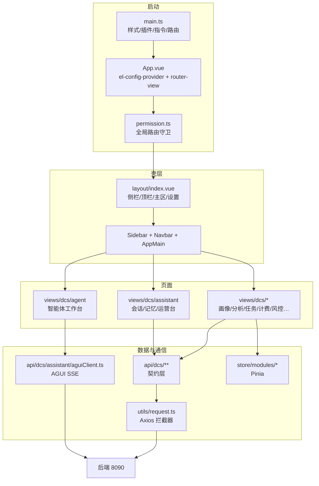
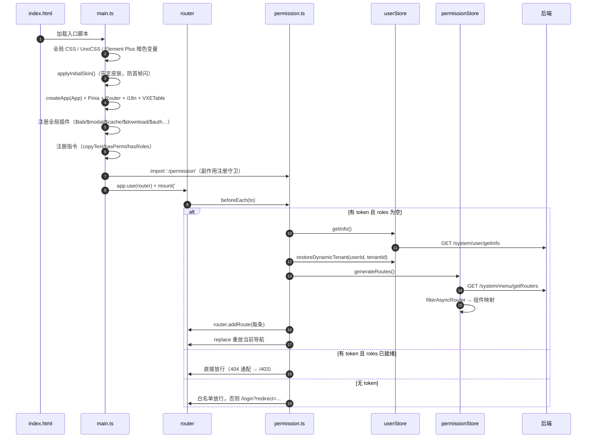
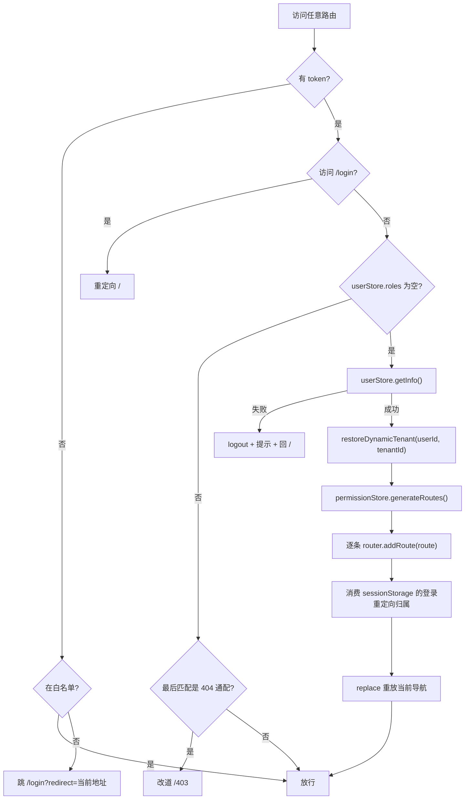
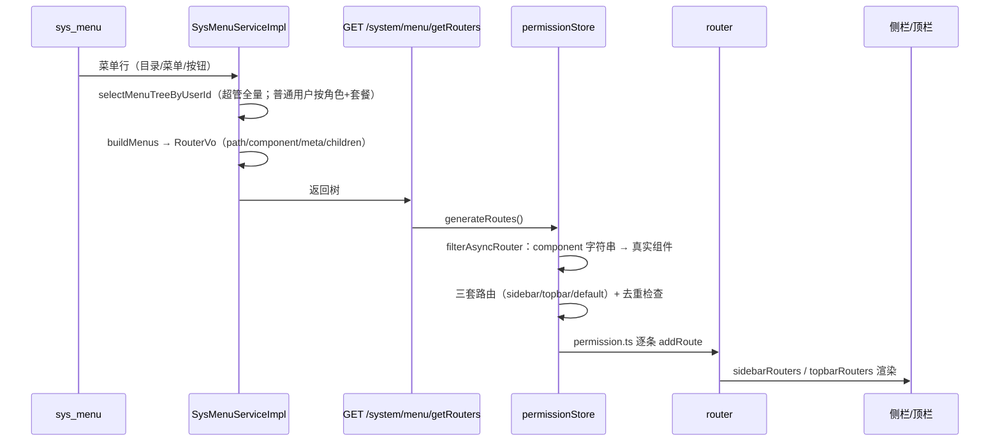
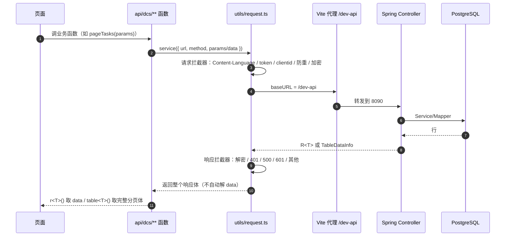
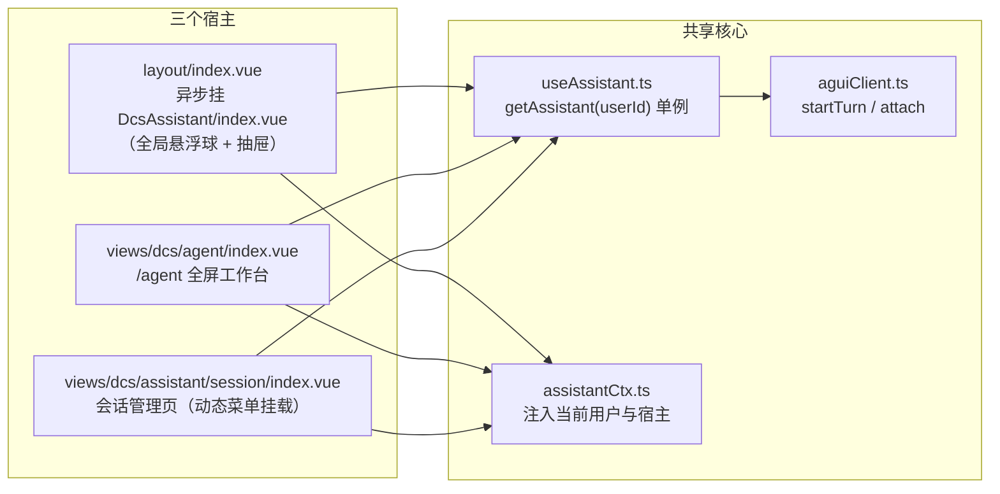
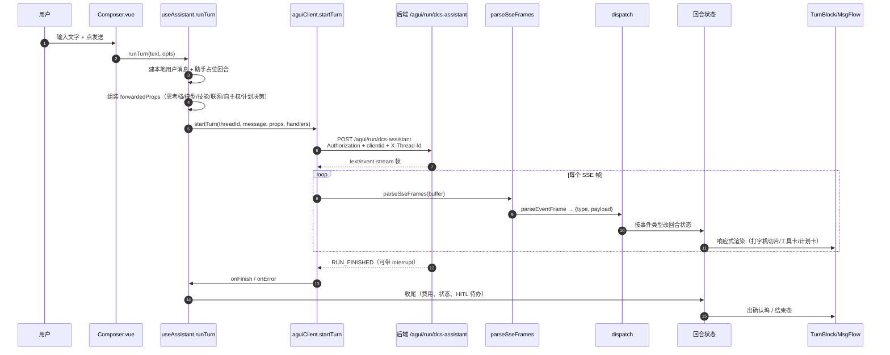
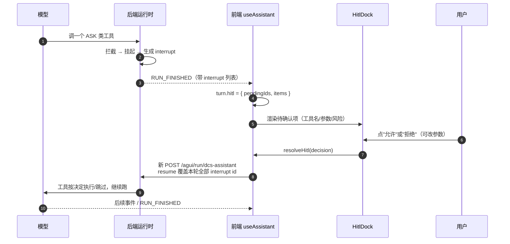
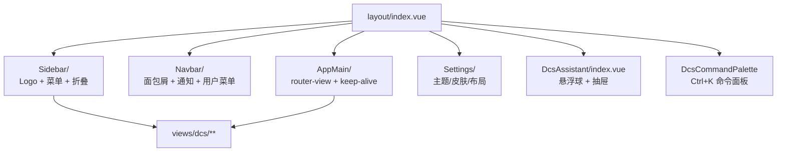

# SmartDock 前端架构详解：层级、数据流与 AI 助手

> **这份文档解决什么问题**：你看得懂 `frontend/src` 每个目录是干什么的、打开一个页面时路由和权限怎么工作、一次请求怎么从页面走到后端、AI 助手那张对话框从"发一句话"到"逐字出答案"中间经过了哪些组件和状态。
>
> **基准**：`master` @ `0a5a11a`（2026-11-20）。规模：171 个 `.vue`、214 个 `.ts`、99 个页面文件、74 个 API 文件、34 个测试文件。
>
> **怎么读**：先看第 0、2、3 章建立"启动—目录—页面"的整体图；想查某个页面怎么调后端看第 7 章；只想搞懂 AI 助手看第 8 章（本篇最重）；排查"为什么没权限/没数据"看第 4、5 章。

---

## 0. 一分钟总览

三句话：

1. **技术栈**：Vue 3.5 + Vite 7 + Element Plus 2.13 + Pinia 3 + TypeScript；Node ≥ 20.19；开发端口固定 **5188**，后端固定 **8090**。
2. **路由不是写死的**：登录后先 `GET /system/menu/getRouters` 拿后端 `sys_menu` 生成的菜单树，前端 `filterAsyncRouter` 把组件字符串转成真实组件，再 `router.addRoute` 动态挂上。`v-hasPermi` 只管按钮级显隐。
3. **AI 助手是一个"单例状态机 + 三个宿主"**：`useAssistant` 全局只建一个实例，悬浮球抽屉、`/agent` 工作台、会话管理页共用它；对话走 `aguiClient.ts` 的 `fetch + ReadableStream`（不是 `utils/sse.ts`，后者是通知推送）。

一张全景图：



---

## 1. 术语表（先过一遍）

| 词 | 大白话 |
|---|---|
| **SPA** | 单页应用：整个站点只有一个 `index.html`，切页面靠前端路由，不重新加载整页。 |
| **路由（router）** | "哪个 URL 显示哪个组件"的映射表。 |
| **路由守卫（guard）** | 每次跳页前先跑的检查函数；本仓用它做登录校验、拉用户信息、挂动态路由。 |
| **动态路由** | 不是写在前端代码里，而是登录后从后端菜单接口拿回来再挂上的路由。 |
| **Pinia** | Vue 的全局状态仓库；一个 `store` 就是一组共享数据 + 改数据的方法。 |
| **composable** | 以 `useXxx()` 形式复用的组合式函数，把状态和逻辑打包。 |
| **v-hasPermi** | 自定义指令：当前用户没有某个权限串时，把元素从 DOM 里删掉。 |
| **契约层** | `api/**` 目录：每个后端端点对应一个前端函数，页面只调函数、不写 URL。 |
| **AGUI** | 智能体 ↔ 前端的事件协议；前端按事件类型（文本/工具/计划/确认卡）渲染。 |
| **SSE** | 服务器持续向浏览器单向推送的管道；对话流式回答用它。 |
| **HITL** | Human-In-The-Loop：需要人点"确认/取消"才能继续。 |
| **单例（singleton）** | 全应用只创建一个实例；助手状态必须单例，否则两个宿主会各说各话。 |
| **Teleport** | Vue 把组件渲染到 DOM 另一处的能力；弹层常用。 |
| **打字机** | 回答逐字出现的视觉效果；本仓用缓冲 + 定时切片实现，不是每个字符都重渲染。 |

---

## 2. 启动链：从 `index.html` 到第一个页面



### 2.1 `main.ts` 的 12 步

文件：`frontend/src/main.ts`

| 顺序 | 做什么 | 为什么 |
|---:|---|---|
| 1 | 引入 `virtual:uno.css`、Element Plus 暗色变量、`@/assets/styles/index.scss` | 全局样式底座 |
| 2 | `applyInitialSkin()` | 在 `createApp` 前定 `html[data-skin]`，避免首帧先按 T1 渲染再跳皮肤 |
| 3 | 引入 `App.vue`、`store`、`router` | 应用入口 |
| 4 | 注册指令 `./directive` | `copyText`/`hasPermi`/`hasRoles` |
| 5 | 注册全局插件 `./plugins/index` | `$tab`/`$modal`/`$cache`/`$download`/`$auth`/`useDict`/`getConfigKey`/`parseTime`/`handleTree`/`animate` |
| 6 | 引入 highlight.js 与 Vue 插件 | 助手回答里的代码高亮 |
| 7 | 注册 SVG 图标 | `virtual:svg-icons-register` + Element 图标 |
| 8 | `import './permission'` | 以副作用方式注册 `beforeEach`/`afterEach` |
| 9 | i18n | `@/lang/index` |
| 10 | VXETable 配置 | `zIndex = 999999` |
| 11 | Element Plus 默认值 | `ElDialog.props.closeOnClickModal.default = false` |
| 12 | `app.mount('#app')` | 挂载 |

### 2.2 `App.vue` 的一个关键细节

`App.vue` 的 `setup` 顶层**同步**调用 `applyThemeMode(settingsStore.dark)`，不能放 `onMounted`。原因：子组件里的 `useChartTokens()` 会在挂载时缓存 `:root` 的默认色；如果主题晚一步应用，图表刷新后不跟主题变。这是一个"看起来只是顺序问题、实际会留视觉 bug"的细节。

---

## 3. 目录层级：每个文件夹放什么

### 3.1 `src` 一级目录

| 目录 | 放什么 | 典型文件 |
|---|---|---|
| `api` | 后端接口模块，按域拆分；`api/dcs` 是业务，`api/system`/`api/monitor` 是 RuoYi 底座 | `api/dcs/assistant/index.ts`、`api/dcs/core/profile.ts` |
| `assets` | 图标、图片、Logo、401/404 图、全局样式与设计令牌 | `assets/styles/dcs-tokens.scss` |
| `components` | 共享/全局组件；`DcsAssistant` 是 AI 助手全家桶 | `components/DcsAssistant/*` |
| `composables` | 跨组件复用的组合式函数 | `tenantMirror.ts`、`useWorkspace.ts` |
| `directive` | 全局指令 | `permission/index.ts`（`hasPermi`） |
| `enums` | 语言/菜单类型/导航类型/响应码枚举 | `enums/*` |
| `hooks` | 通用 hooks | `useDialog.ts` |
| `lang` | vue-i18n 初始化与中英词典 | `lang/index.ts` |
| `layout` | 应用壳层：侧栏、顶栏、主区、设置抽屉、通知、用户菜单 | `layout/index.vue` |
| `plugins` | 全局属性/插件：modal、tab、download、cache、auth、svgicon | `plugins/*` |
| `router` | 常量路由、动态路由数组、Router 实例 | `router/index.ts` |
| `store` | Pinia 根实例与模块 | `store/modules/*` |
| `types` | 全局/自动导入/Axios/环境变量/路由类型声明 | `types/global.d.ts` |
| `utils` | `request`、`auth`、`crypto`、SSE、WebSocket、主题、字典、权限、格式化、错误、i18n | `utils/request.ts` |
| `views` | 页面：RuoYi 系统/监控、登录/注册/协议/错误/重定向、DCS 业务页面 | `views/dcs/*` |

### 3.2 `views/dcs/*` 页面族

| 页面族 | 作用 |
|---|---|
| `agent` | 智能体工作台（`index.vue`）、工作台设置（`settings.vue`）、自动化（`automation/`）、MCP（`mcp/`）、深链辅助（`bridge.ts`/`prefill.ts`） |
| `assistant` | AI 助手管理域：`admin` 运营台、`audit` 动作审计、`memory` 记忆管理、`session` 会话页 |
| `profile` | 用户画像：首页、详情、分析、RFM、分群、工作室、合规、运维、审核 |
| `mission` / `todo` / `audit` / `notice` / `dashboard` | 采集 demo：任务、待办、审核、通知、统计 |
| `risk` | 风控：仪表盘、事件、规则、白名单、处置、内容配置、敏感词、验证码弹窗 |
| `fileReview` | 文件审查中心：列表、待审、通过/驳回、配置、安全检测统计/日志 |
| `account-billing` / `tenant-wallet` / `tenant-wallet-ledger` / `wallet-payment-order` | 账户与账单；旧三个页面已重定向到 `account-billing`，文件仍保留 |
| `ai-config` / `ai-credit` / `ai-usage` / `ai-doc-domain` | 模型配置、额度套餐、用量、文档域名 |
| `feedback` / `announcement` / `changelog` | 反馈、公告、更新日志 |
| `service-charge-rule` | 服务费规则 |
| `support` | 只有共享 `SupportPageHead.vue`，没有独立页面 |
| `utils` | `safeLoad.ts`，带可见错误提示的异步加载辅助 |

### 3.3 `api/dcs/*` 与后端怎么对应

| 前端模块 | 主要端点 | 后端 Controller |
|---|---|---|
| `api/dcs/core/task.ts` | `/dcs/task/*`、`/dcs/stats/overview` | `DcsTaskController`、`DcsStatsController` |
| `api/dcs/core/submission.ts` | `/dcs/submission/*`、`/dcs/audit/*` | `DcsSubmissionController`、`DcsAuditController` |
| `api/dcs/core/notice.ts` | `/dcs/notice/*` | `DcsNoticeController` |
| `api/dcs/core/analytics.ts` | `/analytics/*`、`/analytics/replay/*`、`/analytics/health` | `AnalyticsController`、`AnalyticsReplayController`、`AnalyticsHealthController` |
| `api/dcs/core/profile.ts` | `/profile/*` | 15 个 profile Controller（见后端文档附录 A.1） |
| `api/dcs/assistant/*` | `/dcs/assistant/**`、`/agui/run/dcs-assistant` | 23 个 assistant Controller + AGUI 运行时 |
| `api/dcs/ai/*` | `/dcs/ai-config`、`/dcs/ai-price`、`/dcs/ai-model-price`、`/dcs/ai-usage`、`/dcs/ai/capability` | `DcsAiConfigController` 等 5 个 |
| `api/dcs/risk/*` | `/dcs/risk/*`、`/dcs/captcha/*` | 8 个 risk Controller |
| `api/dcs/fileReview/*` | `/dcs/fileReview/*` | `DcsFileReviewController` |
| `api/dcs/feedback/*` | `/dcs/feedback/*` | `DcsFeedbackController` |
| `api/dcs/announcement/*` | `/dcs/announcement/*` | `SysNoticePortalController` |
| `api/dcs/changelog/*` | `/dcs/changelog/*` | `DcsChangelogController` |
| `api/dcs/account-billing/*` | `/dcs/tenant-wallet/summary` + 旧三组 re-export | `DcsTenantWalletController` 等 |

`api/dcs/core/` 是 DCS 微核心的"契约层"：与后端端点一一对应，页面只消费业务形状，不直接拼 URL。它里面的 `r<T>()` 取 `R<T>.data`，`table<T>()` 返回完整 `TableDataInfo<T>`。

---

## 4. 路由与权限

### 4.1 路由分两类

| 类型 | 来源 | 例子 |
|---|---|---|
| 常量路由 | `router/index.ts` 的 `constantRoutes` | `/login`、`/register`、`/401`、`/403`、`/index`、`/user/profile` |
| 动态路由 | 登录后 `GET /system/menu/getRouters` 返回的菜单树 | 侧栏里的所有业务页面 |

几个重要的常量路由：

| 路由 | 说明 |
|---|---|
| `/agent` | 智能体工作台，`views/dcs/agent/index.vue`，`hidden: true`，**不套业务 Layout**（独立全屏） |
| `/agent/settings` | 工作台设置，顶层全屏路由 |
| `/dcs/mission/detail/:id` | 任务详情，`hidden: true` |
| `/insight/profile-detail/:source/:subjectId` | 画像详情，`hidden: true` |
| `/dcs/review-task` | 审核事项，`hidden: true` |
| 多条 legacy redirect | `/dcs/profile` → `/insight/profile`、`/tenant/tenant-wallet*` → `/tenant/account-billing?tab=...` |

> 注意：静态隐藏路由上虽然写了 `permissions` 字段，但 `permission.ts` 的全局守卫**没有消费它**。实际访问控制靠页面自检 + 后端接口权限。这是代码事实，不是缺陷判断。

### 4.2 全局守卫流程

文件：`frontend/src/permission.ts`



白名单：`/login`、`/register`、`/social-callback`、`/register*`、`/agreement*`。

三个关键点：

1. **先恢复动态租户，再挂路由**：否则壳层显示 B 单位、首屏数据还是 A 单位。`restoreDynamicTenant` 在 `composables/tenantMirror.ts`。
2. **404 统一改道 `/403`**：前端分不清"系统有但本人无权"和"真不存在"，统一按无权处理。
3. **`isRelogin` 防重复弹窗**：401 时只弹一次重登框；`dcs:login-redirect-owner` 记录重定向归属，换账号后不会跳到上个账号有权限的页面。

### 4.3 动态菜单：`sys_menu` 怎么变成侧栏



`filterAsyncRouter` 的组件映射规则：

| 后端 `component` | 前端组件 |
|---|---|
| `Layout` | `layout/index.vue` |
| `ParentView` | 空壳父视图 |
| `InnerLink` | iframe 内链 |
| 其他字符串 | `import.meta.glob('../../views/**/*.vue')` 匹配，`createCustomNameComponent` 包装 |

### 4.4 `v-hasPermi` 的真实行为

文件：`frontend/src/directive/permission/index.ts`

```ts
mounted(el, binding) {
  const { permissions } = useUserStore();
  const has = permissions.some(p => p === '*:*:*' || binding.value.includes(p));
  if (!has) el.parentNode?.removeChild(el);   // 不是 display:none
}
```

两个必须知道的点：

- **只在 `mounted` 执行**，不是响应式；权限后来变了，已删掉的 DOM 不会自己回来（通常靠重新登录/刷新）。
- **无权限直接移除元素**，不是隐藏。所以不能用它做"占位但不可点"的交互；那种场景用 `v-if` + `checkPermi()`。

另有 `utils/permission.ts` 的 `checkPermi()` / `checkRole()` 供逻辑判断，`plugins/auth.ts` 提供 `hasPermi/hasPermiOr/hasPermiAnd`。

---

## 5. 请求层：页面怎么和后端说话

### 5.1 一次普通请求



### 5.2 Axios 实例与拦截器

文件：`frontend/src/utils/request.ts`（258 行）

| 项 | 值/行为 |
|---|---|
| `baseURL` | `import.meta.env.VITE_APP_BASE_API`，开发是 `/dev-api` |
| `timeout` | 50000ms |
| 默认 `Content-Type` | `application/json;charset=utf-8` |
| 默认 `clientid` | `VITE_APP_CLIENT_ID` |
| Token 存储 | `utils/auth.ts`，键 `Admin-Token`，localStorage |
| 请求头 | `Authorization: Bearer <token>`、`clientid`、`Content-Language` |
| 防重 | POST/PUT 500ms 内同 URL 同 data → reject「数据正在处理，请勿重复提交」 |
| 加密 | `VITE_APP_ENCRYPT=true` 且请求头 `isEncrypt=true`：AES 加密 body，RSA 加密 AES key 放 `encrypt-key` |
| FormData | 删除 `Content-Type`，让浏览器自己带 boundary |

**响应拦截器的分支**：

| 情况 | 行为 |
|---|---|
| `blob`/`arraybuffer` | 直接返回；若是 JSON 错误体则解析并 reject（避免把错误 JSON 当文件下载） |
| `code === 401` | 非 silent：确认框重登 → logout → 记录 redirect 归属 → 跳登录；silent：直接 reject |
| `code === 500` | 非 silent 弹 error；reject `BusinessError` |
| `code === 601`（WARN） | 非 silent 弹 warning；reject |
| 其他非 200 | 4601（验证码挑战）不弹通知；其余非 silent 用 `ElNotification.error`；reject |
| 200 | `Promise.resolve(res.data)`，**返回整个响应体** |

**为什么页面里到处是 `res.data`**：拦截器故意不按 `data` 解包，保留 `R<T>` 信封，让调用方自己决定。`api/dcs/core` 里的 `r<T>()` 和 `table<T>()` 就是两种解包姿势。

### 5.3 下载与上传

| 场景 | 做法 |
|---|---|
| 下载 | `download(url, params, fileName)`：POST + `application/x-www-form-urlencoded` + `responseType: 'blob'`；`blobValidate` 判断是不是文件，不是就解析错误 JSON |
| 普通上传 | `FileUpload`/`ImageUpload` 用 `<el-upload :action="baseUrl + '/resource/oss/upload'">` + `globalHeaders()` |
| 助手附件 | `Composer.vue` 直接 `fetch(VITE_APP_BASE_API + '/resource/oss/upload', { headers: globalHeaders(), body: FormData })`，成功后调 `registerAssistantAttachment` |
| OSS 下载 | `plugins/download.ts` 的 `$download.oss(ossId)` / `$download.zip(url, name)` |

### 5.4 租户：不在请求头里

`request.ts` **不添加租户请求头**。动态租户是**服务端状态**：

- 切换：`/system/tenant/dynamic/{tenantId}`
- 清除：`/system/tenant/dynamic/clear`
- 本地镜像：`dcs:dynamic-tenant:<userId>`（`composables/tenantMirror.ts`）
- 刷新后 `restoreDynamicTenant(userId, tenantId)` 把镜像重新下发给服务端，再放行路由

这是"为什么刷新后单位没丢"的机制。

### 5.5 `utils/sse.ts` 与 AGUI 是两条通道

| 文件 | 用途 | 传输 | 关键行为 |
|---|---|---|---|
| `utils/sse.ts` | **通知推送**（不是对话） | `EventSource` / `useEventSource` | URL 带 `Authorization` + `clientid`；解析 `{event,data}`；`DCS_NOTIFY` 去重后进 notice store；自动重连 5 次/5s |
| `api/dcs/assistant/aguiClient.ts` | **AI 对话** | `fetch` POST + 手写 SSE 帧解析 | `POST /agui/run/dcs-assistant`；`Accept: text/event-stream`；`X-Thread-Id`；指数退避重试；600s 停滞看门狗；`attach()` 续看 |

挂载点：`layout/index.vue` 的 `onMounted` 里 `initSSE(BASE_URL + '/resource/sse')`；AGUI 由助手组件按需发起。

---

## 6. 状态管理：Pinia 里有什么

### 6.1 Store 清单

| Store | 文件 | 职责 | 关键状态/动作 |
|---|---|---|---|
| `app` | `store/modules/app.ts` | 壳层 UI | `sidebarStatus`、`sidebarOpenedMenus`、`size`、`language`、`device`、`locale`；`toggleSideBar`、`setOpenedMenus` |
| `user` | `store/modules/user.ts` | 登录用户 | `token`、`name`、`userId`、`tenantId`、`avatar`、`roles`、`permissions`；`login`、`getInfo`、`logout` |
| `permission` | `store/modules/permission.ts` | 动态路由/菜单 | `routes`、`addRoutes`、`defaultRoutes`、`topbarRouters`、`sidebarRouters`；`generateRoutes`、`filterAsyncRouter` |
| `settings` | `store/modules/settings.ts` | 外观/布局 | `theme`、`sideTheme`、`dark`、`skin`、`navType`、`radiusBase`；`setDark`、`setSkin` |
| `tagsView` | `store/modules/tagsView.ts` | keep-alive 缓存 | `visitedViews`、`cachedViews`；`addView`、`delView` |
| `dict` | `store/modules/dict.ts` | 字典缓存 | `Map<string, DictDataOption[]>` |
| `notice` | `store/modules/notice.ts` | 通知中心 | `notices`、`unreadCount`；`refreshUnreadCount`、`addNotice`、`readAll` |
| `announcement` | `store/modules/announcement.ts` | 公告未读 | `unreadCount`；`refreshUnreadCount`、`consumeOne` |
| `fileReviewBadge` | `store/modules/fileReviewBadge.ts` | 文件审查角标 | 60s 轮询待审数；`badgeCount`、`ensureStarted`、`decrement` |

### 6.2 关键本地存储键

| 域 | 键 | 用途 |
|---|---|---|
| 认证 | `Admin-Token` | 登录 token |
| 租户 | `dcs:dynamic-tenant:<userId>` | 动态租户镜像 |
| 助手 | `dcs:assistant:thread:<userId>` | 当前会话 threadId |
| 助手 | `dcs:assistant:thinkLevel:<userId>` | 思考档位 |
| 助手 | `dcs:assistant:modelPin:<userId>:<threadId>` | 会话级模型 pin |
| 助手 | `dcs:assistant:webOn:<userId>:<threadId>` | 会话级联网开关；`0`=停用 |
| 助手 | `dcs:assistant:skill:<userId>:<threadId>` | 会话级技能 |
| 助手 | `dcs:assistant:autoLevel:<userId>` | 自主权档位 |
| 助手 | `smartdock-agent-prefs:v1:<userId>` | 七项偏好 |
| 助手 | `smartdock-agent-drafts:v1:<userId>:<scope>` | 草稿 |
| 助手 | `dcs:assistant:pins:<userId>` | 会话置顶 |
| 登录 | `dcs:login-redirect-owner` | 401 重登 redirect 归属 |
| 表格 | `dcs:table-columns:<storageKey>` | 列设置 |

---

## 7. 页面地图：页面 → API → 后端

| 页面/入口 | 前端 API | 主要端点 | 后端 Controller |
|---|---|---|---|
| 智能体工作台 `/agent` | `api/dcs/assistant/index.ts` + `aguiClient` | `/dcs/assistant/status`、`/conversation/*`、`/hitl/pending`、`/plan/state`、`/agui/run/dcs-assistant` | `AssistantStatusController`、`AssistantConversationController`、`AssistantHitlController` + AGUI |
| 会话管理页（`views/dcs/assistant/session/index.vue`，URL 由动态菜单决定） | 同上 | `/conversation/list`、`/by-thread`、`/{id}/messages`、`/{id}/title`、`/conversation/stop`、`/conversation/attach` | `AssistantConversationController` |
| 记忆管理 | 同上 | `/dcs/assistant/memory/*` | `AssistantMemoryController` |
| 技能管理 | 同上 | `/dcs/assistant/skills`、`/skill/*` | `AssistantSkillViewerController`、`AssistantSkillAdminController` |
| MCP | 同上 | `/dcs/assistant/mcp/*` | `AssistantMcpController` |
| 自动化 | `api/dcs/assistant/automation.ts` | `/dcs/assistant/automations/*` | `AssistantAutomationController` |
| 助手运营台 | `api/dcs/assistant/index.ts` | `/dcs/assistant/admin/*`、`/quota/*`、`/toolgate`、`/tools`、`/config`、`/feedback/*` | `AssistantStatusController`、`AssistantQuotaController`、`AssistantToolGateController` 等 |
| 画像 | `api/dcs/core/profile.ts` | `/profile/*` | 15 个 profile Controller |
| 分析 | `api/dcs/core/analytics.ts` | `/analytics/*` | `AnalyticsController` 等 |
| 任务/待办/审核 | `api/dcs/core/task.ts`、`submission.ts`、`notice.ts` | `/dcs/task/*`、`/dcs/submission/*`、`/dcs/audit/*`、`/dcs/notice/*` | `DcsTaskController` 等 |
| 账户与账单 | `api/dcs/account-billing/*` | `/dcs/tenant-wallet/summary` + 旧三组 | `DcsTenantWalletController` 等 |
| AI 额度 | `api/dcs/ai-credit/*` | `/dcs/ai-credit/*` | `DcsAiCreditController` |
| AI 配置/用量 | `api/dcs/ai/*` | `/dcs/ai-config/*`、`/dcs/ai-price/*`、`/dcs/ai-usage/*` | `DcsAiConfigController` 等 |
| 风控 | `api/dcs/risk/*`、`api/dcs/sensitive-word/*` | `/dcs/risk/*`、`/dcs/sensitive-word/*`、`/dcs/captcha/*` | 8 个 risk Controller |
| 文件审查 | `api/dcs/fileReview/*` | `/dcs/fileReview/*` | `DcsFileReviewController` |
| 首页 `/index` | 组合调用 | `/analytics/overview`、`/profile/overview`、`/dcs/stats/overview`、`/dcs/assistant/status`、`/dcs/changelog/list` | 对应 Controller |

> 遗留项：`api/dcs/audit-log` 目录存在，但未找到同名后端 Controller，也未发现页面导入，疑似未接线；`views/dcs/support` 只有共享页头、没有独立页面；`tenant-wallet`/`tenant-wallet-ledger`/`wallet-payment-order`/`ai-doc-domain` 旧页面文件仍在，但路由已重定向。

---

## 8. AI 助手前端（本篇重点）

### 8.1 三个宿主，一个单例

助手不是"一个页面"，而是**一套状态 + 三个入口**：



| 宿主 | 挂载位置 | 形态 | 用途 |
|---|---|---|---|
| 悬浮球 + 抽屉 | `layout/index.vue:37` 异步组件 | 右下角球，点开右侧抽屉 | 任意业务页面随手问；抽屉里是精简会话 |
| `/agent` | 独立全屏路由（不套业务 Layout） | 左会话列表 + 中消息流 + 右状态栏 | 完整工作台：模型、技能、联网、自主权、计划、TODO |
| 会话管理页 | `views/dcs/assistant/session/index.vue` | 业务 Layout 内 | 运营/审计视角看会话与消息 |

> 路径说明：`/ai/assistant-admin` 是管理端的常量跳转目标（`router/index.ts:24`，工作台设置/记忆页用它跳助手管理端），不是会话页 URL；该常量对应哪个页面由 `sys_menu` 菜单数据决定，会话管理页也挂在动态菜单下，前端不写死。

`getAssistant(userId)`（`useAssistant.ts:2761`）按用户 ID 缓存实例：同一用户切三个宿主，消息、草稿、HITL 状态是同一份；换账号得到新实例，不会串台。

### 8.2 组件分层

`components/DcsAssistant/` 下 23 个 `.vue` + 18 个 `.ts` 模块。按职责分五层：

| 层 | 组件 | 职责 |
|---|---|---|
| **宿主壳** | `index.vue`、`AssistantDrawer.vue`、`AssistantWorkspace.vue`、`FloatingBall.vue`、`HeroWelcome.vue` | 球/抽屉/工作台骨架、欢迎页 |
| **输入** | `Composer.vue`、`PlanDock.vue`、`PlanTip.vue` | 输入框、模型/技能/联网/思考档、计划选择坞 |
| **消息流** | `MsgFlow.vue`、`TurnBlock.vue`、`StatPanel.vue`、`IconSpan.vue` | 回合列表、单回合（思考/工具/正文/收尾）、右侧状态栏 |
| **卡片** | `PlanCard.vue`、`PlanFormCard.vue`、`AskUserCard.vue`、`ElicitationCard.vue`、`ConfirmCard.vue`、`FormCard.vue`、`TemplateCard.vue`、`DataCard.vue`、`ChartBlock.vue`、`GateCard.vue` | 计划确认、结构化反问、补全信息、确认、表单、模板、数据卡、图表、权限闸 |
| **审批与提示** | `HitlDock.vue`、`AssistantToasts.vue` | 底部 HITL 审批坞、全局轻提示 |

非组件模块（都是"逻辑/状态"，不是 UI）：

| 模块 | 职责 |
|---|---|
| `useAssistant.ts`（2775 行） | 单例状态机：回合、消息、流、HITL、计划、TODO、费用、记忆、停止、续看 |
| `assistantCtx.ts` | 宿主上下文（当前用户、租户、宿主类型） |
| `aguiClient.ts`（528 行） | AGUI 传输：发一轮、解析 SSE 帧、attach 续看、重试/看门狗 |
| `md.ts` | Markdown 渲染（含代码高亮、表格、链接安全） |
| `toolJson.ts` | 工具参数/结果的 JSON 折叠展示 |
| `draftStore.ts` / `favStore.ts` / `conversationPins.ts` | 草稿、收藏、会话置顶 |
| `prefsStore.ts` / `skillState.ts` / `webOnState.ts` / `nameState.ts` | 七项偏好、会话级技能/联网、会话命名 |
| `planDock.ts` | 计划坞的展开/选择状态 |
| `toastStore.ts` / `helpModal.ts` / `useTour.ts` | 轻提示、帮助弹窗、新手引导 |
| `icons.ts` / `time.ts` / `util.ts` | 图标、相对时间、杂项 |

### 8.3 一次发送的完整链路



`runTurn`（`useAssistant.ts:1572`）的职责边界要说清：**它不负责拼 HTTP**，只做四件事：

1. 本地先落"用户消息 + 助手占位"，让界面立刻有反馈；
2. 把 UI 选择翻译成 `forwardedProps`（下表）；
3. 调 `aguiClient.startTurn` 并把回调接到状态机；
4. 处理重试、停止、失败收口、HITL 续跑。

`forwardedProps` 清单：

| 字段 | 来源 | 何时带 |
|---|---|---|
| `thinkTier` | 输入区"快速/平衡/深入" | 总是带 |
| `autoLevel` | 自主权档位 | 总是带 |
| `modelConfigId` | 会话级模型 pin | 仅"允许选模型"且用户 pin 了模型时 |
| `skillId` | 会话级技能 | 选中技能时 |
| `webSearchEnabled` | 联网开关 | 总是带（`false` 也带，表示显式停用） |
| `askAutoContinue` | "反问后自动继续" | 总是带 |
| `planDecision` / `planId` | 计划卡三按钮 | 用户对计划卡作出选择后 |

> 口径提醒：`thinkTier` 是**产品行为**不是视觉，前端只传枚举，不改语义；模型选择器在"未开启选择"时只显示不可点，不能当成状态块降级成灰字。

### 8.4 AGUI 事件消费表

前端只消费协议的一个子集，但子集覆盖了所有可见行为：

| 事件 | 处理 | 落到哪个状态 | 渲染 |
|---|---|---|---|
| `TEXT_MESSAGE_START` | 开一个新文本段 | `turn.blocks[]` 追加 text block | 正文容器 |
| `TEXT_MESSAGE_CONTENT` | 追加 delta | block.text += delta；打字机缓冲 | 逐字出现 |
| `TEXT_MESSAGE_END` | 收段 | block.done = true | 光标消失 |
| `REASONING_MESSAGE_START/CONTENT/END` | 同上，进思考段 | `turn.reasoning` | 可折叠"思考中"块 |
| `TOOL_CALL_START` | 建工具卡 | `turn.tools[id]` | 工具名 + 运行中 |
| `TOOL_CALL_ARGS` | 累积参数 JSON | `tools[id].args` | 参数折叠 |
| `TOOL_CALL_END` | 参数收完 | `tools[id].argsDone` | 参数区定格 |
| `TOOL_CALL_RESULT` | 填结果 | `tools[id].result` | 结果折叠/摘要 |
| `RUN_FINISHED` | 收轮 | `turn.status`、`turn.hitl` | 结束态 / 审批坞 |
| `RUN_ERROR` | 失败 | `turn.status = 'error'`、错误文案 | 错误条 + 重试 |
| `CUSTOM` | 按 `name` 分发（见 8.5） | 各自字段 | 各自卡片 |

**没有实现/没有消费的事件**（读代码可见，不是漏文档）：

- `STEP_STARTED` / `STEP_FINISHED`：前端没有对应渲染；
- `STATE_SNAPSHOT` / `STATE_DELTA` / `MESSAGES_SNAPSHOT`：不消费，会话历史靠自己的 `Conversation` 接口；
- `ACTIVITY_*`、`*_CHUNK`：不消费。

所以排查"某个事件没反应"时，先确认它是否在 `aguiClient.dispatch` 的分支里，而不是先怀疑后端没发。

### 8.5 11 个 CUSTOM 帧 → 界面

| 帧名 | 触发 | 前端落点 |
|---|---|---|
| `plan` | 模型调 `submit_plan` | `PlanCard`（执行 / 调整 / 取消） |
| `tool_denied` | 工具权限闸拒绝 | `GateCard` + 提示 |
| `ask_user` | 模型调 `ask_user` | `AskUserCard`（选项/多选/自填） |
| `model_degrade` | 主模型失败降级 | `AssistantToasts` 提示 |
| `todo` | 模型调 `todo_write` | `StatPanel` 的 TODO 分区 |
| `elicitation` | 需要补充结构化信息 | `ElicitationCard` |
| `cost_meta` | 一轮结束的费用元数据 | `StatPanel` 费用区 |
| `memory_turn` | 本轮写入/命中长期记忆 | 记忆标记 |
| `auto_done` | 自动继续跑完 | 完成提示 |
| `dcs-heartbeat` | 长任务保活 | 只更新"最后活动时间"，不渲染正文 |
| `dcs-resume-truncated` | 续看时回放环溢出 | 横幅"部分历史未回放" |

### 8.6 HITL（人工确认）全流程



关键事实：

- **批准/拒绝不是独立 REST 端点**，而是"下一轮 `/agui/run` 带 `resume`"。后端 `AssistantHitlController` 只有 `GET /pending`，没有 approve/abort。
- `resume` 必须覆盖**本轮所有** interrupt id：只恢复一个，其余仍挂起，下一轮会再次收到确认。
- 页面刷新后 `turn.hitl` 会丢，但后端 pending 还在：前端进来会拉 `GET /dcs/assistant/hitl/pending` 重新出坞。
- 确认卡上改过的参数（`editedArgs`）随 `resolveHitl` 一起回传，不是在前端本地改工具参数。

### 8.7 计划 / TODO / 反问 / 费用 / 记忆

| 能力 | 前端行为 | 注意点 |
|---|---|---|
| 计划卡 | 模型出 `plan` 帧 → `PlanCard` 三按钮；选择写进 `planDock` | 选"执行"后下一轮带 `planDecision=approve`；选"调整"把意见作为用户消息发回 |
| TODO | `todo` 帧整表替换 `StatPanel` 的清单 | 整表替换，不是增量 merge；空数组=清空 |
| 结构化反问 | `ask_user` 帧 → `AskUserCard`；作答走**独立端点**，不进 HITL resume | 超时/关闭按"未作答"处理，模型侧收到对应工具结果 |
| 费用 | `cost_meta` 帧 → 状态栏显示本轮/累计 | 仅展示，不参与计费判断 |
| 长期记忆 | `memory_turn` 帧 → 记忆标记；开关在设置页 | 租户没开记忆时后端不注册 `save_memory`，前端也不会收到该帧 |
| 自动继续 | `askAutoContinue` 偏好 + `auto_done` 帧 | 关闭后反问/计划必须人工点，不会自己往下跑 |

### 8.8 续看、重试、看门狗、停止

| 机制 | 实现 | 判据 |
|---|---|---|
| **首轮重试** | `startTurn` 内指数退避，最多 5 次 | 只在"零帧就断"时重发；已经收到帧再断**不重发**（重发会撞后端 409 双 RUNNING） |
| **停滞看门狗** | 600s 没新帧判定卡死 | 触发后收口为错误态，允许用户重试/续看 |
| **续看 attach** | `POST /dcs/assistant/conversation/attach?threadId=…` | 后端 `AssistantRunStreamHub` 4096 帧回放环；先回放再续推；溢出补 `dcs-resume-truncated` |
| **刷新恢复** | `localStorage` 的 `dcs:assistant:thread:<userId>` + attach | 刷新后先按 threadId 续看，失败再回退普通会话加载 |
| **停止** | `POST /dcs/assistant/conversation/stop` | 停止后本轮状态收口；已产生的内容保留 |
| **409 双跑** | 前端展示"该会话正在生成" | 不自动换 runId 重发；换 runId 重试是后端约束（会撞运行锁） |

### 8.9 输入区控件 → 上游参数

| 控件 | 存储 | 上游字段 | 备注 |
|---|---|---|---|
| 思考档位（快速/平衡/深入） | `dcs:assistant:thinkLevel:<userId>` | `thinkTier` | 三件套必须齐：brain 图标 + 文字 + chevron |
| 模型选择 | `dcs:assistant:modelPin:<userId>:<threadId>` | `modelConfigId` | 仅 `choiceOn && pin` 才带 |
| 技能 | `dcs:assistant:skill:<userId>:<threadId>` | `skillId` | 会话级 |
| 联网 | `dcs:assistant:webOn:<userId>:<threadId>` | `webSearchEnabled` | `'0'` 表示显式停用 |
| 自主权 | `dcs:assistant:autoLevel:<userId>` | `autoLevel` | 影响工具审批档 |
| 反问自动继续 | `smartdock-agent-prefs:v1:<userId>` | `askAutoContinue` | 默认开 |
| 计划决策 | `planDock.ts` | `planDecision` / `planId` | 只在有计划卡时带 |
| 附件 | — | 先上传 OSS，再登记附件 | 上传走 `fetch` + `FormData`，不用 Axios 实例 |

---

## 9. 布局与壳层



| 能力 | 实现 | 注意 |
|---|---|---|
| 侧栏折叠 | `appStore.toggleSideBar` + `sidebarStatus` | 移动端自动收起 |
| 移动端 | 断点 992px，`device` 切 `mobile` | 侧栏变抽屉 |
| keep-alive | `tagsViewStore.addView` 把路由加进 `cachedViews` | 标签页 UI 已注释掉，但缓存机制还在用 |
| 通知 | `layout/index.vue` `onMounted` 里 `initSSE('/resource/sse')` | 通知 SSE，与助手 AGUI 无关 |
| WebSocket | `utils/websocket.ts` | 在线状态/系统消息 |
| 命令面板 | `DcsCommandPalette`，Ctrl+K | 全局快捷键 |
| 主题 | `settings.dark` + `settings.skin` | 见第 10 章 |

---

## 10. 样式与设计令牌

| 文件 | 作用 |
|---|---|
| `assets/styles/dcs-tokens.scss` | **唯一令牌定义**：6 档字号 12/13/14/15/20/26；4 档圆角 2/4/8/12；胶囊 999px；间距/颜色/阴影变量 |
| `assets/styles/theme-framed.scss` | T1/T7 两套皮肤 × 亮/暗，输出 `--app-*` 变量 |
| `assets/styles/dcs-ui-kit.scss` | 业务组件通用类（卡片、工具栏、空态） |
| `assets/styles/dcs-responsive.scss` | 断点与移动端规则 |
| `assets/styles/tokens.test.ts` | **门禁**：扫 `src/**/*.vue` 的 `<style>` 与 `*.scss`，出现档外字面量 px 就失败并报 `文件:行` |
| `assets/styles/tokens-baseline.json` | 存量豁免清单，**只减不增**；残留行会被测试第二条用例抓出来 |

三条必须遵守：

1. **字号/圆角只用 `var(--dcs-*)`**，不写 `13px` 这种字面量；新代码不许往 baseline 加行。
2. **SVG 样式用 `:style` CSS 对象**，不写 SVG 属性样式（项目铁律）。
3. 改样式必须视觉验收：先 `getComputedStyle` 断言真实值，再截图原生读图；至少 2 个数据规模回归。

主题应用链：`main.ts` 的 `applyInitialSkin()` 先定皮肤 → `App.vue` setup 同步 `applyThemeMode(settings.dark)` → 子组件 `useChartTokens()` 读 `:root` 变量。顺序错了图表不跟主题。

---

## 11. 构建、代理与环境

| 项 | 值 |
|---|---|
| 构建工具 | Vite 7 |
| 开发端口 | **5188**，`--host --strictPort`，端口被占直接报错不跳号 |
| 代理 | `/dev-api` → `http://localhost:8090`（后端固定 8090） |
| 别名 | `@` → `src` |
| Node | ≥ 20.19 |
| 生产构建 | `npm run build:prod` = `typecheck-warn.mjs` + `vite build --mode production` |
| 类型检查 | `npm run type-check` = `vue-tsc --noEmit` |
| 单测 | `npm test` = `vitest run` |
| 分包 | 没有手写 `manualChunks`；靠路由懒加载 + Vite 默认策略 |

`package.json` 脚本（已核对）：

```
dev        vite serve --mode development
build:prod node scripts/typecheck-warn.mjs && vite build --mode production
build:dev  vite build --mode development
preview    vite preview
test       vitest run
test:watch vitest
type-check vue-tsc --noEmit
```

`typecheck-warn.mjs` 的定位是"类型错误先告警不阻断构建"，真正的类型门禁要单独跑 `type-check`——交付时两个都要看，不能只拿 `build:prod` 过当类型也过。

---

## 12. 测试现状

| 项 | 事实 |
|---|---|
| 测试框架 | Vitest，`environment: 'node'` |
| 测试文件 | 34 个（`src/**/*.test.ts` / `*.spec.ts`） |
| 用例声明 | 275 个 `it/test` |
| 覆盖重点 | 纯函数与状态逻辑：`aguiClient` 帧解析、`useAssistant` 状态迁移、`toolJson`、`md`、`planDock`、`prefsStore`、令牌门禁 |
| **没覆盖的** | 没有 jsdom 组件挂载测试；没有 Playwright/Cypress E2E；交互回归靠人工/活体验证 |

这意味着：改组件模板、样式、事件绑定，`npm test` 全绿也不代表界面对。交付前必须跑 `vite build` + 活体浏览器走查（双视角）。

---

## 13. 已知边界与未确认项

### 13.1 源码确认（读代码可见）

| 项 | 说明 |
|---|---|
| `api/dcs/audit-log` 疑似未接线 | 目录存在，未找到同名后端 Controller，也未发现页面 import |
| `views/dcs/support` 没有独立页面 | 只有共享 `SupportPageHead.vue` |
| 旧钱包页面仍在 | `tenant-wallet`、`tenant-wallet-ledger`、`wallet-payment-order` 文件保留，路由已重定向到 `account-billing` |
| 静态路由 `permissions` 不被消费 | `permission.ts` 只做登录/角色/动态路由，不检查 `route.permissions` |
| `v-hasPermi` 非响应式 | `mounted` 时删 DOM，权限变化不会自动恢复 |
| AGUI 常量多于消费 | `AGUI_EVENT` 定义了完整协议，`dispatch` 只实现第 8.4 节那批 |
| 标签页 UI 注释掉 | `tags-view` 组件未启用，但 `tagsViewStore` 仍用于 keep-alive |
| 助手 agentId 硬编码 | 前端固定 `/agui/run/dcs-assistant`；换默认 agent 要前后端一起改 |

### 13.2 尚未验证（需运行或环境）

| 项 | 缺什么 |
|---|---|
| 皮肤切换入口是否被 `v-if="false"` 隐藏 | 只读到样式与主题链路，未逐页确认设置面板的显隐条件 |
| 移动端全页面无横向溢出 | 只抽查过关键页；未做全量 390px 扫描 |
| `audit-log` 是否真的完全未使用 | 未做全仓 import 图；只做了目录/Controller/页面三层检索 |
| 通知 SSE 断线重连的真实表现 | 代码显示 5 次/5s，未在弱网下实测 |
| 助手三宿主状态是否完全一致 | 单例机制已读，未做"抽屉发一半→工作台继续"的活体对照 |

### 13.3 明确没查的高风险区

- `permission.ts` 与后端 `sys_menu` 的**逐行对账**（菜单数据是运行期数据，不在仓库里）；
- 生产构建产物体积与首屏性能（未跑 `vite build --mode production` 分析）；
- 浏览器兼容性（未做多浏览器矩阵）；
- 前端 XSS 全量审计（`md.ts` 的链接安全只读了渲染入口，未做绕过测试）。

---

## 附录 A：前端源码索引

| 主题 | 文件:行 |
|---|---|
| 应用入口 | `src/main.ts` |
| 根组件/主题 | `src/App.vue` |
| 路由表 | `src/router/index.ts` |
| 全局守卫 | `src/permission.ts:22` |
| 请求封装 | `src/utils/request.ts` |
| 认证存储 | `src/utils/auth.ts` |
| 租户镜像 | `src/composables/tenantMirror.ts` |
| 动态菜单转换 | `src/store/modules/permission.ts` |
| 权限指令 | `src/directive/permission/index.ts` |
| 通知 SSE | `src/utils/sse.ts` |
| AGUI 客户端 | `src/api/dcs/assistant/aguiClient.ts`（`startTurn:403`、`attach:471`、`parseSseFrames:50`、`dispatch:88`） |
| 助手状态机 | `src/components/DcsAssistant/useAssistant.ts`（`runTurn:1572`、`resolveHitl:1970`、`onCustom:939`、`getAssistant:2761`） |
| 输入区 | `src/components/DcsAssistant/Composer.vue` |
| 消息流 | `src/components/DcsAssistant/MsgFlow.vue`、`TurnBlock.vue` |
| 计划卡 | `src/components/DcsAssistant/PlanCard.vue` |
| 审批坞 | `src/components/DcsAssistant/HitlDock.vue` |
| 令牌定义 | `src/assets/styles/dcs-tokens.scss` |
| 令牌门禁 | `src/assets/styles/tokens.test.ts` |
| 构建配置 | `vite.config.ts` |

## 附录 B：与旧文档的差异（勘误）

| 旧说法 | 实际 | 依据 |
|---|---|---|
| "AGUI SSE 走 `utils/sse.ts`" | 走 `api/dcs/assistant/aguiClient.ts` 的 `fetch + ReadableStream`；`utils/sse.ts` 是通知 EventSource | 两文件实现与调用点 |
| "前端只有 `/agent` 一个助手入口" | 三个宿主：全局悬浮球/抽屉、`/agent`、会话管理页（`views/dcs/assistant/session/index.vue`） | `layout/index.vue:37` + 两个 `AssistantWorkspace` 宿主 |
| "HITL 有 approve/abort 接口" | 只有 `GET /pending`；决定走下一轮 `/agui/run` 的 `resume` | `AssistantHitlController` + `resolveHitl` |
| "计划卡是纯展示" | 三按钮会把 `planDecision`/`planId` 带回后端 | `PlanCard.vue` + `runTurn` 的 forwardedProps |
| "标签页仍在使用" | `tags-view` UI 已注释，store 仅用于 keep-alive | `layout/index.vue` 模板 |

---

> **文档定位**：这是前端**代码地图**，不是操作手册。查"某个按钮为什么没权限"看第 4 章；查"某句回答怎么渲染出来"看第 8 章；查"某个页面调哪个后端"看第 7 章。
> 与 `docs/architecture.md` 的关系：那份是**模块级总览与索引**，本篇是前端的**逐层拆解**；两份冲突时以本篇的 `file:line` 证据为准，并回刷总览。
