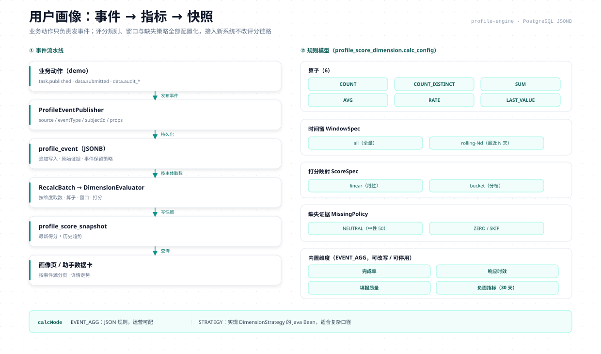

# 用户画像引擎 · 深度文档

> 本文承接 README「引擎：用户画像」章节的实现细节：完整数据模型、通用接入协议、
> 评分模型与 RFM、标签分群与低分复核、行为分析中心。能力概览与接入三步见 README。



## 1. 完整数据模型

| 表 | 作用 | 关键字段 |
|---|---|---|
| `profile_event` | 原始事件（追加写入） | `source`、`event_type`、`event_uid`、`subject_type`、`subject_id`、`occurred_time`、`props(jsonb)` |
| `profile_subject` | 主体登记（事件写入时 upsert） | 主体、首末事件时间、事件计数 |
| `profile_protocol` | 业务源接入协议清单（`profile.protocol/v1`） | `source`、事件清单、主体类型、保留期 |
| `profile_schema_registry` | 事件 Schema 注册与轻校验 | `event_name`、`schema_version`、`required`、`properties` |
| `profile_identity_link` / `profile_identity_merge` | 身份图谱：匿名 → 登录主体归并 | `identity_type`、`identity_value`、`subject_id`、合并记录 |
| `profile_score_dimension` | 维度治理 | `dim_code`、`source`、`calc_mode`、`calc_config(jsonb)`、`score_max`、`enabled`、`builtin` |
| `profile_score_rule` | 评分规则/权重 | `rule_version`、`weights(jsonb)`、`enabled` |
| `profile_recalc_batch` | 批量重算批次 | `status`、`total_subjects`、`done_subjects`、`last_subject_id`、`error_msg` |
| `profile_score_snapshot` | 版本化快照 | `total_score`、`dimension_detail(jsonb)`、`rule_version`、`prev_snapshot_id`、`calc_time` |
| `profile_score_model` / `profile_model_run` / `profile_model_snapshot` | 通用评分模型（RFM 只是预设） | `model_config(jsonb)`、分箱/权重、模型快照链 |
| `profile_segment` / `profile_segment_member` / `profile_segment_run` | 标签分群 | 规则 DSL、静态名单、成员快照、运行记录 |
| `profile_review_queue` | 低分复核队列 | 触发来源、分数、状态、确认/忽略人 |
| `profile_engine_config` | 按业务源的引擎开关 | 自动重算、复核、去抖窗口 |
| `analytics_session` / `analytics_daily` | 行为分析：会话与日汇总 | 访客、渠道、设备、地域、PV/UV/访问次数、跳出 |
| `analytics_funnel` | 漏斗定义 | 步骤 JSON、窗口天数 |

设计要点：

- **幂等**：`(tenant_id, source, event_uid)` 唯一；同一业务事件重复投递只写一次。
- **主体登记**：首次事件 upsert 主体；后续事件更新首末时间与计数，画像页无需回扫事件表。
- **快照账本**：快照只增不改，`prev_snapshot_id` 串起趋势；事件可按保留期清理，快照不清理。
- **多租户**：所有表带 `tenant_id`；租户隔离由 MyBatis-Plus 租户插件与显式租户上下文共同保证。

## 2. 通用接入协议

画像引擎不绑定具体业务。任何系统接入时，先登记一份协议（`profile_protocol`），
再用同构事件写入；协议版本为 `profile.protocol/v1`。

| 协议要素 | 说明 |
|---|---|
| `source` | 业务源标识（订单、供应链、工程、电商、租赁、用户……），维度、模型、分群均按它隔离 |
| `subjectTypes` | 主体类型清单，如 `user` / `order` / `supplier` / `project` / `tenant` |
| `events` | 事件名、Schema 版本、必填 `props` / `context` |
| `retentionDays` | 事件保留期；快照与模型结果不受影响 |

事件信封（写入 `profile_event`）：

```json
{
  "eventName": "order.paid",
  "eventUid": "order:paid:202610190001:v1",
  "subjectType": "order",
  "subjectId": "202610190001",
  "anonymousId": "visitor-a1b2",
  "sessionId": "s-9f8e",
  "occurredTime": "2026-10-19T10:30:00+08:00",
  "schemaVersion": "1-0-0",
  "props": { "amount": 399, "channel": "wechat" },
  "context": { "pageUrl": "/checkout", "deviceType": "mobile" }
}
```

事件信封字段一览（`ProfileEventBo`，发布接口与 CSV 导入共用同一套语义）：

| 字段 | 必填 | 说明 |
|---|---|---|
| `source` | ✅ | 业务源标识，与协议登记一致；维度 / 模型 / 分群 / 保留期按它隔离 |
| `eventName` | ✅ | 事件名，点分命名（`order.paid` / `page_view`） |
| `eventUid` | 发布必填 | 幂等键：`(tenant, source, eventUid)` 重复投递返回 `false` 不报错；CSV 留空自动生成 `csv-<uuid>` |
| `subjectType` / `subjectId` | ✅ | 主体类型（默认 `user`）与 ID；分析优先认登录主体 |
| `anonymousId` | 匿名事件必填 | 未登录访客 ID；与登录主体自动归并，绝不互搬身份 |
| `sessionId` | 建议 | 显式会话 ID（`s-` 前缀）；缺省按 30 分钟无操作切分 |
| `occurredTime` | 建议 | 事件发生时间；缺省取落库时间 |
| `schemaVersion` | 可选 | Schema 版本号（如 `1-0-0`），配合轻校验 |
| `props` / `context` / `traits` | 可选 | 业务属性 / 页面上下文 / 主体标签，均为 JSON 对象；派生属性（响应时长、质量分）由业务算好放 `props` |

Java 侧接入只依赖一个门面 Bean（Spring Boot 业务工程引 `ruoyi-profile-engine` 模块即可）：

```java
@RequiredArgsConstructor
@Service
public class OrderEventReporter {

    private final ProfileEventPublisher eventPublisher;   // 引擎门面, 幂等追加

    public void onOrderPaid(Order order) {
        ProfileEventBo event = new ProfileEventBo();
        event.setSource("order");                          // 与协议登记的 source 一致
        event.setEventName("order.paid");
        event.setEventUid("order:paid:" + order.getOrderNo()); // 幂等键: 重放/重试只写一次
        event.setSubjectType("order");
        event.setSubjectId(order.getOrderNo());
        event.setOccurredTime(order.getPaidAt());
        event.getProps().put("amount", order.getAmount());
        event.getProps().put("channel", order.getChannel());
        eventPublisher.publish(event);                     // 返回 false = eventUid 重复, 已幂等跳过
    }
}
```

- **身份归并**：同一 `anonymousId` 先产生匿名事件，登录后带 `userId`（`subjectType=user`）的事件
  会把身份链写入 `profile_identity_link`；分析会话优先采用归并后的登录主体。
- **Schema 轻校验**：只检查必填键和基础类型；未注册 Schema 的事件直接放行，保证旧接入零破坏。
- **三种扩展点**：`DimensionStrategy`（自定义维度口径）、`ProfilePostProcessor`（快照后处理）、
  `EventQueryPort`（事件查询端口），均为 Spring Bean，只读、不写表。

## 3. 评分模型与 RFM

`profile_score_model` 把「指标 → 分箱 → 权重 → 等级」做成 JSON 配置，RFM 只是内置预设之一。
同一张表可以配置订单金额模型、供应商履约模型、工程进度模型，无需新增 Java 类。

| 能力 | 说明 |
|---|---|
| 模型管理 | 新建/复制/启停/删除；内置模型不可删，可改分箱与权重 |
| 运行与快照 | 每次运行写 `profile_model_run` 与逐主体 `profile_model_snapshot`，`prev_snapshot_id` 串趋势 |
| 分箱 | `fixed`（固定边界）或 `percentile`（分位点）；方向 `higher` / `lower` |
| RFM 预设 | R/F/M 三维 × 2 分位 = 8 个中文分层（重要价值客户、一般保持客户……），另附高/中/低价值兜底 |
| 自动重算 | 新事件写入后按 `profile_engine_config.debounce_ms` 合并触发，同主体只算一次 |

画像 RFM 页面提供分层分布、维度质量、平均标准分趋势、主体明细和模型配置编辑。

## 4. 标签分群与低分复核

**分群**（`profile_segment`）支持两种成员来源：

1. **规则分群**：条件树 `all` / `any`，叶子为「主体属性 / 维度分 / 事件计数」比较，
   可带时间窗；先预览命中人数，再固化为成员快照（`profile_segment_member`）。
2. **静态名单**：CSV 或逐行主体 ID 导入，适合线下名单、白名单、实验组。

每次执行写 `profile_segment_run`，成员快照可追溯；分群结果可被助手工具、运营页面复用。

**复核**（`profile_review_queue`）用于低分主体的人工兜底：分数低于阈值时入队，
确认或忽略后，除非分数继续下降，否则不再重复入队（抑制重复打扰）。
复核、自动重算、去抖窗口都由 `profile_engine_config` 按业务源单独开关。

## 5. 行为分析中心

分析中心和分析画像共用同一本事件账本，不额外埋点：

```text
profile_event
  └─ 会话重建（analytics_session）
       ├─ 显式 sessionId 优先
       └─ 否则按访问者 + 30 分钟无操作切分
            └─ 日汇总（analytics_daily）→ 趋势 / 渠道 / 设备 / 浏览器 / 地域
                 ├─ 漏斗（analytics_funnel）：按访客顺序匹配步骤，窗口限制相邻间隔
                 ├─ 留存：按首次访问日分组，统计第 N 天回访
                 ├─ 页面与搜索：page_view / keyword 下钻
                 ├─ 自定义分析：维度 × 指标（PV / UV / 访问次数 / 事件数）
                 └─ 访问明细：会话 + 事件时间线
```

口径固定且可解释：

- **PV** = `page_view` 事件数；**UV** = 去重访客；**访问次数** = 去重会话。
- **跳出** = 只浏览一个页面且没有搜索、注册等交互；`page_leave` 是收尾事件，不算交互。
- **新访客** = 该业务源内首次出现；回访 = 之前已有会话。
- 漏斗步骤按访客「首次满足顺序」计数，跨会话超过窗口不累计。

数据进系统只有两条路（外部网站采集口与 SDK 已于 2026-10-23 移除）：

- **内部业务系统走事件协议**：服务端调用 `ProfileEventPublisher` 门面发布
  `ProfileEventBo`（事件名/主体/会话/上下文/属性），事件按 `eventUid` 幂等，
  大批量建议分批发布。
- **离线数据走 CSV 导入**：管理台「数据分析 → 数据导入」粘贴 CSV（最多 5000 行、5MB），
  事件同样走 Schema 校验与幂等写入。

  CSV 细则：

  | 规则 | 说明 |
  |---|---|
  | 必填列 | `eventName`（或 `event_name`）——唯一必填列，其余全可省 |
  | 幂等列 | `eventUid`——留空自动生成 `csv-<uuid>`；同一份文件重复导入想不重复计数，**必须自带稳定的 eventUid** |
  | 主体列 | `subjectType`（缺省 `user`）、`subjectId`、`anonymousId`、`subjectName` |
  | 会话/时间列 | `sessionId`、`occurredTime`（或 `time`，支持常见格式） |
  | 属性列 | `props` / `properties` / `context` 为 JSON 字符串；`pageUrl`、`keyword`、`referrer`、`channel`（或 `sourceChannel`）、`campaign`、`deviceType`、`os` 可作独立列，导入时自动并入 `context` |
  | 编码 | Excel/Windows 导出的首列 BOM 会自动剥掉；换行与引号按标准 CSV 转义 |
  | 演示数据 | 官方合成演示脚本写入的数据带 `demo-` 前缀 eventUid；跨天重播前先按前缀清旧数据，否则叠加 |

分析页面在「画像与分析 → 数据分析」，包含数据导入、流量概览、页面与搜索、
路径分析、转化漏斗、留存分析、活跃分析、访问明细、自定义分析和实时看板十个页签。
